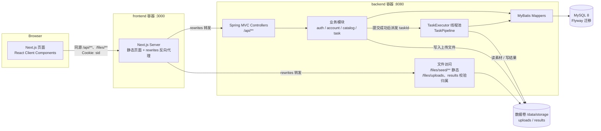
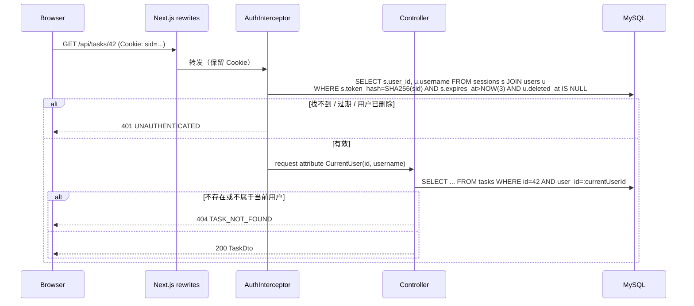
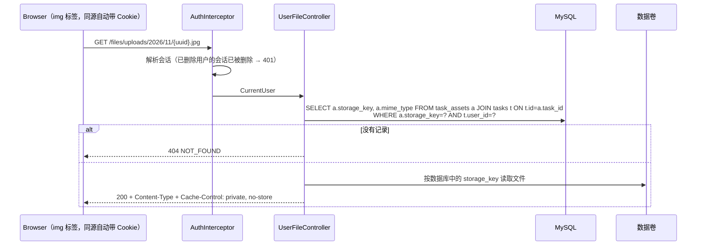
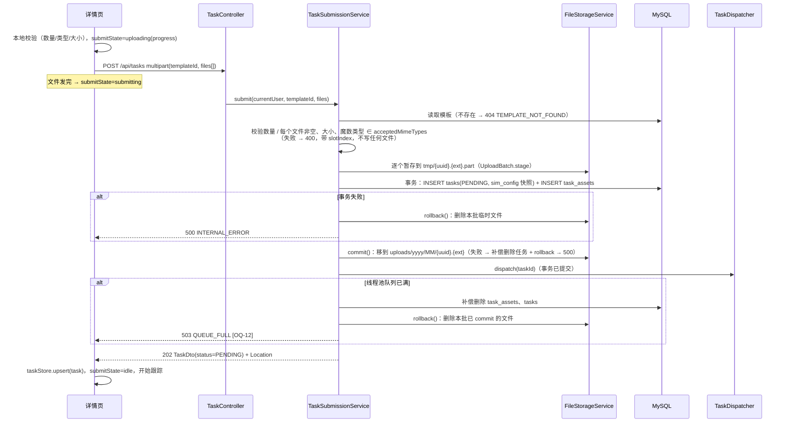
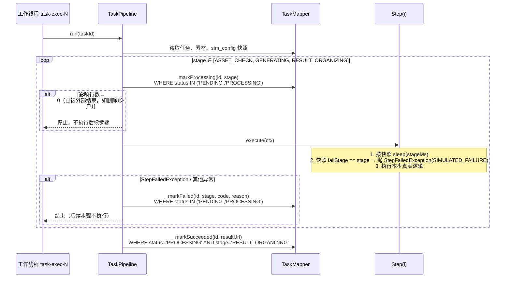
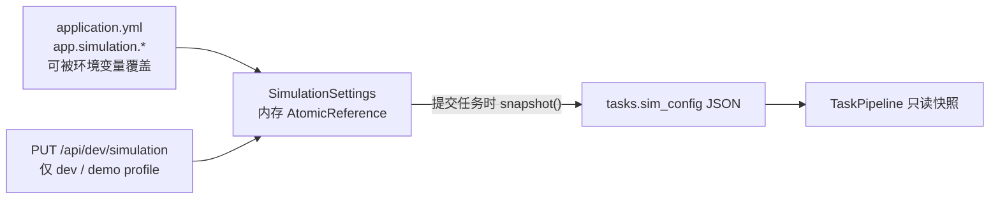
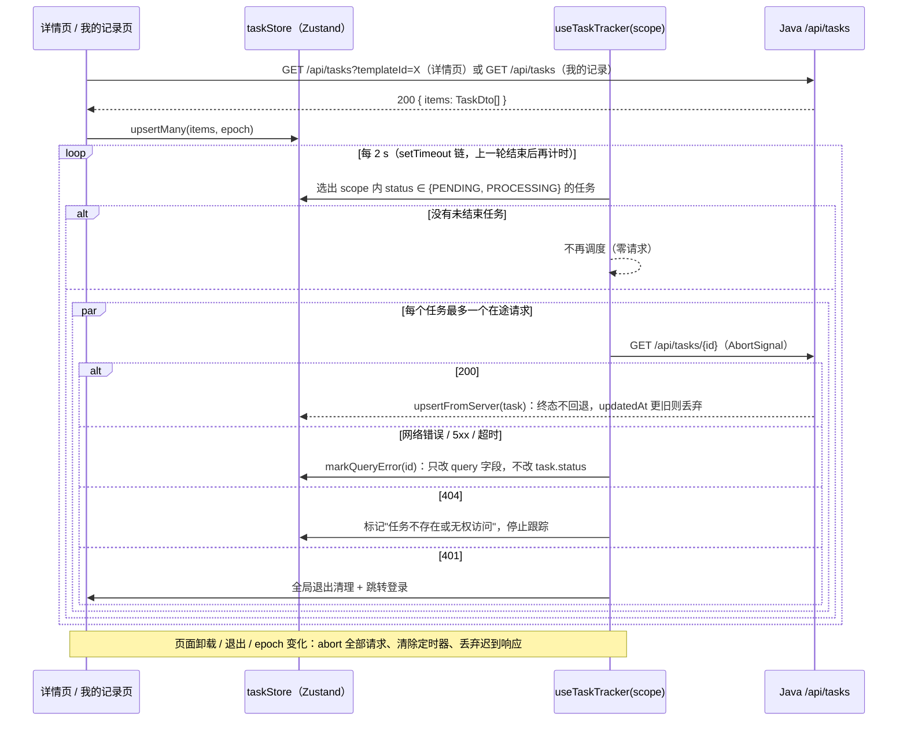
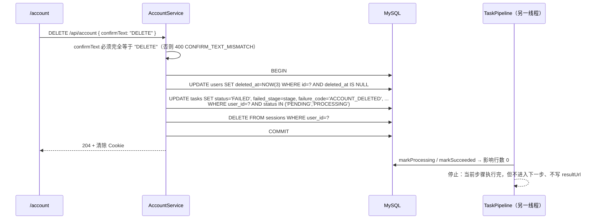

# 架构设计（Architecture）

> 来源：[PRD.md](./PRD.md)、[requirements.md](./requirements.md)（F-xx）、[backlog.md](./backlog.md)（T-xxx）、[open-questions.md](./open-questions.md)（OQ-xx）
> 配套：[database.md](./database.md)、[api.yaml](./api.yaml)、[implementation-plan.md](./implementation-plan.md)
> 状态：草案 v0.1（2026-11-04）。带 `[OQ-xx]` 的设计点按 requirements 中的临时默认执行，结论变化时只影响标注处。

## 0. 设计原则

| 原则 | 落地方式 |
| --- | --- |
| 单体优先 | 后端是**一个** Spring Boot 进程，内部按业务模块分包；异步执行用进程内线程池；不引入 MQ、Redis、独立身份服务（R-01.5、不在范围 §1） |
| 前端不承载业务 | Next.js 只做页面和 UI 状态；所有业务规则、校验、持久化、任务执行都在 Java（R-01.3、R-01.4） |
| 契约先行 | [api.yaml](./api.yaml) 是前后端唯一契约；前端类型从它生成；后端 Controller 只收发 DTO |
| 状态单点推进 | 任务状态只由后端执行器通过**条件更新**推进；查询接口只读（R-05.2、R-05.3） |
| 默认拒绝 | 除模板、注册、登录、健康检查外，所有 `/api/**` 都需要登录；所有用户数据查询都带 `user_id` 条件 |
| 可替换 | 轮询 → 批量 / SSE、线程池 → 持久化队列、本地磁盘 → 对象存储，都只需替换单个模块的实现 |

---

## 1. 系统总览



### 1.1 前后端连接方式 `[技术决策]`

**选择：Next.js `rewrites` 把 `/api/:path*` 和 `/files/:path*` 转发给 Java，浏览器只访问前端域名。**

| 方案 | 结论 | 理由 |
| --- | --- | --- |
| A. 浏览器跨域直连 Java（CORS） | 不选 | 需要 `SameSite=None; Secure` 的 Cookie 或 token 存储，本地 http 演示不方便；还要维护 CORS 配置 |
| **B. Next.js rewrites 同源代理** | **选** | 同源，Cookie 用 `HttpOnly; SameSite=Lax` 即可；Next.js 不写任何业务代码；上传进度（XHR）透传 |
| C. Next.js Route Handler 中间层（BFF） | 不选 | 需要手写转发、multipart 流式透传和 Cookie 转发，增加一层却没有业务收益 |

注意事项（在 T-003 / T-062 中验证）：

1. **不使用** Next.js middleware / `proxy.ts`。存在 middleware 时，Next.js 会缓冲请求体并有默认大小上限（约 10 MB），会截断 multipart 上传。路由守卫在客户端做，真正的权限由 Java 保证。
   T-041 实测：即使没有 `proxy.ts`，Next.js 16 的 rewrites 转发仍按 `experimental.proxyClientMaxBodySize`（默认 10 MB）缓冲并截断请求体，因此 `next.config.ts` 将其设为 `25mb`（高于后端 20 MB 请求上限，超限请求完整到达 Java 并返回 413）。
2. standalone 构建时 rewrites 目标地址在**构建时**写入，Docker 构建需要传入 `BACKEND_INTERNAL_URL`（Compose 中为 `http://backend:8080`）。
3. 所有业务数据都由 Client Component 通过同源 `/api` 获取，不在 Server Component 里调用 Java。这样不需要在服务端转发 Cookie，前端只有一个 API client 和一套错误模型，也方便用 MSW 测试。

### 1.2 部署拓扑（docker compose）

| 服务 | 镜像 | 端口 | 依赖 | 说明 |
| --- | --- | --- | --- | --- |
| `mysql` | `mysql:8.4` | 3306（仅内部，不映射到宿主机） | — | 健康检查 `mysqladmin ping`；数据卷 `mysql-data` |
| `backend` | 多阶段构建：Maven 构建 → JRE 21 运行（非 root 用户 `app`） | 8080（映射，便于 curl） | `mysql` healthy | `SPRING_PROFILES_ACTIVE=demo`；启动时 Flyway 建表和写种子；数据卷 `storage-data:/data/storage` |
| `frontend` | 多阶段构建：`next build`（standalone）→ Node 运行（非 root 用户 `node`） | 3000（对外） | `backend` healthy | 构建参数 `BACKEND_INTERNAL_URL` |

镜像 tag 由 `IMAGE_TAG` 控制（`xiaoying-backend:<tag>`、`xiaoying-frontend:<tag>`），回滚时切回上一个 tag `[OQ-21]`。

镜像：`backend/Dockerfile`、`frontend/Dockerfile` 均为多阶段构建，同一个文件提供 `dev`（开发）与 `runtime`（演示 / 生产）两个目标；runtime 镜像以非 root 用户运行并自带 `HEALTHCHECK`。

### 1.3 本地开发拓扑（docker-compose.dev.yml）`[技术决策]`

**所有服务（含前后端）都在 Docker 中运行**，宿主机只需要 Docker；JDK、Node.js、Maven 都在镜像里，开发与 CI / 演示使用相同的运行时版本。

| 服务 | 镜像目标 | 端口 | 运行方式 | 说明 |
| --- | --- | --- | --- | --- |
| `mysql` | `mysql:8.4` | 宿主机 3307（`MYSQL_PORT`，避免与本机 MySQL 冲突） | — | 数据卷 `mysql-dev-data` |
| `backend` | `backend/Dockerfile` → `dev`（JDK 21） | 8080 | `./mvnw spring-boot:run`（dev profile），源码 bind mount | 修改 Java 代码后 `restart backend`；`target/`、`~/.m2` 用命名卷；挂载宿主机 `docker.sock` 供容器内 Testcontainers 使用 |
| `frontend` | `frontend/Dockerfile` → `dev`（Node 24） | 3000 | `next dev`，源码 bind mount，热更新 | `node_modules`、`.next` 用匿名卷（使用镜像内的 Linux 依赖，与宿主机隔离）；`docs/` 只读挂载供 `gen:api`；`BACKEND_INTERNAL_URL=http://backend:8080` 运行时读取 |

测试、lint、类型生成同样在容器中执行（`docker compose -f docker-compose.dev.yml exec frontend npm test`、`... run --rm backend ./mvnw -B verify`），命令见 README。

---

## 2. 技术选型

以下版本已在 S0（T-002 / T-003）中验证兼容并锁定，同步写入 README（R-01.5）。所有服务都在 Docker 中构建和运行（§1.2、§1.3），宿主机只需要 Docker。

| 层 | 选型 | 用途 / 理由 |
| --- | --- | --- |
| 语言运行时 | Java 21 LTS（`eclipse-temurin:21`）；Node.js 24 LTS（`node:24-alpine`） | 长期支持版本；镜像固定运行时，开发、CI、演示一致 |
| 后端框架 | Spring Boot 4.0.9 | PRD 指定 Spring Boot（R-01.2） |
| 持久层 | MyBatis + mybatis-spring-boot-starter 4.0.1（与 Boot 4.0 匹配），XML Mapper | PRD 指定；XML 中 SQL 一目了然，条件更新易审查 |
| 数据库 | MySQL 8.4 LTS，`utf8mb4` / `utf8mb4_0900_ai_ci` | PRD 指定；8.0.16+ 才强制执行 CHECK 约束 |
| 迁移 | Flyway（`spring-boot-starter-flyway` + `flyway-mysql`） | 容器启动自动建表和写种子；版本化，只增不改 |
| 校验 | Jakarta Bean Validation（`spring-boot-starter-validation`） | DTO 字段规则 |
| 密码哈希 | `spring-security-crypto` 的 `BCryptPasswordEncoder`（cost 10） | 只引入加密模块，**不引入** Spring Security 过滤器链，鉴权用一个 `HandlerInterceptor` 即可 |
| 异步执行 | Spring `ThreadPoolTaskExecutor` | 进程内有界线程池（R-01.5 允许） |
| 文件类型探测 | 自写魔数检测（JPEG `FF D8 FF`、PNG `89 50 4E 47 0D 0A 1A 0A`、WebP `RIFF....WEBP`） | 只需要少数图片类型，不引入 Tika `[OQ-17]` |
| 健康检查 | `spring-boot-starter-actuator`，只暴露 `health` | Compose 健康检查 |
| 后端测试 | JUnit 5、Mockito、Spring Boot Test、Testcontainers（MySQL）、Awaitility | 编排逻辑单测 + 真实 MySQL 集成测试 |
| 前端框架 | Next.js 16.4 App Router + React 19 + TypeScript 5（strict） | PRD 指定（R-01.1） |
| 样式 | Tailwind CSS 4 | 无运行时开销，便于做暗色主题（F-18） |
| 客户端状态 | React Context（身份）+ Zustand（任务 store） | Zustand store 可在 React 外读写，调度器和单测都方便；不引入数据请求库，任务跟踪逻辑自己实现以便解释（PRD 目标 2 的考察点） |
| 契约类型 | `openapi-typescript` 从 `docs/api.yaml` 生成 `schema.d.ts` | 前端类型与契约一致 |
| 前端测试 | Vitest、React Testing Library、MSW、fake timers | 覆盖 F-15 前端条目 |
| CI | GitHub Actions：frontend job + backend job + docker compose 冒烟 job | R-12.1 |

明确**不引入**：Spring Security 过滤器链、JPA、Redis、MQ、WebSocket/SSE（P2）、SWR/React Query、对象存储、API 网关。

---

## 3. 后端模块划分

按业务模块分包（package-by-feature），每个模块内部再分 `web`（Controller + DTO）/ `service` / `mapper` / `domain`。模块之间只通过 service 接口调用，不跨模块直接用 Mapper。

```
com.xiaoying
├── common            # 统一错误、全局异常处理、时间、ID 序列化、Web 配置
│   ├── error         # ErrorCode 枚举、ApiException、ErrorResponse、GlobalExceptionHandler
│   └── web           # WebMvcConfig（拦截器注册、/files/** 资源映射）、Jackson 配置
├── auth              # 注册、登录、退出、会话、当前用户
│   ├── web           # AuthController、RegisterRequest、LoginRequest、UserDto
│   ├── service       # AuthService、SessionService、PasswordPolicy
│   ├── mapper        # UserMapper、SessionMapper
│   └── security      # AuthInterceptor、CurrentUser、@CurrentUserParam 参数解析器
├── account           # 修改密码、删除账户
│   ├── web           # AccountController、ChangePasswordRequest、DeleteAccountRequest
│   └── service       # AccountService（调用 auth、task 模块的服务）
├── catalog           # 分类与模板（只读）
│   ├── web           # CategoryController、TemplateController、*Dto
│   ├── service       # CatalogService
│   └── mapper        # CategoryMapper、TemplateMapper
├── storage           # 本地文件存储
│   ├── FileStorageService、ImageTypeDetector、StoredFile
│   └── web           # UserFileController（/files/uploads/**、/files/results/**，校验归属后返回文件）
├── task              # 制作任务
│   ├── web           # TaskController、TaskDto、InputAssetDto、TaskDtoAssembler
│   ├── service       # TaskSubmissionService、TaskQueryService、TaskAbandonService
│   ├── pipeline      # TaskDispatcher、TaskPipeline、TaskStep、AssetCheckStep、GenerateStep、ResultOrganizeStep、StepFailedException
│   ├── mapper        # TaskMapper、TaskAssetMapper
│   └── domain        # Task、TaskAsset、TaskStatus、TaskStage、FailureCode
└── simulation        # 模拟配置（耗时、指定阶段失败）
    ├── SimulationProperties、SimulationSettings（运行时可变，线程安全）、SimulationConfig（快照值对象）
    └── web           # DevSimulationController（仅 dev / demo profile）
```

| 模块 | 职责 | 对外接口 | 数据表 | 需求 |
| --- | --- | --- | --- | --- |
| common | 统一错误格式、异常映射、序列化约定、拦截器注册、静态文件映射 | — | — | R-01、§8 统一错误 |
| auth | 注册、登录、退出、会话签发与解析、`CurrentUser` 注入 | `/api/auth/*` | users、sessions | F-12 |
| account | 修改密码（作废其他会话）、删除账户（软删除 + 废弃任务 + 作废会话） | `/api/account*` | users、sessions、tasks | F-28 |
| catalog | 分类、模板列表、模板详情 | `/api/categories`、`/api/templates*` | categories、templates | F-01、F-02、F-13 |
| storage | 魔数检测、随机命名、写入 / 删除文件、生成 URL；用户文件按归属返回 | `/files/seed/**`（静态）、`/files/uploads/**`、`/files/results/**`（需登录且仅本人） | task_assets、tasks（只读，用于判断归属） | F-03、F-28（DQ-02） |
| task | 提交受理、后台三步执行、查询、废弃 | `/api/tasks*` | tasks、task_assets | F-04 ~ F-07、F-11 |
| simulation | 模拟配置默认值、运行时修改、创建任务时快照 | `/api/dev/simulation`（仅 dev/demo） | tasks.sim_config | F-08 |

### 3.1 分层规则

1. **Controller 只收发 DTO**（`*Request` / `*Dto`，Java `record`）。实体（`Task`、`User`…）不出现在 Controller 方法签名中；由 `*DtoAssembler` 转换。`password_hash`、`token_hash`、`storage_key`、`sim_config`、内部 `user_id` 永远不进入 DTO。
2. **Service 负责事务和业务规则**；`@Transactional` 只放在 service 方法上。
3. **Mapper 只做 SQL**。所有用户数据的 Mapper 方法签名都带 `userId` 参数（如 `findByIdAndUser(taskId, userId)`），从接口层面防止漏写过滤条件。
4. **异常**：业务错误抛 `ApiException(ErrorCode, message, details)`；`GlobalExceptionHandler` 统一转为错误响应。未预期异常记日志并返回 `INTERNAL_ERROR`，不把堆栈返回给前端。

---

## 4. 身份认证与数据访问边界

### 4.1 会话方案（F-12）

| 项 | 设计 |
| --- | --- |
| 凭据 | 用户名 + 密码；密码只存 BCrypt 哈希 |
| 会话令牌 | 32 字节 `SecureRandom` → Base64URL，作为 Cookie 值下发；数据库只存其 **SHA-256 哈希**（`sessions.token_hash`），数据库泄露也无法直接冒用会话 |
| Cookie | 名称 `sid`；`HttpOnly; SameSite=Lax; Path=/; Max-Age=604800`；`Secure` 由配置 `app.auth.cookie-secure` 控制（本地 http 为 false） |
| 有效期 | 固定 7 天，不续期 `[OQ-28]` |
| 退出 | 删除当前会话记录并清除 Cookie |
| 修改密码 | 更新哈希；删除该用户除当前会话以外的全部会话 `[OQ-25 余项]` |
| 删除账户 | 同一事务内：软删除用户、废弃进行中任务、删除该用户全部会话 `[OQ-26]` |
| CSRF | 依赖 `SameSite=Lax`：跨站的 POST / PUT / DELETE 请求不会带上 Cookie；所有写接口都不是 GET |
| 登录失败 | 统一返回 `INVALID_CREDENTIALS`，不区分"用户不存在 / 密码错 / 账户已删除" |

### 4.2 请求鉴权流程



### 4.3 访问控制矩阵

| 资源 | 匿名 | 已登录 | 说明 |
| --- | --- | --- | --- |
| `GET /api/categories`、`GET /api/templates*` | ✅ | ✅ | 未登录可浏览模板（OQ-23） |
| `POST /api/auth/register`、`POST /api/auth/login` | ✅ | ✅ | 已登录时调用会替换当前会话 |
| `POST /api/auth/logout` | ✅（幂等，返回 204） | ✅ | |
| `GET /api/auth/me` | 401 | ✅ | 前端用它判断登录状态；此处的 401 不触发跳转 |
| `/api/account*` | 401 | ✅ 仅本人 | 没有路径参数，只能操作自己 |
| `/api/tasks*` | 401 | ✅ 仅本人 | 他人或不存在的任务一律 404，不暴露存在性 |
| `/api/dev/simulation` | dev / demo profile 下开放；prod 下 404 | 同左 | 不要求登录，便于 curl 演示（DQ-01 已确认） |
| `/files/uploads/**`、`/files/results/**` | 401 | ✅ 仅本人 | 由 `UserFileController` 查库确认文件属于当前用户后返回；他人的或不存在的文件 404（DQ-02 已确认：删除账户后链接失效） |
| `/files/seed/**` | ✅ | ✅ | 种子封面和示例图，静态资源 |
| `/actuator/health` | ✅ | ✅ | 只返回 `status` |

实现方式：`AuthInterceptor` 对 `/api/**`、`/files/uploads/**`、`/files/results/**` 生效，按"路径 + 方法"白名单放行匿名接口；其余请求没有有效会话时直接返回 401。Controller 通过参数解析器拿到 `CurrentUser`，service 层把 `currentUser.id()` 传给 Mapper。

### 4.3.1 用户文件访问（DQ-02）



- 结果图 `/files/results/{taskId}/{fileName}`：按 `tasks.id = {taskId} AND user_id = 当前用户 AND result_url = 请求路径` 查找。
- 实际读取的文件路径**只来自数据库中的 `storage_key`**，不拼接请求路径，杜绝路径穿越。
- 删除账户后：该用户没有任何有效会话，其他用户查不到归属，于是所有链接都返回 401 / 404，满足 OQ-26"任何人都不能通过界面或接口访问这些数据"。
- `Cache-Control: private, no-store`：浏览器不缓存，删除后本机缓存也不会再显示图片。卡片中的 `` 挂载后不会重复请求，对轮询没有额外开销。

### 4.4 前端身份边界

- `AuthProvider` 保存 `{ status: 'loading'|'anonymous'|'authenticated', user, epoch }`。`epoch` 在每次登录、退出、删除账户时递增。
- 任何异步响应写入 store 之前都校验"发起时的 epoch === 当前 epoch"，不一致就丢弃（R-08.2，F-10 规则 5）。
- 全局 401 处理：除 `/api/auth/me`、`/api/auth/login` 外，收到 401 就执行"退出清理"（abort 全部请求、`taskStore.reset()`、epoch+1）并跳转 `/login?next=<当前路径>`。
- 前端路由守卫只影响体验；即使绕过，Java 仍然返回 401 / 404。

---

## 5. 核心数据流

### 5.1 提交任务（F-03 ~ F-05）



要点：

- **先校验、后写文件**：所有校验在写磁盘之前完成，校验失败不会产生文件。
- **文件与数据库一致性**（T-030 两阶段写入）：文件先写到 `tmp/`（随机文件名），数据库事务提交后 `commit()` 原子移动到正式目录；之后任一步失败都 `rollback()` 删除本批文件（临时与已 commit 的）。进程恰好崩溃在两步之间时只会在 `tmp/` 留下孤儿文件，不会出现在正式目录，README 说明即可。
- **事务提交后才派发**：`TaskSubmissionService.submit()` 本身不加事务，按"写文件 → 调用带 `@Transactional` 的 `TaskWriter.create()` → dispatch"顺序编排，执行器线程不会读到未提交的数据，也不需要 `TransactionSynchronization`。
- **接口耗时只包含上传和入库**，不包含模拟耗时（R-04）。

### 5.2 后台三步执行（F-06、F-08）



| 步骤 | 真实逻辑（轻量） | 失败码 |
| --- | --- | --- |
| ASSET_CHECK | 素材记录数 = 模板要求张数；每个文件存在、可读、大小与记录一致、魔数类型仍合法 `[OQ-14]` | `ASSET_MISSING`、`ASSET_INVALID`、`SIMULATED_FAILURE` |
| GENERATING | 只等待（可被中断） | `SIMULATED_FAILURE` |
| RESULT_ORGANIZING | 把模板的预置结果图复制为 `results/{taskId}/{uuid}.{ext}`，在上下文中返回 `resultUrl` `[OQ-08]` | `RESULT_WRITE_FAILED`、`SIMULATED_FAILURE` |

规则：

1. 每一步开始时持久化 `stage`，形成服务端可观察的执行边界（R-05.1）。
2. 所有状态写入都是条件更新，终态（SUCCEEDED / FAILED）不会被覆盖（R-05.3）。
3. `TaskPipeline` 捕获所有 `Throwable`，兜底写为 `FAILED / INTERNAL_ERROR`，`failureReason` 用通用中文文案，堆栈只写日志（F-06 规则 6、7）。
4. 日志用 MDC 带上 `taskId`、`stage`，每步记录开始、结束、耗时、结果（requirements §9 可观察性）。
5. 线程池：核心 = 最大 = `app.task.executor.pool-size`（默认 2），队列 `app.task.executor.queue-capacity`（默认 100），`AbortPolicy`，线程名前缀 `task-exec-` `[OQ-12]`。
6. 优雅停机：`setWaitForTasksToCompleteOnShutdown(true)` + `awaitTermination` 30 s；超时后仍未完成的任务停在原状态，处理方式见 `[OQ-13]`（T-072 预留 `app.task.fail-interrupted-on-startup` 开关，默认关闭）。

### 5.3 模拟配置（F-08）



- 全局一份配置，创建任务时快照到 `tasks.sim_config`；修改配置只影响之后创建的任务，同一任务的行为可重复 `[OQ-10]`。
- 运行时修改不持久化，进程重启后回到 `application.yml` / 环境变量的值。

### 5.4 查询、多任务跟踪与刷新恢复（F-07、F-09 ~ F-11）



- **后端**：查询接口只执行 `SELECT`，不调用 pipeline，不写任何字段（R-05.2）。
- **前端 store 结构**：`Record<taskId, { task: TaskDto, query: { state: 'idle'|'loading'|'error', error?, lastSuccessAt? } }>`；按 `templateId` 和"全部"派生列表。
- **查询异常 ≠ 任务失败**（R-07.2）：只有服务端返回 `status=FAILED` 才显示"制作失败"；查询异常叠加在最后已知状态上，并提供"重新查询"。
- **刷新恢复**（R-09）：进入页面先拉历史，未结束的任务自动进入跟踪；状态以服务端为准。
- P1（F-21 / T-073）：调度器改为每轮一次 `GET /api/tasks?ids=a,b,c`，store 和卡片不变。

### 5.5 删除账户（F-28）



---

## 6. 前端模块划分

```
frontend/src
├── app/                              # App Router 路由（页面只做组合）
│   ├── layout.tsx                    # 顶栏 + AuthProvider
│   ├── page.tsx                      # / 模板列表（?category=）           F-01
│   ├── templates/[templateId]/page.tsx  # 模板详情 + 上传 + History    F-02 F-03 F-11
│   ├── records/page.tsx              # 我的记录（需登录）                 F-11
│   ├── account/page.tsx              # 账户设置（需登录）                 F-28
│   ├── login/page.tsx、register/page.tsx                                  F-12
│   └── not-found.tsx
├── lib/api/
│   ├── schema.d.ts                   # 由 docs/api.yaml 生成，禁止手改
│   ├── client.ts                     # fetch 封装：同源、credentials、AbortSignal、错误统一为 ApiError
│   ├── upload.ts                     # XHR multipart：上传进度、abort、"已发完"回调
│   └── endpoints/                    # auth.ts、catalog.ts、tasks.ts、account.ts
├── features/
│   ├── auth/                         # AuthProvider、useAuth、useRequireAuth、退出清理
│   ├── catalog/                      # CategoryTabs、TemplateGrid、TemplateRequirements
│   ├── upload/                       # UploadSlots、useSlots（empty|selected|invalid）、useSubmitTask（idle|uploading|submitting|error）
│   ├── tasks/                        # taskStore、useTaskTracker、TaskCard、TaskList、ResultPreviewDialog
│   └── account/                      # ChangePasswordForm、DeleteAccountDialog
└── components/                       # 通用 UI：Button、Dialog、EmptyState、ErrorState、Skeleton
```

前端异步状态分层（对应 requirements §3.3）：

| 维度 | 所在位置 | 状态 |
| --- | --- | --- |
| 上传位 | `useSlots`（组件本地） | `empty` / `selected(file, previewUrl)` / `invalid(reason)` |
| 提交请求 | `useSubmitTask`（组件本地） | `idle` / `uploading(progress)` / `submitting` / `error(ApiError)` |
| 任务（服务端事实） | `taskStore.entries[id].task` | `PENDING` / `PROCESSING(stage)` / `SUCCEEDED(resultUrl)` / `FAILED(failedStage, reason)` |
| 任务查询请求 | `taskStore.entries[id].query` | `idle` / `loading` / `error` |
| 身份 | `AuthProvider` | `loading` / `anonymous` / `authenticated(user, epoch)` |

`ApiError` 结构：`{ kind: 'network'|'http', status?, code?, message, details? }`。`kind='network'`（断网、超时、abort 以外的失败）和 `5xx` 在任务卡片上都归为"查询异常"。

---

## 7. 统一约定

| 项 | 约定 |
| --- | --- |
| URL | `/api` 前缀；资源名用复数名词；路径参数用 ID；不在路径中放动词（删除账户用 `DELETE /api/account`） |
| 方法与状态码 | 查询 `GET 200`；注册 `201`；提交任务 `202 + Location`；无响应体 `204`；见 [api.yaml](./api.yaml) |
| 列表响应 | 统一包一层 `{ "items": [...] }`，以后加分页（`nextCursor`）不破坏兼容 |
| 错误响应 | `{ "code": "TASK_NOT_FOUND", "message": "任务不存在", "details": { ... } }`；`code` 是稳定的机器可读值，`message` 是可直接展示的中文；字段级错误放在 `details.fieldErrors[]`，文件错误带 `slotIndex` |
| 时间 | 数据库 `DATETIME(3)` 存 UTC；JVM 与 JDBC 连接时区都设为 UTC；接口输出 ISO-8601 带 `Z`（如 `2026-11-04T08:30:00.123Z`）；前端按浏览器本地时区显示 `[OQ-09 余项]` |
| ID | 用户、任务为 `BIGINT` 自增，**接口中以字符串输出**（避免 JS 精度问题，以后可换 ULID 而不改契约）；分类、模板为可读 slug 字符串 |
| 枚举 | 接口与数据库都用大写下划线字符串（`PROCESSING`、`RESULT_ORGANIZING`） |
| `slotIndex` | 从 0 开始，与 multipart 中 `files` 的顺序一致；界面显示时加 1 |
| 文件 URL | 接口返回站内相对路径（`/files/...`），浏览器经 rewrites 访问 |
| 配置 | 全部来自 `application.yml`，可被环境变量覆盖；仓库中只有无真实凭据的 `.env.example` |

### 7.1 关键配置项

| 配置 | 默认 | 说明 |
| --- | --- | --- |
| `spring.datasource.url / username / password` | 环境变量 | MySQL 连接，URL 带 `connectionTimeZone=UTC` |
| `spring.servlet.multipart.max-file-size` / `max-request-size` | 5MB / 20MB | 超限返回 413 `[OQ-18]` |
| `app.storage.root` | `/data/storage`（容器内，环境变量 `APP_STORAGE_ROOT`，挂载数据卷） | 上传与结果文件根目录 |
| `app.auth.session-ttl` | `7d` | `[OQ-28]` |
| `app.auth.cookie-secure` | `false` | 部署到 https 时改为 true |
| `app.task.executor.pool-size` / `queue-capacity` | 2 / 100 | `[OQ-12]` |
| `app.simulation.asset-check-ms` / `generating-ms` / `result-organizing-ms` | 1500 / 3000 / 1500 | 各阶段模拟耗时 |
| `app.simulation.fail-stage` | 空 | `ASSET_CHECK` / `GENERATING` / `RESULT_ORGANIZING` |
| `app.simulation.fail-reason` | 空（使用按阶段的默认文案） | `[OQ-11]` |
| `app.simulation.dev-api-enabled` | dev、demo profile 为 true，其余 false | 控制 `/api/dev/simulation` 是否注册 |
| `BACKEND_INTERNAL_URL`（前端） | `http://localhost:8080`；compose 中为 `http://backend:8080` | rewrites 目标；`next dev` 运行时读取，runtime 镜像在构建期写入 |

---

## 8. 需求追溯

| 需求 | 前端 | 后端模块 / 接口 | 数据表 |
| --- | --- | --- | --- |
| F-01 分类与列表 | `/`、CategoryTabs、TemplateGrid | catalog：`GET /api/categories`、`GET /api/templates` | categories、templates |
| F-02 模板详情 | `/templates/[id]` | catalog：`GET /api/templates/{id}` | templates |
| F-03 选择与上传 | UploadSlots、upload.ts | task + storage：`POST /api/tasks`、`/files/uploads/**`（校验归属） | task_assets |
| F-04 校验与防重复 | useSlots、useSubmitTask | TaskSubmissionService 校验 | templates |
| F-05 受理 | useSubmitTask → taskStore | TaskSubmissionService、TaskDispatcher | tasks、task_assets |
| F-06 三步执行 | — | task.pipeline | tasks |
| F-07 查询 | endpoints/tasks.ts | TaskQueryService：`GET /api/tasks/{id}`、`GET /api/tasks` | tasks、task_assets、templates |
| F-08 模拟控制 | — | simulation：`/api/dev/simulation` | tasks.sim_config |
| F-09 状态展示 | TaskCard、taskStore.query | — | — |
| F-10 多任务跟踪 | useTaskTracker、AuthProvider.epoch | — | — |
| F-11 历史与刷新恢复 | History 面板、`/records`、ResultPreviewDialog | `GET /api/tasks?templateId=` | tasks |
| F-12 身份 | `/login`、`/register`、AuthProvider | auth：`/api/auth/*`、AuthInterceptor | users、sessions |
| F-28 账户设置 | `/account` | account：`PUT /api/account/password`、`DELETE /api/account`；storage：删除后文件链接失效 | users、sessions、tasks |
| F-13 种子数据 | — | Flyway `V2__seed_data.sql`、`classpath:/seed/` | categories、templates、users |
| F-14 / F-15 CI 与测试 | Vitest | JUnit + Testcontainers | — |
| F-17 Compose | Dockerfile | Dockerfile | 数据卷 |
| F-20 重启边界（P1） | — | `StartupTaskReconciler`（开关，默认关） | tasks（`idx_tasks_status`） |
| F-21 批量查询（P1） | useTaskTracker 批量模式 | `GET /api/tasks?ids=` | tasks |
| F-22 步骤日志（P1） | — | TaskPipeline 写日志表 | task_step_logs（V3 迁移） |

---

## 9. 演进路径（不在本期实现）

| 需要时 | 替换点 | 影响范围 |
| --- | --- | --- |
| 减少轮询请求 | `useTaskTracker` 改用批量接口（P1） / SSE（P2） | 只改 tracker；store、卡片不变 |
| 重启后继续执行 | `TaskDispatcher` 改为"DB 轮询领取 PENDING"或持久化队列 | 只改 dispatcher；pipeline、步骤不变 |
| 多实例部署 | 文件存储换对象存储；会话表已在 DB 中，天然共享；领取任务需要行锁 | storage 模块、dispatcher |
| 受理幂等（P2） | `POST /api/tasks` 增加 `Idempotency-Key` 头 + 唯一索引 | 提交 service + 一张表 / 一列 |

---

## 10. 已知限制

1. 进程重启时，线程池中排队和执行中的任务会中断，停在 PENDING / PROCESSING `[OQ-13]`。
2. 单实例：线程池、模拟配置都在进程内存中。
3. 用户文件每次访问都查一次数据库判断归属；单机演示规模下可以忽略。
4. 没有登录限流 / 验证码（PRD 未要求，不扩展）。
5. 历史列表不分页 `[OQ-09 余项]`，任务很多时一次返回全部。
6. 进程崩溃在"写文件"和"事务提交"之间时可能留下孤儿文件。

---

## 11. 本文涉及的未确定问题

已在 open-questions.md 中的问题，本设计按临时默认实现：

| OQ | 本文中的临时处理 | 结论变化时的改动点 |
| --- | --- | --- |
| OQ-04 张数规则 | 恰好 N 张 | TaskSubmissionService 数量校验、前端 canSubmit |
| OQ-08 结果图来源 | 复制模板预置结果图 | ResultOrganizeStep |
| OQ-09 余项 | 倒序、不分页、不筛选、离开页面不跟踪 | 查询接口参数、tracker scope |
| OQ-10 模拟粒度 | 全局 + 创建时快照 | SimulationSettings、sim_config |
| OQ-11 失败文案 | 中文文案 + `failureCode` | FailureCode 枚举、步骤文案 |
| OQ-12 并发与队列 | 2 线程 / 队列 100 / 满了 503 不建任务 | 线程池配置、提交补偿逻辑 |
| OQ-13 重启边界 | 只在 README 说明；预留开关 | StartupTaskReconciler |
| OQ-14 素材检查内容 | 轻量真实检查 + 模拟 | AssetCheckStep |
| OQ-17 / OQ-18 类型与大小 | 魔数判定（不信任 Content-Type）；5 MB / 20 MB | ImageTypeDetector、multipart 配置 |
| OQ-23 余项 2 | 已由 DQ-02 结论取代：用户文件需登录且仅本人可访问 | — |
| OQ-25 余项 | 需要当前密码；其他会话失效 | AccountService |
| OQ-26 余项 | 废弃 = FAILED + `ACCOUNT_DELETED`；`DELETE` 区分大小写 | TaskAbandonService、DeleteAccountRequest 校验 |
| OQ-28 会话有效期 | 7 天固定 | `app.auth.session-ttl` |
| OQ-29 / OQ-30 / OQ-31 | 见 database.md §2 users | 校验规则、唯一索引 |

本次设计新发现的问题（DQ = Design Question，可并入 open-questions.md）：

| ID | 问题 | 选项 | 状态 |
| --- | --- | --- | --- |
| DQ-01 | `/api/dev/simulation` 在 Compose 的 demo profile 下开放且不需要登录，任何能访问 3000 端口的人都能改模拟配置。是否可以接受？ | A 可以（只用于本地演示）；B 需要登录；C 需要额外的开发令牌（环境变量） | **已确认（2026-11-04）：A**，README 写明 prod profile 下不存在该接口 |
| DQ-02 | OQ-26 要求删除账户后"任何人都不能通过界面或接口访问这些数据"，但文件 URL 不鉴权时，已知 URL 的人在删除后仍能打开图片。是否需要在删除后让文件 URL 失效？ | A 接受；B 由 Controller 校验归属后返回文件 | **已确认（2026-11-04）：B，删除后失效**。见 §4.3.1；取代 OQ-23 余项 2 的临时默认 |
| DQ-03 | 失败原因是否需要同时返回机器可读的 `failureCode`？ | A 返回 `failureCode` + `failureReason`；B 只返回 `failureReason` | **已确认（2026-11-04）：A** |
| DQ-04 | `requirements` 规定"两次密码不一致时服务端返回 400"。确认密码只是前端防输错的字段，是否要求注册 / 修改密码接口也接收并校验 `confirmPassword`？ | A 只在前端校验（接口与 requirements §8 草案一致）；B 接口也接收并校验 | **已确认（2026-11-04）：A**。服务端仍校验密码规则（长度等），只是不接收"确认密码" |
