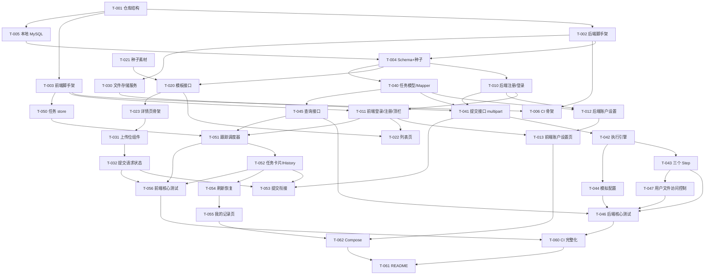

# 开发 Backlog

> 配套：[requirements.md](./requirements.md)（功能规格，F-xx）、[open-questions.md](./open-questions.md)（OQ-xx）
> 版本：v0.4（2026-11-04）。已按 OQ-02 / 03 / 05 / 09 / 23 / 25 / 26 及后续补充的确认结果调整：注册需要邮箱（不可修改，删除账户后可再注册）、用户名 + 密码登录、开放注册、未登录只能看模板、账户设置页（登录后修改密码；输入 DELETE 删除账户，数据保留，进行中任务废弃）、一级分类、图片在提交时一起上传、增加"我的记录"页。
> 约定：
> - 每个任务控制在一个小型迭代内：**S** ≈ 半天以内，**M** ≈ 1 天以内；超过 1 天的已继续拆分。
> - 每个任务都可独立验证（有明确的"完成定义"）。
> - "受 OQ 影响"表示可先按 requirements.md 中的临时默认实现；OQ 结论不同时，返工范围有限。
> - 所有任务完成时 CI 必须保持绿色（T-006 之后）。

## 1. 里程碑与实施顺序

| 里程碑 | 目标 | 包含任务 | 完成后可演示 |
| --- | --- | --- | --- |
| **M0 工程骨架** | 前后端可启动、DB 可连接、CI 跑通 | T-001 ~ T-006 | 空页面 + health 接口 + 绿色 CI |
| **M1 账户与模板** | 注册/登录/退出、账户设置、浏览与筛选模板、查看详情 | T-010 ~ T-023 | 登录 → 列表 → 详情；修改密码、删除账户 |
| **M2 选图与提交** | 上传位本地交互、文件存储、提交请求的上传进度与失败反馈 | T-030 ~ T-032 | 选图/预览/替换/移除；提交时显示上传进度 |
| **M3 后端异步核心** | 受理 → 三步执行 → 终态，模拟可控，核心测试 | T-040 ~ T-046 | curl 完整闭环 + 指定阶段失败 |
| **M4 前端异步状态** | 任务卡片、多任务跟踪、查询异常、刷新恢复、我的记录、核心测试 | T-050 ~ T-056 | 浏览器完整闭环 |
| **M5 交付** | Compose、CI 完整化、README | T-060 ~ T-062 | `docker compose up --build` 验收 |
| **M6 打磨（P1）** | 视觉、可访问性、重启边界、批量查询、步骤日志 | T-070 ~ T-075 | — |

> **关键路径**：T-001 → T-002 → T-004 → T-010 → T-040 → T-041 → T-042 → T-045 → T-050 → T-051 → T-052 → T-054 → T-062
> M1 中的账户设置（T-012、T-013）不在关键路径上，可以和 M2、M3 并行。M3 的后端测试直接用 curl 或 MockMultipartFile 提交文件，不依赖前端上传 UI。

## 2. 依赖关系图

---

## 3. P0 任务明细

### M0 工程骨架

#### T-001 仓库结构与基础约定 · S · P0
- **范围**：建立 `frontend/`、`backend/`、`docs/` 目录与根目录 compose 文件；`.gitignore`、`.editorconfig`、`.env.example` 占位；根 README 骨架。
- **依赖**：无
- **完成定义**：目录结构就绪，`git status` 中没有构建产物或依赖目录。

#### T-002 后端脚手架 · S · P0
- **范围**：Spring Boot + MyBatis + MySQL 驱动；`dev`/`test`/`prod` profile；统一错误响应结构 `{code,message,details}` 与全局异常处理（含 multipart 超限异常 → 413）；health 接口；CORS 或 Next.js 中间层约定（与 T-003 对齐，需考虑会话 Cookie 的携带方式）。
- **依赖**：T-001
- **完成定义**：`./mvnw verify` 通过；连接 MySQL 后 health 返回 UP；示例接口抛业务异常时返回统一错误结构。
- **相关**：F-14, R-01

#### T-003 前端脚手架 · S · P0
- **范围**：Next.js App Router + TypeScript（strict）+ ESLint；全局布局（顶栏 + 内容区）；API client（base URL 来自环境变量、携带 Cookie、错误统一转换为 `ApiError{status, code, message, details, isNetworkError}`、支持 AbortSignal）；测试框架（Vitest + RTL + MSW）初始化。
- **依赖**：T-001
- **完成定义**：`lint`、`typecheck`、`build`、`test` 四个脚本都能执行通过；示例页面能调用后端 health。
- **相关**：F-14, R-01

#### T-004 数据库 Schema 与种子数据 · M · P0
- **范围**：迁移脚本（Flyway 或 schema.sql/data.sql）：
  - `users`（username 唯一且不区分大小写；email；password_hash；created_at；deleted_at；生成列 `active_email = IF(deleted_at IS NULL, LOWER(email), NULL)` 加唯一索引，保证邮箱只在未删除账户中唯一；已删除用户保留记录）
  - `sessions`（token、user_id、created_at、expires_at）
  - `categories`（一级）、`templates`
  - `tasks`、`assets`（task_id、slot_index，一个素材只属于一个任务）
  - 索引：`tasks(user_id, template_id, created_at)`、`tasks(user_id, created_at)`、`tasks(status)`
  - 种子：≥2 个分类、≥3 个模板（requiredImageCount 覆盖 1/2/3）、≥2 个演示账户（BCrypt 哈希）
- **依赖**：T-002, T-005
- **受 OQ 影响**：OQ-29（用户名规则）、OQ-30（邮箱规则）、OQ-31（已删除账户的用户名能否再用，影响 username 唯一约束的写法）
- **完成定义**：空库启动后自动建表并写入种子；重复启动不重复插入；演示账户可登录（T-010 完成后验证）。
  - 2026-11-05：演示账户 demo1 / demo2 登录已在 T-010 中验证（`AuthControllerIT.seededDemoAccountCanLogIn` + curl）。
- **相关**：F-13, requirements §4

#### T-005 本地开发环境（全部容器化） · S · P0
- **范围**：开发用 `docker-compose.dev.yml`：MySQL + 数据卷，以及 backend / frontend 开发容器（源码挂载、前端热更新）；`backend/Dockerfile`、`frontend/Dockerfile`（多阶段，含 `dev` 与 `runtime` 目标）；连接配置示例。宿主机只需要 Docker。
- **依赖**：T-001
- **完成定义**：一条命令拉起全部服务，后端 dev profile 连上 MySQL，前端经 rewrites 访问后端；测试可在容器内执行。

#### T-006 CI 骨架 · S · P0
- **范围**：`.github/workflows/ci.yml`，push / pull_request 触发；frontend job：安装（锁文件）→ lint → typecheck → test → build；backend job：安装 JDK → `./mvnw -B verify`；docker job：`docker compose up --build --wait` 冒烟。
- **依赖**：T-002, T-003
- **完成定义**：推送分支后两个 job 均为绿色；故意制造类型错误时 frontend job 失败。
- **相关**：F-14

### M1 账户与模板

#### T-010 后端注册 / 登录 / 退出 · M · P0
- **范围**：`POST /api/auth/register`（用户名 + 邮箱 + 密码，自助注册）、`POST /api/auth/login`（用户名 + 密码）、`POST /api/auth/logout`、`GET /api/auth/me`；用户名、邮箱和密码规则校验；用户名判重包含已删除账户（OQ-31 临时默认）；邮箱只在未删除账户中判重，并发注册时以唯一索引兜底（捕获唯一键冲突转为 409）；BCrypt 哈希；签发随机 token 存 `sessions`，以 HttpOnly Cookie 下发；拦截器解析会话并注入 `CurrentUser`（排除已删除用户和过期会话）；模板接口允许匿名访问，任务、记录、账户接口需要登录（OQ-23 已确认）；登录失败统一提示。
- **依赖**：T-004
- **受 OQ 影响**：OQ-24（密码规则）、OQ-28（会话有效期）、OQ-29（用户名规则）、OQ-30（邮箱规则）、OQ-31
- **完成定义**：集成测试覆盖注册 → me、重复用户名 409（含大小写不同、含已删除账户）、未删除账户的重复邮箱 409、已删除账户的邮箱可再注册、邮箱不能用于登录、密码错误 401、匿名访问模板接口 200、匿名访问任务接口 401、logout 后会话失效；DB 中只有哈希值。
- **相关**：F-12
- **状态**：Done（2026-11-05）。`AuthControllerIT`（25）、`AuthInterceptorTest`（6）、`AuthServiceTest`（5）通过。"匿名访问模板接口 200"目前用桩接口验证拦截器放行（真实接口不存在时为 404 而非 401），T-020 的 `CatalogControllerIT` 需复核匿名 200。

#### T-011 前端登录 / 注册 / 顶栏 · M · P0
- **范围**：`/login`（用户名 + 密码）、`/register`（用户名 + 邮箱 + 密码 + 确认密码，提示"邮箱注册后不能修改"）页面，表单校验、错误提示；顶栏未登录时显示"登录 / 注册"，登录后显示用户菜单：用户名、"我的记录"、"账户设置"、"退出"；`AuthContext`（userId + 会话世代号 `sessionEpoch`）；退出时取消全部在途请求、清空用户相关状态（任务 store、已选文件）；全局 401 处理（跳转登录并带回跳地址）；需要登录的路由守卫（我的记录、账户设置）；提供 `useRequireAuth` 供详情页判断是否显示上传区和 History（未登录时显示"登录后即可制作"提示）。
- **依赖**：T-003, T-010
- **受 OQ 影响**：OQ-23 余项（未登录时详情页的呈现）、OQ-24、OQ-29、OQ-30
- **完成定义**：可以注册、登录 A → 退出 → 登录 B；切换后页面不残留 A 的数据；单测验证退出时 store 被清空。
- **相关**：F-12, F-10
- **状态**：Done（2026-11-05）。前端 68 个单测通过（新增 `AuthProvider.test.tsx` 9、`LoginForm.test.tsx` 7、`RegisterForm.test.tsx` 15、`UserMenu.test.tsx` 4、`RequireAuth.test.tsx` 4、`session.test.ts` 15，`client.test.ts` 新增 4）：me 401 → anonymous 且不跳转；登录 / 退出 epoch 递增；A → 退出 → B 时在途请求被取消、模块级 store（经 `onUserScopeReset` 注册）与组件本地状态被清空；业务接口 401 → 清理并 `router.replace('/login?next=…')`；迟到的 me 响应被丢弃；表单校验 / 409 / 400 字段映射；`next` 拒绝站外地址。`lint`、`typecheck`、`build` 通过。`docker compose up --build` 后用 headless Chrome 走通：匿名访问 `/records`、`/account` 跳转登录并回跳；错误密码统一提示；登录 demo1 → 菜单 → 退出 → 登录 demo2，页面不含 demo1；注册（不一致密码拦截、已占用用户名提示、成功后自动登录）。说明：T-050 尚未实现，taskStore 届时需调用 `onUserScopeReset(() => store.reset())` 接入退出清理，并在写入前用 `isCurrentEpoch` 校验；`/records`、`/account` 目前是带守卫的占位页（内容见 T-055、T-013）；`LoginPrompt` 已提供，详情页接入在 T-023；退出后停留在当前页（受保护页由守卫跳转登录），`/me` 网络失败时按未登录处理。

#### T-012 后端账户设置：修改密码、删除账户 · M · P0
- **范围**：
  - `PUT /api/account/password`：校验当前密码（OQ-25 余项临时默认），更新哈希，作废其他会话；
  - `DELETE /api/account`（`{confirmText}`）：服务端校验确认文字为 `DELETE`；在同一事务中软删除用户（`deleted_at`）、用条件更新把该用户 PENDING / PROCESSING 的任务改为废弃终态（OQ-26 余项临时默认：FAILED + "账户已删除，任务已废弃"）、作废全部会话；不删除任何任务或文件。
- **依赖**：T-010, T-040（任务条件更新）
- **受 OQ 影响**：OQ-25 余项、OQ-26 余项
- **完成定义**：集成测试：当前密码错误时拒绝；修改后旧密码无法登录、新密码可以；确认文字错误时 400；删除后无法登录、原会话 401；该用户进行中的任务变为废弃终态，已完成的任务不变；任务和文件仍在库中；其他用户不受影响。
- **相关**：F-28

#### T-013 前端账户设置页 · S · P0
- **范围**：`/account` 页面：账户信息区（默认头像 + 用户名 + 邮箱，只读）、修改密码表单（当前密码、新密码、确认新密码）、删除账户（确认对话框，输入框中输入 `DELETE` 后确认按钮才可用，说明"数据将无法再访问、正在制作的任务会被废弃；邮箱之后可以重新注册，用户名不能再用"）；删除成功后执行与退出相同的清理并跳转；对话框语义、焦点管理、按钮标签。不包含 Billing / Terms / Privacy / Subscription。
- **依赖**：T-011, T-012
- **受 OQ 影响**：OQ-25 余项、OQ-26 余项、OQ-27
- **完成定义**：F-28 验收标准全部通过；组件测试：输入不是 `DELETE` 时按钮禁用、取消时不发请求、删除失败时保持登录。
- **相关**：F-28, F-19

#### T-020 模板接口 · S · P0
- **范围**：`GET /api/categories`（一级）、`GET /api/templates?categoryId=`、`GET /api/templates/{id}`（不存在时返回 404 + `TEMPLATE_NOT_FOUND`）；种子封面的静态文件映射（`/files/seed/**`）；用户素材和结果图不做静态映射，由 T-047 提供。
- **依赖**：T-004, T-021
- **完成定义**：Controller / Mapper 测试覆盖全部、按分类、不存在三种情况；封面 URL 可在浏览器打开。
- **相关**：F-01, F-02
- **状态**：Done（2026-11-05）。`CatalogControllerIT`（17）通过：全部 / 按分类 / 不存在的分类返回空列表 / 超长 categoryId 400 / 详情字段与 api.yaml 严格一致且不含 `sample_result_path` / 不存在 → 404 `TEMPLATE_NOT_FOUND` / 匿名及无效 Cookie 均 200 / `/files/seed/**` 200、缺失文件 404、目录不列举、路径穿越不可达。T-010 遗留的"匿名访问模板接口 200"已在真实接口上复核（`AuthControllerIT` 改为断言 200）。`docker compose up --build` 后经前端 :3000 代理 curl 四个 `coverUrl` 均 200 `image/jpeg`。说明："全部"列表按分类顺序再按模板 `sort_order` 排序（= 种子顺序）；目录接口的写方法返回 405（路由先于鉴权拦截器）。

#### T-021 种子素材准备 · S · P0
- **范围**：每个模板的封面图、预置结果图；演示上传用的样例（合法 jpg/png、超大文件、非法类型）；记录来源与许可。
- **依赖**：无（可以最早开始并行）
- **受 OQ 影响**：OQ-08（结果图来源）、OQ-19（素材来源）
- **完成定义**：素材放在 `backend/src/main/resources/seed/` 或数据卷初始化目录；有来源清单。
- **相关**：F-13
- **状态**：Done（2026-11-05）。素材由 `scripts/gen-seed-assets.py` 程序生成（CC0，来源见 README「素材来源」）；`SeedAssetsIT` 校验 V2 中每个模板的封面和结果图都在 classpath 上且文件头与扩展名一致，jar 中已包含 `seed/**`。F-13 "浏览器中封面全部加载成功"依赖 T-020 的 `/files/seed/**` 映射，届时复核。

#### T-022 模板列表页 · M · P0
- **范围**：分类标签行（"全部" + 一级分类）、卡片网格（封面 + 标题，可点击进入详情）；分类筛选与 URL query 同步；加载 / 空 / 错误 + 重试；切换分类时取消旧请求。
- **依赖**：T-020, T-011
- **完成定义**：F-01 验收标准通过；组件测试覆盖空态、错误态，以及快速切换分类时结果不错乱。
- **相关**：F-01
- **状态**：Done（2026-11-05）。`TemplateListPage.test.tsx`（10，MSW）通过：加载占位 → 分类与卡片来自接口；卡片链接 `/templates/{id}`；筛选与 `?category=` 双向同步（含初始 URL、前进后退）、切回"全部"恢复完整列表；快速切换时较慢的旧响应不覆盖新结果且旧请求被 abort；空态；分类 / 模板接口失败 → 错误 + 重试后恢复（不回退到静态数据）；未知分类回落"全部"并提示，且不发给后端；封面加载失败显示占位、标题仍可点。前端 78 个单测、`lint`、`typecheck`、`build` 通过。`docker compose up --build` 后用 headless Chrome 渲染 `/`、`?category=portrait`、`?category=festival`（单分类）、`?category=nope`（回落 + 提示）结果正确，4 个封面经 :3000 均 200 `image/jpeg`；停止 backend 容器后页面显示错误 + 重试、无卡片。说明：URL 用原生 `history.pushState` 写入（Next.js 同步到 `useSearchParams`，不触发服务端往返）；先取分类再按其决定实际筛选的分类，因此未知 / 超长 categoryId 不会发给后端；卡片点击后的详情页由 T-023 提供（当前为 404）；真实浏览器中的点击切换未做自动化验证（由组件测试覆盖）；首页不再显示骨架期的 `BackendStatus`（组件与测试保留）。

#### T-023 模板详情页骨架 · S · P0
- **范围**：`/templates/[id]`：返回按钮、标题、封面、描述、素材要求；左右两栏布局（右栏 History 由 T-052 填充）；404 页面、加载与错误态（区分"不存在"和"请求失败"）。
- **依赖**：T-020
- **完成定义**：F-02 验收标准通过。
- **相关**：F-02
- **状态**：Done（2026-11-05）。`TemplateDetailPage.test.tsx`（17，MSW）通过：加载占位期间无上传位 → 标题 / 分类 / 描述 / 封面来自接口；素材要求（张数、格式、单张上限）来自接口；已登录时上传位占位数量 = `requiredImageCount`（1/2/3）、右栏 History 占位；匿名时上传区与 History 均替换为"登录后即可制作"，登录 / 注册链接带 `next=/templates/{id}`，且不强制跳转；404 `TEMPLATE_NOT_FOUND` → "模板不存在" + 返回列表（无重试）；超长 / 含特殊字符的 ID 编码后请求、按不存在处理；500、网络错误、无错误码的 404（代理 HTML）→ "模板加载失败" + 重试（不显示为不存在），重试后恢复；返回链接保留列表页的分类筛选，直接打开时回到 `/`。`TemplateListPage.test.tsx` 新增 1 项（记住已确认的分类，未知分类不记录）。前端 96 个单测、`lint`、`typecheck`、`build` 通过。dev 栈与 `docker compose up --build` 下用 headless Chrome 渲染 4 个种子模板（1/2/3 张、PNG-only 1 MB）与 `/templates/nope`，内容与接口一致；停止 backend 后显示"模板加载失败 + 重试"。说明：上传位是不可操作的占位（选图由 T-031、提交由 T-032 实现），History 内容由 T-052 填充；"不存在"在客户端判定，页面 HTTP 状态仍为 200；分类筛选只保存在内存中，刷新详情页后"返回"回到"全部"；列表页的加载 hook 抽到 `lib/useKeyedLoad.ts` 供两页共用（行为不变）；已登录状态与"返回"点击只做了组件测试，未在真实浏览器中自动化验证。

### M2 选图与提交

#### T-030 文件存储服务（后端） · S · P0
- **范围**：`FileStorageService`，供 T-041 调用，不对外暴露单独的上传接口：
  - 文件头魔数检测真实类型；
  - 随机文件名，防路径穿越；
  - 两阶段写入：先写临时目录，`commit()` 后移到正式目录，`rollback()` 删除临时文件；
  - 生成可访问的 URL；
  - 全局 multipart 上限配置（≥ 最大张数 × 单张上限，见 OQ-18）。
- **依赖**：T-002
- **受 OQ 影响**：OQ-17、OQ-18
- **完成定义**：单测：伪造扩展名的非图片被识别为非法；rollback 后临时目录为空；commit 后文件可通过 URL 访问。
- **相关**：F-03
- **状态**：Done（2026-11-05）。新增 `storage` 模块：`ImageTypeDetector`（魔数识别 jpeg / png / webp）、`FileStorageService` + `UploadBatch`（`stage` 写 `tmp/{uuid}.{ext}.part` → `commit()` 原子移到 `uploads/yyyy/MM/{uuid}.{ext}`（UTC 年月）→ `rollback()` 删除本批临时与已 commit 文件，幂等）、`urlOf` / `resolve`（拒绝绝对路径、`..`、反斜杠、空段，供 T-047 使用）、`app.storage.root`（`APP_STORAGE_ROOT`，默认 `/data/storage`）。`ImageTypeDetectorTest`（10）：扩展名 .jpg + Content-Type image/jpeg 的文本文件识别为非法、PNG 改名 .jpg 仍识别为 PNG、gif / pdf / wav / zip / 截断 / 空文件为非法、真实种子 jpg / png 可识别。`FileStorageServiceTest`（24）：stage 只写临时目录；commit 后临时目录为空、URL = `/files/` + storageKey 且解析到内容一致的文件；commit 前 rollback 后临时目录为空且无正式文件；commit 后 rollback 删除正式文件；rollback 幂等、之后不能再 stage / commit；随机且唯一的文件名、扩展名只由类型决定；写入中途失败不留临时文件；commit 失败后 rollback 清理干净；10 种非法 storageKey 被拒绝。`MultipartLimitsIT`（3）：全局上限 5 MB / 20 MB，每个种子模板 张数 × 单张上限 < 请求上限、单张上限 ≤ 全局单张上限。backend `mvnw verify` 共 55 个单测 + 112 个 IT 通过；`docker compose up --build` 健康，容器内 `app` 用户可写 `/data/storage`。说明：multipart 全局上限与 413 处理在 T-002 / T-010 已配置，本任务只补了校验测试；Content-Type 与魔数的双重校验（OQ-17）、模板 `acceptedMimeTypes` / 大小校验在 T-041 中用本模块实现；"commit 后可通过 URL 访问"只验证到 URL → 磁盘文件的映射，HTTP 访问（需登录、仅本人）由 T-047 的 `UserFileController` 提供，未做 HTTP 验证；architecture §5.1 原写"直接写正式目录"，已按本任务改为两阶段写入；本期不做 `tmp/` 孤儿文件清理。

#### T-031 上传位组件（纯前端） · M · P0
- **范围**：按 `requiredImageCount` 渲染 N 个上传位；每位状态 `empty | selected | invalid`；点击选择（可选支持拖拽）、本地预览（blob URL）、替换、移除，并及时释放 blob URL；选择时做类型和大小校验；提交期间锁定；支持显示服务端返回的上传位错误（slotIndex）；`aria-label`（"选择第 n 张图片"、"移除第 n 张图片"）。
- **依赖**：T-023
- **完成定义**：组件测试：选择合法文件后出现预览且没有网络请求；非法文件不进入上传位；替换、移除后状态正确；锁定期间不能操作。
- **相关**：F-03, F-19

#### T-032 提交请求状态与上传进度 · M · P0
- **范围**：
  - 支持上传进度的 multipart 请求封装（XMLHttpRequest 或等价方案），支持 abort；
  - `submitState: idle | uploading(progress) | submitting | error`；
  - `canSubmit` 派生：全部上传位为 `selected`，且当前处于 idle 或 error；
  - 上传中、提交中禁用按钮，防止重复提交；
  - 失败时保留已选文件，显示原因（网络失败、413、400 带 slotIndex）；
  - 离开页面或退出登录时 abort。
- **依赖**：T-031
- **受 OQ 影响**：OQ-04
- **完成定义**：组件测试：未选齐时按钮禁用；双击只发一次请求；进度事件让状态从 uploading 进入 submitting；网络失败后文件仍在，可以重新提交；400 带 slotIndex 时错误显示在对应上传位。
- **相关**：F-03, F-04, F-09

### M3 后端异步核心

#### T-040 任务领域模型与 Mapper · S · P0
- **范围**：`TaskStatus`、`TaskStage` 枚举；`Task`、`Asset` 实体；Mapper：insert、findByIdAndUser、listByUser(templateId?)（关联模板标题和封面）、以及**条件更新**：
  - `markProcessing(id, stage)`：`WHERE status IN ('PENDING','PROCESSING')`
  - `markSucceeded(id, resultUrl)`：`WHERE status='PROCESSING'`
  - `markFailed(id, stage, reason)`：`WHERE status IN ('PENDING','PROCESSING')`
  - 返回影响行数，用来判断状态转换是否成功。
- **依赖**：T-004
- **完成定义**：Mapper 集成测试：对终态任务调用任何 mark 方法，影响行数为 0 且数据不变。
- **相关**：F-06, F-07
- **状态**：Done（2026-11-05）。`TaskMapperIT`（29）通过：insert 后为 PENDING / stage=NULL、关联模板标题与封面、`sim_config` 原样保存；`findByIdAndUser` 对他人 / 不存在的任务返回 null；`listByUser` 按 templateId 过滤、`created_at DESC, id DESC`、用户隔离；`listByIdsAndUser` 只返回本人、空列表安全；完整成功路径（`started_at` 只在首次 `markProcessing` 写入）；`markFailed` 可从 PENDING（stage=null）或 PROCESSING 进入；`markSucceeded` 在 PENDING 或 stage≠RESULT_ORGANIZING 时返回 0 且数据不变；**终态不可变**（参数化 12 例：SUCCEEDED / FAILED × markProcessing×2 / markSucceeded / markFailed×2 / deleteById，影响 0 行、整行数据与素材不变）；`abandonActiveByUser` 只废弃该用户的 PENDING / PROCESSING（failed_stage = 当时阶段，PENDING 时为 NULL），终态任务与其他用户不变，之后的条件更新返回 0；`deleteById` 只删 PENDING 并级联删除素材；素材按 `task_id, slot_index` 排序、重复 slot / storage_key 抛 `DuplicateKeyException`。backend `mvnw verify` 共 91 个测试通过。说明：按 database.md §2.5 实现，`markFailed` 额外带 `failureCode`（`chk_tasks_failed` 要求非空），并同时提供 T-012 / T-041 需要的 `abandonActiveByUser`、`deleteById` 与 P1 的 `listByIdsAndUser`；`TaskAssetMapper.listByTaskIdsAndUser` 比 database.md Q10 多 JOIN tasks 校验 `user_id`（更严格，结果相同）；`sim_config` 暂以 JSON 字符串保存在实体中，结构化对象由 T-044 引入；`created_at` 等时间由数据库 `NOW(3)`（UTC 会话）生成，T-041 需在 insert 后回读以返回 `createdAt`；按 id 读取任务（执行器用）留给 T-042。

#### T-041 任务提交接口（multipart） · M · P0
- **范围**：`POST /api/tasks`（`templateId` + `files[]`）；需要登录；服务端校验（模板存在、文件数量、每个文件的类型和大小符合模板、文件非空）；调用 T-030 先写临时文件 → 事务内写入 `tasks(PENDING)`、`assets`、模拟配置快照 → 事务提交后 commit 文件并派发执行器（afterCommit）；任何一步失败都 rollback 文件；返回 202 `{taskId,status,stage,createdAt}`；校验错误带 `slotIndex`；执行器拒绝时的处理按 OQ-12。
- **依赖**：T-040, T-010, T-030
- **受 OQ 影响**：OQ-04、OQ-10、OQ-12
- **完成定义**：测试（MockMultipartFile）：各类校验失败返回 4xx，没有任务记录，也没有残留文件；成功时响应不等待执行完成（mock 执行器，验证已派发）；未登录 401。
- **相关**：F-03, F-04, F-05
- **状态**：Done（2026-11-05；"成功时响应不等待执行完成"按完成定义用 mock 执行器验证，真实执行耗时下的 < 1 s 由 T-046 第 6 条验证）。`TaskController.create`（不限定 `consumes`：先过鉴权 → 匿名一律 401，再判断非 multipart → 415）、`TaskSubmissionService`（模板 404 → 张数 400 `IMAGE_COUNT_MISMATCH` → 逐个文件 空 / 超过模板上限 / Content-Type 与魔数类型都 ∈ `acceptedMimeTypes`，否则 400 `ASSET_VALIDATION_FAILED`，每个出错的上传位一条 `slotIndex` → 暂存 `tmp/` → `TaskWriter.create()` 单事务写 `tasks(PENDING)` + `task_assets` 并回读 → 文件 commit → `TaskDispatcher.dispatch` → 202 + `Location`；commit / 派发失败时删除仍为 PENDING 的任务再删文件，任务删不掉时保留文件；`TaskRejectedException` → 503 `QUEUE_FULL` + `Retry-After: 5`）；`SimulationSettings.snapshotJson()` 把 `app.simulation.*` 默认值快照到 `sim_config`。`TaskSubmissionIT`（18，MockMvc，mock 执行器）：成功 202 + Location + PENDING，响应字段与 api.yaml 一致且不含 `userId` / `simConfig` / `storageKey`，执行器被调用时任务已提交（其他连接可见）且两个文件已在正式目录，`sim_config` 为默认快照，`mime_type` 来自魔数，文件内容一致、`tmp/` 无残留；webp / 恰好 1 MB / 3 张均受理；连续 3 次得到 3 个不同任务；客户端文件名 `../../evil.jpg` 不影响存储路径；匿名 / 无效会话 / 匿名非 multipart → 401；缺失 / 空白 / 超长 templateId → 400；JSON 与 urlencoded → 415；模板不存在 404（先于张数校验）；1 / 3 / 0 张 → 400 带 expected / actual；伪装成 jpg 的文本、模板不接受的 webp、声明为 png 的 jpeg、声明为 octet-stream / 缺失 Content-Type 的 png → `FILE_TYPE_NOT_ACCEPTED`；1 MB + 1 字节 → `FILE_TOO_LARGE`；空文件 → `FILE_EMPTY`；3 张中 2 张出错时两条错误 slotIndex 1、2；执行器拒绝 → 503；第 2 条素材写入失败 → 500 且整个事务回滚；**每个失败用例都断言**该用户没有任务、`task_assets` 行数不变、存储目录无新文件。`TaskSubmissionHttpIT`（3，真实 Tomcat）：真实 multipart 202；单文件 5 MB + 1 KB → 413 `PAYLOAD_TOO_LARGE` 且无任务无文件；匿名 401。`TaskSubmissionServiceTest`（8）：暂存 → 事务 → commit → 派发的顺序；校验失败不创建批次；事务失败 rollback 文件且不派发；commit 失败 / 派发拒绝 / 派发异常 → 先删任务再删文件；任务无法撤销时保留文件；文案与原始文件名截断。`AuthControllerIT` 中匿名 `POST /api/tasks` 已改回断言 401。backend `mvnw verify` 共 63 个单测 + 133 个 IT 通过；前端 `lint`、`typecheck`、96 个单测、`build` 通过。`docker compose up --build` 后经 :3000 curl `samples/`：正常 202（0.05 s）、匿名 401、模板不存在 404、张数 400、`fake-image.jpg` / `sample.webp` / `over-1mb.png` 400 带 slotIndex、`over-5mb.png` 413、JSON 415；3 × 5 MB（15 MB）经 :3000 202，约 25 MB 413；DB 中 3 个受理任务对应 8 个正式文件、`tmp/` 为空。说明：**Next.js rewrites 即使没有 proxy.ts 也按 `proxyClientMaxBodySize`（默认 10 MB）缓冲并截断请求体**（实测 15 MB 经 :3000 → 后端 EOF → 500），已在 `frontend/next.config.ts` 设为 `25mb`（高于后端 20 MB 上限，超限请求仍完整到达后端得到 413；超过 25 MB 的请求会被截断，后端返回 500 而不是 413）；`TaskDispatcher` 目前只记日志，线程池与 pipeline 由 T-042 接入，在此之前任务停留在 PENDING；`SimulationProperties` / `SimulationSettings` 只提供默认值与快照，运行时修改与参数校验（`/api/dev/simulation`）仍归 T-044；OQ-17 双重校验只要求声明类型与魔数类型都在允许列表内，不要求两者相同；413 在 multipart 解析阶段产生，先于鉴权（匿名超大请求也是 413）；前端提交交互（上传进度、slotIndex 错误展示）属于 T-032 / T-053，本任务未改前端页面。

#### T-042 异步执行引擎 · M · P0
- **范围**：有界 `ThreadPoolTaskExecutor`（线程数、队列容量可配置，设置线程名前缀便于看日志）；`TaskStep` 接口（`stage()`、`execute(ctx)`）；`TaskPipeline`：每一步先 `markProcessing(stage)` → 执行 → 失败则 `markFailed` 并结束；全部成功后 `markSucceeded`；任何条件更新影响行数为 0（任务已被外部结束，如删除账户时废弃）时立即停止，不执行后续步骤；捕获所有 `Throwable`，兜底标为 FAILED；每一步记录日志（taskId、stage、耗时、结果）。
- **依赖**：T-041
- **完成定义**：用假 step 的单测验证顺序与中断（细化测试见 T-046）；任务被外部改为终态后，pipeline 不再调用后续 step；curl 提交后能在 DB 中观察到 stage 变化。
- **相关**：F-06
- **状态**：Done（2026-11-05）。`TaskExecutorConfig`（`ThreadPoolTaskExecutor` Bean `taskPipelineExecutor`：核心 = 最大 = `app.task.executor.pool-size` 默认 2，队列 `queue-capacity` 默认 100，`AbortPolicy`，线程名 `task-exec-`，停机等待已受理任务最多 30 s）+ `TaskExecutorProperties`（`@Validated`）；`TaskDispatcher` 改为提交到线程池（拒绝时抛 `TaskRejectedException`，T-041 已据此返回 503）；`TaskStep`（`stage()`、`execute(ctx)`）、`TaskContext`（任务行、素材、`sim_config` 快照、`resultUrl`）、`StepFailedException(code, reason)`；`TaskPipeline`：按 `TaskStage` 声明顺序，每步先 `markProcessing` → 执行 → `StepFailedException` 写 `markFailed(stage, code, reason)` 并结束 / 其他 `Throwable` 兜底 `INTERNAL_ERROR`（通用中文文案，堆栈只写日志）/ 全部成功 `markSucceeded(resultUrl)`；任何条件更新影响 0 行立即停止；`InterruptedException`（停机）保持原状并恢复中断标记 [OQ-13]；读任务 / 解析快照 / 写状态本身出错也兜底为 FAILED，`run` 从不抛异常；启动时校验每个阶段恰好一个 step；每步日志带 taskId、stage、耗时、结果（同时放入 MDC）。新增 `TaskMapper.findById`（执行器专用，不带 userId）与 `SimulationSettings.parseSnapshot`。`TaskPipelineTest`（26，假 step）：成功顺序 + 每步之前 `markProcessing` + `markSucceeded(resultUrl)`；注册顺序打乱不影响执行顺序；参数化 3 个阶段 `StepFailedException` → failedStage / code / reason 正确、后续 step 与 `markProcessing` 0 次、不 `markSucceeded`；参数化 3 个阶段 RuntimeException、checked 异常、`Error` → `INTERNAL_ERROR`；缺 resultUrl → `INTERNAL_ERROR`；参数化 3 个阶段 `markProcessing` 返回 0 → 该步与后续步骤不执行、不写任何状态；执行中被废弃 → 下一步 `markProcessing` 返回 0 后停止；`markSucceeded` / `markFailed` 返回 0 容忍；任务不存在或已是终态 → 零写入；快照非法 → `markFailed(null, INTERNAL_ERROR)`；DB 异常兜底、DB 完全不可用时 `run` 也不抛；中断保持原状；MDC 清理；缺失 / 重复 step 启动失败。`TaskDispatcherTest`（3）：默认 2 / 100、`task-exec-` 线程执行且派发不等待；1 线程 + 队列 1 时第 3 个派发抛 `TaskRejectedException` 且不执行。`TaskExecutionIT`（3，真实线程池 + Testcontainers）：提交 < 1 s 返回，只读 DB 观察到 `PROCESSING/ASSET_CHECK → GENERATING → RESULT_ORGANIZING → SUCCEEDED`（无回退），在 `task-exec-` 线程执行，GET 返回 SUCCEEDED；GENERATING 时 `abandonActiveByUser` → 停在 `FAILED/ACCOUNT_DELETED`、failed_stage=GENERATING、`result_url` NULL，未调用 `markSucceeded` / `markFailed`；连续 3 个任务均到达 SUCCEEDED。backend `mvnw verify` 共 92 个单测 + 136 个 IT 通过。`docker compose up --build` 后经 :3000 curl：提交 202（0.05 s），反复 `SELECT status, stage` 观察到 ASSET_CHECK → GENERATING → RESULT_ORGANIZING → SUCCEEDED，日志每步有开始 / 结束 / 耗时；连续 3 个任务时第 3 个先 PENDING 排队、最终全部 SUCCEEDED；GENERATING 期间手动把任务改为 `FAILED/ACCOUNT_DELETED` 后日志为 "finished externally, stopping before RESULT_ORGANIZING"，状态不再变化。说明：**三个 step 目前是 `PlaceholderSteps` 中的临时占位**（只按快照耗时 `Thread.sleep`，结果整理返回模板预置结果图的公开地址 `/files/seed/results/*.png`，不做素材检查、不复制结果文件、不处理 `failStage`），为满足"curl 后能观察到 stage 变化"而加，T-043 实现真实 step 时整体删除；T-042 之前（T-041 演示时）受理的任务仍停留在 PENDING，不会被补跑（重启 / 遗留任务处理见 OQ-13 / T-072）；默认日志格式不输出 MDC，所以 taskId 直接写在日志消息中。

#### T-043 三个步骤实现 · S · P0
- **范围**：
  - `AssetCheckStep`：确认任务的素材记录和文件都存在、可读，类型和大小合规；
  - `GenerateStep`：按快照中的耗时等待（可中断）；
  - `ResultOrganizeStep`：生成结果文件或地址，在上下文中返回 `resultUrl`；
  - 三步开头都调用 `SimulationGate.check(stage)`，支持指定阶段失败和耗时控制。
- **依赖**：T-042, T-021
- **受 OQ 影响**：OQ-08、OQ-14、OQ-11
- **完成定义**：成功任务的 `resultUrl` 能在浏览器打开；手动删掉某个素材文件后，该任务在 ASSET_CHECK 失败。
- **相关**：F-06

#### T-044 模拟配置 · S · P0
- **范围**：`SimulationProperties`（各阶段耗时 ms、failStage、failReason），默认值写在 `application.yml`，可由环境变量覆盖；`dev`/`demo` profile 下提供 `GET/PUT /api/dev/simulation`（参数校验，内存中线程安全地保存）；提交时快照到任务。
- **依赖**：T-042
- **受 OQ 影响**：OQ-10
- **完成定义**：curl 设置 failStage=GENERATING 后，新任务稳定在 GENERATING 失败；prod profile 下接口返回 404；非法参数返回 400。
- **相关**：F-08

#### T-045 任务查询接口 · S · P0
- **范围**：`GET /api/tasks/{id}`（他人的或不存在的任务 → 404）；`GET /api/tasks?templateId=`：带 templateId 时返回当前模板的任务（详情页），不带时返回全部（"我的记录"页）；当前用户、`created_at` 倒序；每条带模板标题、封面、输入素材 URL；纯只读，不触发任何状态逻辑。
- **依赖**：T-040
- **受 OQ 影响**：OQ-09 余项（分页）
- **完成定义**：F-07 验收标准通过；测试：用户 A 在模板 X、Y 各有任务，带 templateId=X 只返回 X 的任务，不带时两者都返回；用户 B 看不到。
- **相关**：F-07, F-11
- **状态**：Done（2026-11-05；F-07 验收第 1 条依赖执行引擎，待 T-046 验证，见下方说明）。`TaskQueryIT`（18）通过：A 在模板 X、Y 各有任务，`?templateId=X` 只返回 X，不带参数（或空白）两者都返回，`created_at DESC, id DESC`；B 查 A 的 taskId → 404 `TASK_NOT_FOUND`（与不存在的 ID 相同），B 的列表不含 A 的任务；PENDING / PROCESSING / SUCCEEDED / FAILED 各状态字段正确，可空字段以 `null` 必返，不含 `userId` / `simConfig` / `storageKey`；`inputAssets` 按 slotIndex 升序、URL = `/files/` + storage_key，列表中每条只带本任务素材（批量加载，无 N+1）；非数字 / 负数 / 超过 19 位的 taskId → 400 `PATTERN`，19 位但超出 long 范围 → 404；templateId 超过 64 字符 → 400；不存在的 templateId → 空列表；匿名、无效会话、账户已删除 → 401；连续查询前后 tasks 行（含 `updated_at`）完全不变。backend `mvnw verify` 共 130 个测试（21 单测 + 109 IT）通过；`docker compose up --build` 后经 :3000 代理 curl 验证 200 / 404 / 401 / 400。说明：`ids` 批量查询（P1）按 implementation-plan 留给 T-073，当前忽略该参数；由于 `/api/tasks` 目前只注册了 GET，匿名 `POST /api/tasks` 在鉴权拦截器之前被 MVC 判为 405（不涉及用户数据），`AuthControllerIT` 中该断言已临时改为 405 并注明 T-041 实现 POST 后改回 401；F-07 验收第 1 条“执行期间状态只前进不后退”依赖执行引擎（T-042/T-043），留给 T-046 第 5 条验证。

#### T-047 用户文件访问控制 · S · P0
- **范围**（DQ-02 已确认）：`/files/uploads/**`、`/files/results/**` 改由 Controller 提供：需要登录，查库确认文件属于当前用户的任务后返回，否则 404；只用数据库中的存储路径读文件；`Cache-Control: private, no-store`。删除账户后这些链接失效。
- **依赖**：T-040, T-041, T-043
- **完成定义**：集成测试：本人 200；匿名 401；他人 404；删除账户后原链接对任何人都打不开，文件仍在磁盘上。
- **相关**：F-03, F-28

#### T-046 后端核心测试 · M · P0
- **范围**：
  1. Pipeline 单测：成功路径的步骤调用顺序 = [ASSET_CHECK, GENERATING, RESULT_ORGANIZING]，最终 SUCCEEDED + resultUrl；
  2. 参数化失败：每个阶段失败时 failedStage 正确、后续 step 调用 0 次、原因已记录；
  3. 未预期异常兜底为 FAILED；任务在执行中被外部废弃时，后续步骤不执行、不写 resultUrl；
  4. 终态不可变（Mapper 集成测试）；
  5. 查询接口不改变状态（查询前后 DB 一致，且不调用 pipeline）；
  6. 每阶段配置 5s 时，提交小文件的接口在 1s 内返回（集成测试，用 Awaitility 等到终态）；
  7. 提交校验：数量 / 类型 / 大小 / 模板不存在，均无任务记录和残留文件。
- **依赖**：T-043, T-044, T-045
- **完成定义**：`./mvnw verify` 在开发容器和 CI 中都通过。
- **相关**：F-15

### M4 前端异步状态

#### T-050 任务状态 Store · M · P0
- **范围**：按 `taskId` 归一化的 store（Zustand 或 useReducer + Context，`[技术决策]`），绑定当前 userId；每个条目 `{ task: ServerTaskView, query: { status: 'idle'|'loading'|'error', error?, lastSuccessAt? } }`；按 templateId 派生当前模板的任务列表，派生全部任务列表供"我的记录"使用；`upsertFromServer` 单调合并（终态不会被非终态覆盖，按 `updatedAt` 拒绝旧数据）；`markQueryError` 只改 query 字段，不改 task；`reset()` 供退出登录时使用。
- **依赖**：T-003
- **完成定义**：纯函数单测：两个任务的更新互不影响；查询错误不改变 task.status；终态不回退；按模板派生的列表正确；reset 后清空。
- **相关**：F-09, F-10, F-11

#### T-051 任务跟踪调度器 · M · P0
- **范围**：`useTaskTracker(scope)`：scope 为当前模板（详情页）或全部（"我的记录"页）；从 store 派生该范围内未结束的任务，为空时不调度；按固定间隔查询（每个任务同时最多一个在途请求）；任务进入终态后移出；失败时调用 `markQueryError`（可退避，保留手动重查）；页面卸载或退出登录时 abort 并清除定时器；写入响应前校验 `sessionEpoch` 与 userId，过期的直接丢弃；对外提供 `refetch(taskId)` 和 `refetchAll()`。
- **依赖**：T-050, T-045, T-011
- **完成定义**：fake timers 测试：终态后不再请求；没有任务时零请求；卸载后零请求；epoch 变化后迟到的响应被丢弃。
- **相关**：F-10

#### T-052 任务卡片与详情页 History 面板 · M · P0
- **范围**：详情页右栏 History（只显示当前模板的任务）+ 刷新按钮；可复用的 `TaskCard`：等待处理 / 处理中·阶段 / 成功·结果缩略图 / 失败·阶段 + 原因 / 查询异常提示 + "重新查询"按钮（叠加在最后已知状态之上）；可选显示模板信息（供"我的记录"复用）；结果预览对话框（语义 `dialog`、Esc 关闭、焦点归还）；空、加载、错误态。
- **依赖**：T-051
- **受 OQ 影响**：OQ-11、OQ-16、OQ-20、OQ-22
- **完成定义**：F-09 验收标准通过（手动 + 组件测试）。
- **相关**：F-09, F-11

#### T-053 提交与任务区衔接 · S · P0
- **范围**：提交成功后立即把返回的任务 upsert 进 store（PENDING），并自动开始跟踪；`submitState` 回到 idle；上传区是否清空按 OQ-07；提交失败时不插入任务。
- **依赖**：T-032, T-041, T-052
- **受 OQ 影响**：OQ-07
- **完成定义**：提交后 1s 内出现新卡片，按钮不再显示"提交中"；连续提交 3 次出现 3 张独立卡片。
- **相关**：F-05, F-09

#### T-054 刷新恢复与历史加载（详情页） · S · P0
- **范围**：进入详情页（或登录状态确认后）用 templateId 请求历史并填入 store，未结束的任务自动进入跟踪；历史加载失败时显示错误 + 重试（不显示成空列表）。
- **依赖**：T-052
- **完成定义**：在详情页提交任务后刷新，任务仍在并继续更新至终态；关闭浏览器后重新打开能看到结果。
- **相关**：F-11

#### T-055 "我的记录"页 · S · P0
- **范围**：`/records`（需要登录，顶栏入口）：请求全部历史，复用 `TaskCard`，每条显示模板标题和封面，点击进入该模板详情页；使用 `useTaskTracker('all')` 跟踪未结束任务；空、加载、错误态。
- **依赖**：T-054
- **受 OQ 影响**：OQ-09 余项（排序、分页、筛选）
- **完成定义**：F-11 验收标准中关于"我的记录"的条目全部通过；在模板 A、B 各提交任务后，两个任务都显示在该页并持续更新；该页与详情页显示的状态一致。
- **相关**：F-11

#### T-056 前端核心测试 · M · P0
- **范围**（Vitest + RTL + MSW + fake timers）：
  1. 同时跟踪 2~3 个任务：各自的阶段分别推进，一个失败一个成功，卡片内容互不串扰；
  2. 任务 A 查询返回 500，任务 B 正常：A 显示查询异常并保留"处理中·生成中"，B 正常推进到成功；A 不显示"制作失败"；
  3. 服务端返回 FAILED：显示失败阶段和原因，样式与文案都与查询异常不同；
  4. 某任务终态后停止对它的请求；全部终态后不再有请求；
  5. 退出登录后，旧用户的迟到响应不被渲染；
  6. 提交请求：上传失败（网络错误）和任务失败（服务端 FAILED）显示不同，失败后已选文件仍在。
- **依赖**：T-051, T-052, T-032
- **完成定义**：`npm test` 在本地和 CI 都通过。
- **相关**：F-15

### M5 交付

#### T-060 CI 完整化 · S · P0
- **范围**：CI 跑前后端全部测试；后端集成测试所需的 MySQL（Testcontainers 或 `services: mysql`）；依赖缓存；README 中加入 CI 说明。
- **依赖**：T-046, T-056
- **说明**：依赖缓存、Testcontainers、API 类型同步检查、docker compose 冒烟与 README CI 说明已在 S0（T-006）中完成；本任务确认功能测试补齐后全部运行。
- **完成定义**：PR 上全部检查为绿色；任一测试失败时 CI 失败。
- **相关**：F-14

#### T-062 Docker Compose 交付 · M · P1（建议纳入 MVP）
- **范围**：`frontend/Dockerfile`、`backend/Dockerfile`（多阶段构建）；`docker-compose.yml`：mysql（健康检查、初始化）、backend（depends_on healthy、上传文件数据卷、`SPRING_PROFILES_ACTIVE=demo` 以启用模拟开发接口）、frontend；`.env.example`（没有真实凭据）；反向代理或同源配置，确保会话 Cookie 在容器环境下能正常携带。
- **依赖**：T-055, T-013（功能闭环完成后）
- **说明**：Dockerfile 与 `docker-compose.yml` 已随 S0（T-005）提前完成并在 CI 中冒烟；本任务负责功能闭环后的完整验收。
- **完成定义**：在干净机器上执行 `docker compose up --build`，能用演示账户完成成功、失败、多任务、刷新恢复、我的记录、修改密码、删除账户的演示；`down` 再 `up` 后数据仍在。
- **相关**：F-17

#### T-061 README 与交付整理 · M · P0
- **范围**：按 requirements F-16 清单逐项撰写；附演示脚本（curl 设置耗时、失败阶段）；接口与字段表；状态和阶段说明；身份方案（密码登录、会话、账户设置、删除账户的数据处理）与演示账户；已知限制（含 OQ-13 的重启边界）；实际投入（OQ-01）；AI 使用说明；素材来源；验收 commit。
- **依赖**：T-060, T-062
- **完成定义**：F-16 清单逐条打勾；另一个人只看 README 就能完成演示。
- **相关**：F-16

---

## 4. P1 任务

| ID | 任务 | 规模 | 依赖 | 完成定义 | 相关 |
| --- | --- | --- | --- | --- | --- |
| T-070 | 视觉打磨：参考 UI-01/02/03 和 image/4 的暗色主题、两栏布局、卡片层级与间距；登录、注册、我的记录页风格统一 | M | T-022, T-052, T-013, T-055 | 主要页面布局与参考一致，各状态有视觉区分 | F-18 |
| T-071 | 可访问性与小屏：语义元素、焦点样式、aria-label、360px 单栏布局 | S | T-031, T-052, T-013 | 只用键盘能完成主流程和账户设置；360px 下没有横向滚动 | F-19 |
| T-072 | 服务重启时未完成任务的处理（按 OQ-13 结论：启动时标记 / 只在文档中说明） | S | T-042 | 行为与 README 描述一致，并有测试 | F-20 |
| T-073 | 批量任务查询接口，调度器改为批量请求 | S | T-045, T-051 | N 个未结束任务每轮只发 1 个请求 | F-21 |
| T-074 | TaskStepLog：每阶段的开始/结束/结果落库，详情接口返回阶段时间线 | S | T-042 | DB 中每个任务都有三条阶段记录 | F-22 |
| T-075 | 阶段步骤条 UI（三个阶段的进度和当前阶段） | S | T-052 | `[待确认 OQ-20]` | F-09 |

## 5. P2（本期不做，只在 README 中讨论）

| ID | 项 | 说明 |
| --- | --- | --- |
| T-090 | 任务受理幂等（Idempotency-Key） | 解决提交超时后重复创建；由于提交包含文件，重试代价更高 |
| T-091 | SSE / WebSocket 推送替代轮询 | — |
| T-092 | 失败重试 / 重新制作 / 断点续跑 / 自动重试 | PRD 明确不要求 |
| T-093 | 删除历史 / 下载结果 | 截图中有删除按钮，但 R-09 明确不要求 |
| T-094 | 历史分页、"我的记录"筛选 | 视 OQ-09 余项 |
| T-095 | 忘记密码（邮件重置）、邮箱验证、邮箱登录、修改邮箱 | 已确认不做 |

## 6. 需在开工前或早期关闭的 Open Questions

| 时机 | OQ | 影响任务 |
| --- | --- | --- |
| M1 期间 | OQ-23 余项（未登录时详情页呈现）、OQ-24 密码规则、OQ-25 余项（是否需要当前密码、会话处理）、OQ-26 余项（废弃任务的状态、DELETE 大小写）、OQ-28 会话有效期、OQ-29 用户名规则、OQ-30 邮箱规则、OQ-31 已删除账户的用户名 | T-010 ~ T-013 |
| M2 之前 | OQ-04 张数规则、OQ-17 类型校验依据、OQ-18 大小上限 | T-030, T-031, T-032, T-041 |
| M3 之前 | OQ-08 结果图、OQ-10 模拟粒度、OQ-12 并发与队列、OQ-14 检查范围 | T-041 ~ T-044 |
| M4 之前 | OQ-07 提交后是否清空、OQ-09 余项（排序/分页/筛选/离页跟踪） | T-053, T-055 |
| M5 之前 | OQ-01 投入、OQ-13 重启边界、OQ-19 素材来源、OQ-21 部署环境 | T-061, T-062, T-072 |

已关闭：OQ-02、OQ-03、OQ-05、OQ-09（主体）、OQ-23、OQ-25、OQ-26（主体）；OQ-06、OQ-15 因 OQ-05 的结论不再适用。其余 OQ 可按 requirements.md 中的临时默认推进，结论变化时局部调整。
