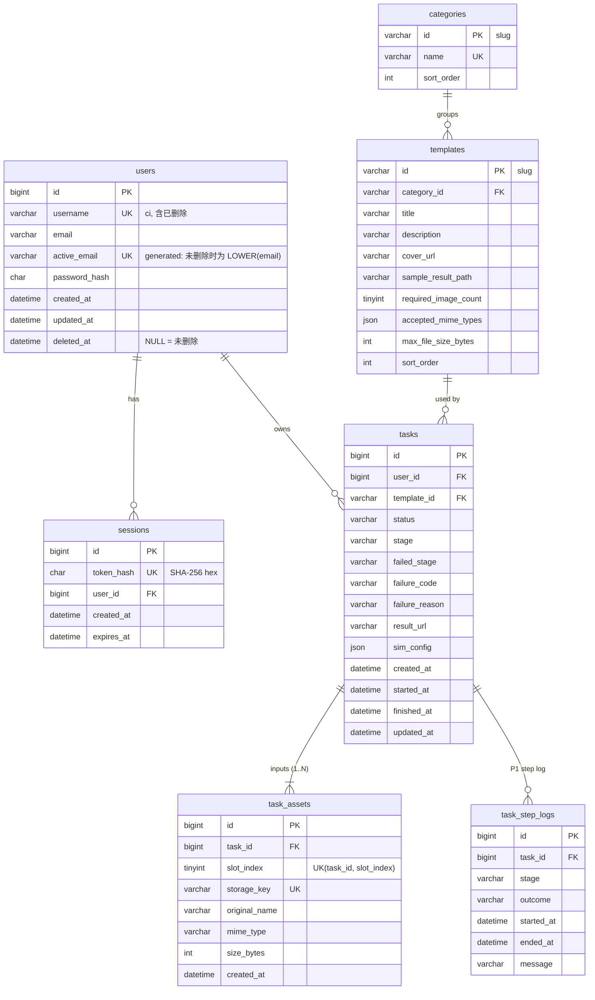

# 数据库设计（Database）

> 来源：[requirements.md](./requirements.md) §4 领域模型、F-xx；[backlog.md](./backlog.md) T-004、T-040
> 配套：[architecture.md](./architecture.md)、[api.yaml](./api.yaml)
> 状态：草案 v0.1（2026-11-04）

## 0. 通用约定

| 项 | 约定 | 理由 |
| --- | --- | --- |
| 版本 | MySQL 8.4 LTS（最低 8.0.16） | 8.0.16 起 CHECK 约束才会真正执行 |
| 字符集 / 排序规则 | 库和所有表：`utf8mb4` / `utf8mb4_0900_ai_ci` | `_ci` 使 `username` 的唯一索引天然不区分大小写（OQ-29） |
| 存储引擎 | InnoDB | 事务、外键 |
| 主键 | 业务数据用 `BIGINT UNSIGNED AUTO_INCREMENT`；种子字典数据（分类、模板）用可读 slug `VARCHAR` | 模板 ID 与 PRD 示例 `demo-postcard` 一致，前端 URL 可读 |
| 时间 | `DATETIME(3)`，**存 UTC**；JDBC `connectionTimeZone=UTC`，JVM `-Duser.timezone=UTC` | 避免 `TIMESTAMP` 的 2038 问题和会话时区隐式转换；毫秒精度用于排序和 `updatedAt` 比较 |
| 枚举 | `VARCHAR` + `CHECK (... IN (...))`，不用 MySQL `ENUM` | 增删枚举值只需改 CHECK，迁移简单；MyBatis 映射为 Java enum |
| 布尔 / 软删除 | 软删除用 `deleted_at DATETIME(3) NULL` | 同时记录"是否删除"和"何时删除" |
| 外键 | 全部声明；`ON DELETE RESTRICT`，仅 `task_assets → tasks` 为 `CASCADE`（用于提交失败时的补偿删除） | 业务数据只软删除，不会级联物理删除 |
| 迁移 | Flyway：`V1__init_schema.sql`、`V2__seed_data.sql`；P1 加 `V3__task_step_logs.sql`。**已发布的迁移不修改，只追加** | 容器首次启动自动初始化；重复启动不重复执行（T-004 完成定义） |
| 命名 | 表名复数蛇形；索引 `idx_<表>_<列>`，唯一 `uk_<表>_<列>`，外键 `fk_<表>_<引用表>`，检查 `chk_<表>_<含义>` | — |

---

## 1. ER 图



基数说明：

- 一个用户有多个会话、多个任务；用户只软删除，所以外键始终有效。
- 一个模板只属于一个分类（OQ-03 已确认一级分类）。
- 一个任务有 1..N 个输入素材（N = 模板的 `required_image_count`，OQ-04 临时默认"恰好 N 张"），一个素材只属于一个任务（OQ-05 已确认提交时上传，不复用）。
- 与 requirements §4 的差异：`Asset` 不再冗余 `userId` 和 `url`。归属通过 `task → user` 判断，URL 由 `storage_key` 在 DTO 转换时生成，避免两处数据不一致。

---

## 2. 表结构

### 2.1 `users` — 用户（F-12、F-28）

| 列 | 类型 | 空 | 默认 | 说明 |
| --- | --- | --- | --- | --- |
| `id` | `BIGINT UNSIGNED` | N | AUTO_INCREMENT | PK |
| `username` | `VARCHAR(20)` | N | — | 3 ~ 20 位 `[A-Za-z0-9_]`，原样保存；注册后不可修改 `[OQ-29]` |
| `email` | `VARCHAR(254)` | N | — | 原样保存；注册后不可修改；不用于登录 `[OQ-30]` |
| `active_email` | `VARCHAR(254)` | Y | 生成列 | `GENERATED ALWAYS AS (IF(deleted_at IS NULL, LOWER(email), NULL)) STORED` |
| `password_hash` | `CHAR(60)` | N | — | BCrypt（`$2a$10$...`，固定 60 字符） |
| `created_at` | `DATETIME(3)` | N | `CURRENT_TIMESTAMP(3)` | |
| `updated_at` | `DATETIME(3)` | N | `CURRENT_TIMESTAMP(3) ON UPDATE CURRENT_TIMESTAMP(3)` | 修改密码、删除时更新 |
| `deleted_at` | `DATETIME(3)` | Y | NULL | 非空 = 已删除（软删除，OQ-26） |

| 约束 / 索引 | 定义 | 支撑的规则 / 查询 |
| --- | --- | --- |
| PK | `(id)` | |
| `uk_users_username` | `UNIQUE (username)` | 用户名全局唯一、**包含已删除账户**（OQ-31 临时默认：永久占用）；`_ci` 排序规则使 `Alice` 与 `alice` 冲突；登录查询 `WHERE username = ?` |
| `uk_users_active_email` | `UNIQUE (active_email)` | 邮箱只在未删除账户中唯一（不区分大小写）；删除后 `active_email` 变 NULL，多个 NULL 不冲突，同一邮箱可再注册（2026-11-04 确认） |
| `chk_users_username` | `CHECK (REGEXP_LIKE(username, '^[A-Za-z0-9_]{3,20}$', 'c'))` | 数据库兜底，主要校验在应用层 |

> 若 OQ-31 改为"已删除账户的用户名可以再用"：把 `uk_users_username` 换成 `active_username` 生成列（同 `active_email` 写法）+ 唯一索引，再追加一条迁移即可。

### 2.2 `sessions` — 登录会话（F-12）

| 列 | 类型 | 空 | 默认 | 说明 |
| --- | --- | --- | --- | --- |
| `id` | `BIGINT UNSIGNED` | N | AUTO_INCREMENT | PK |
| `token_hash` | `CHAR(64)` | N | — | Cookie 中令牌的 SHA-256 十六进制；**不存明文令牌** |
| `user_id` | `BIGINT UNSIGNED` | N | — | FK → users.id |
| `created_at` | `DATETIME(3)` | N | `CURRENT_TIMESTAMP(3)` | |
| `expires_at` | `DATETIME(3)` | N | — | `created_at + 7d` `[OQ-28]` |

| 约束 / 索引 | 定义 | 支撑的规则 / 查询 |
| --- | --- | --- |
| PK | `(id)` | |
| `uk_sessions_token_hash` | `UNIQUE (token_hash)` | 每个请求的会话解析：`WHERE token_hash = ? AND expires_at > NOW(3)` |
| `idx_sessions_user_id` | `(user_id)` | 修改密码时删除其他会话、删除账户时删除全部会话；同时满足外键索引要求 |
| `fk_sessions_users` | `FOREIGN KEY (user_id) REFERENCES users(id) ON DELETE RESTRICT` | |

会话是技术数据而非业务记录：退出、修改密码、删除账户时直接 `DELETE` 行。过期行不影响正确性（查询带 `expires_at` 条件），本期不做定时清理。

### 2.3 `categories` — 一级分类（F-01）

| 列 | 类型 | 空 | 默认 | 说明 |
| --- | --- | --- | --- | --- |
| `id` | `VARCHAR(32)` | N | — | slug，如 `creative` |
| `name` | `VARCHAR(50)` | N | — | 显示名 |
| `sort_order` | `INT` | N | 0 | 升序 |

| 约束 / 索引 | 定义 | 说明 |
| --- | --- | --- |
| PK | `(id)` | |
| `uk_categories_name` | `UNIQUE (name)` | 防止种子数据重名 |

"全部"不是一条分类记录，由前端在标签行首位虚拟出来（OQ-03 余项临时默认）。

### 2.4 `templates` — 模板（F-01、F-02、F-13）

| 列 | 类型 | 空 | 默认 | 说明 |
| --- | --- | --- | --- | --- |
| `id` | `VARCHAR(64)` | N | — | slug，如 `demo-postcard` |
| `category_id` | `VARCHAR(32)` | N | — | FK → categories.id |
| `title` | `VARCHAR(100)` | N | — | |
| `description` | `VARCHAR(500)` | N | `''` | |
| `cover_url` | `VARCHAR(255)` | N | — | 站内路径，如 `/files/seed/covers/postcard.jpg` |
| `sample_result_path` | `VARCHAR(255)` | N | — | 预置结果图的 classpath 相对路径（如 `seed/results/postcard.png`），结果整理时复制 `[OQ-08]`；**不对外暴露** |
| `required_image_count` | `TINYINT UNSIGNED` | N | — | 需要的图片张数 |
| `accepted_mime_types` | `JSON` | N | — | 如 `["image/jpeg","image/png"]`；MyBatis 用 `StringListJsonTypeHandler` 映射为 `List<String>` |
| `max_file_size_bytes` | `INT UNSIGNED` | N | — | 单张上限，如 5242880 |
| `sort_order` | `INT` | N | 0 | 列表内升序 |
| `created_at` | `DATETIME(3)` | N | `CURRENT_TIMESTAMP(3)` | |

| 约束 / 索引 | 定义 | 支撑的规则 / 查询 |
| --- | --- | --- |
| PK | `(id)` | 详情 `WHERE id = ?` |
| `idx_templates_category_sort` | `(category_id, sort_order)` | 列表 `WHERE category_id = ? ORDER BY sort_order, id`；同时满足外键索引 |
| `fk_templates_categories` | `FOREIGN KEY (category_id) REFERENCES categories(id) ON DELETE RESTRICT` | |
| `chk_templates_image_count` | `CHECK (required_image_count BETWEEN 1 AND 9)` | |
| `chk_templates_max_size` | `CHECK (max_file_size_bytes > 0)` | |
| `chk_templates_mime_types` | `CHECK (JSON_TYPE(accepted_mime_types) = 'ARRAY' AND JSON_LENGTH(accepted_mime_types) > 0)` | |

只读字典表：不提供 CRUD（R-02.3），全部数据来自 `V2__seed_data.sql`。

### 2.5 `tasks` — 制作任务（F-05 ~ F-08、F-11、F-28）

| 列 | 类型 | 空 | 默认 | 说明 |
| --- | --- | --- | --- | --- |
| `id` | `BIGINT UNSIGNED` | N | AUTO_INCREMENT | PK；接口中以字符串 `taskId` 输出 |
| `user_id` | `BIGINT UNSIGNED` | N | — | FK → users.id，归属与访问控制依据 |
| `template_id` | `VARCHAR(64)` | N | — | FK → templates.id |
| `status` | `VARCHAR(16)` | N | `'PENDING'` | `PENDING` / `PROCESSING` / `SUCCEEDED` / `FAILED` |
| `stage` | `VARCHAR(24)` | Y | NULL | 当前（或最后）阶段：`ASSET_CHECK` / `GENERATING` / `RESULT_ORGANIZING`；PENDING 时为 NULL |
| `failed_stage` | `VARCHAR(24)` | Y | NULL | 失败时所处阶段；PENDING 阶段被废弃时为 NULL |
| `failure_code` | `VARCHAR(32)` | Y | NULL | `SIMULATED_FAILURE` / `ASSET_MISSING` / `ASSET_INVALID` / `RESULT_WRITE_FAILED` / `ACCOUNT_DELETED` / `INTERNAL_ERROR`；对外返回（DQ-03 已确认） |
| `failure_reason` | `VARCHAR(255)` | Y | NULL | 用户可读中文原因；不含堆栈 |
| `result_url` | `VARCHAR(255)` | Y | NULL | 成功后的站内结果路径 `/files/results/{taskId}/{uuid}.png` |
| `sim_config` | `JSON` | N | — | 创建时的模拟配置快照：`{"assetCheckMs":1500,"generatingMs":3000,"resultOrganizingMs":1500,"failStage":null,"failReason":null}` `[OQ-10]`；**不对外暴露** |
| `created_at` | `DATETIME(3)` | N | `CURRENT_TIMESTAMP(3)` | 历史排序依据 |
| `started_at` | `DATETIME(3)` | Y | NULL | 第一次 `markProcessing` 时写入 |
| `finished_at` | `DATETIME(3)` | Y | NULL | 进入终态时写入 |
| `updated_at` | `DATETIME(3)` | N | `CURRENT_TIMESTAMP(3) ON UPDATE CURRENT_TIMESTAMP(3)` | 前端单调合并时比较新旧 |

| 约束 / 索引 | 定义 | 支撑的规则 / 查询 |
| --- | --- | --- |
| PK | `(id)` | 执行器按 ID 读写 |
| `idx_tasks_user_created` | `(user_id, created_at, id)` | "我的记录"：`WHERE user_id = ? ORDER BY created_at DESC, id DESC`；单任务查询 `WHERE id = ? AND user_id = ?` 走 PK；删除账户废弃任务 `WHERE user_id = ? AND status IN (...)` 用前缀 `user_id` |
| `idx_tasks_user_template_created` | `(user_id, template_id, created_at, id)` | 详情页 History：`WHERE user_id = ? AND template_id = ? ORDER BY created_at DESC, id DESC` |
| `idx_tasks_template_id` | `(template_id)` | 外键 `template_id` 需要以它开头的索引（上面两个复合索引都以 `user_id` 开头，不满足），显式声明避免 MySQL 自动生成不规范命名的索引 |
| `idx_tasks_status` | `(status)` | P1 T-072 启动时扫描 PENDING / PROCESSING 任务；数据量小，代价低 |
| `fk_tasks_users` | `FOREIGN KEY (user_id) REFERENCES users(id) ON DELETE RESTRICT` | |
| `fk_tasks_templates` | `FOREIGN KEY (template_id) REFERENCES templates(id) ON DELETE RESTRICT` | |
| `chk_tasks_status` | `CHECK (status IN ('PENDING','PROCESSING','SUCCEEDED','FAILED'))` | |
| `chk_tasks_stage` | `CHECK (stage IS NULL OR stage IN ('ASSET_CHECK','GENERATING','RESULT_ORGANIZING'))` | |
| `chk_tasks_failed_stage` | `CHECK (failed_stage IS NULL OR failed_stage IN ('ASSET_CHECK','GENERATING','RESULT_ORGANIZING'))` | |
| `chk_tasks_succeeded` | `CHECK (status <> 'SUCCEEDED' OR result_url IS NOT NULL)` | 成功必有结果地址（R-05.2） |
| `chk_tasks_failed` | `CHECK (status <> 'FAILED' OR (failure_code IS NOT NULL AND failure_reason IS NOT NULL))` | 失败必有原因（R-06.1） |
| `chk_tasks_terminal_time` | `CHECK (status NOT IN ('SUCCEEDED','FAILED') OR finished_at IS NOT NULL)` | |

#### 状态写入（只允许以下 SQL 修改 status，全部为条件更新）

| Mapper 方法 | SQL 要点 | 调用方 | 影响行数 = 0 的含义 |
| --- | --- | --- | --- |
| `insert` | `status='PENDING', stage=NULL` | TaskSubmissionService | — |
| `markProcessing(id, stage)` | `SET status='PROCESSING', stage=#{stage}, started_at=COALESCE(started_at, NOW(3)) WHERE id=#{id} AND status IN ('PENDING','PROCESSING')` | TaskPipeline，每步开始 | 任务已是终态（被废弃），停止执行 |
| `markSucceeded(id, resultUrl)` | `SET status='SUCCEEDED', result_url=#{resultUrl}, finished_at=NOW(3) WHERE id=#{id} AND status='PROCESSING' AND stage='RESULT_ORGANIZING'` | TaskPipeline，最后 | 同上，不写结果 |
| `markFailed(id, stage, code, reason)` | `SET status='FAILED', failed_stage=#{stage}, failure_code=..., failure_reason=..., finished_at=NOW(3) WHERE id=#{id} AND status IN ('PENDING','PROCESSING')` | TaskPipeline，步骤失败 / 兜底 | 同上 |
| `abandonActiveByUser(userId)` | `SET status='FAILED', failed_stage=stage, failure_code='ACCOUNT_DELETED', failure_reason='账户已删除，任务已废弃', finished_at=NOW(3) WHERE user_id=#{userId} AND status IN ('PENDING','PROCESSING')` | AccountService（删除账户事务内） | 没有进行中的任务 |
| `deleteById(id)` | `DELETE FROM tasks WHERE id=#{id} AND status='PENDING'`（`task_assets` 级联删除） | TaskSubmissionService，仅在派发被拒绝时补偿 `[OQ-12]` | — |

`stage` 在终态时保留最后所处阶段，便于排查；前端在终态下展示 `failedStage` / 结果，不展示 `stage`。

### 2.6 `task_assets` — 任务输入素材（F-03、F-06）

| 列 | 类型 | 空 | 默认 | 说明 |
| --- | --- | --- | --- | --- |
| `id` | `BIGINT UNSIGNED` | N | AUTO_INCREMENT | PK |
| `task_id` | `BIGINT UNSIGNED` | N | — | FK → tasks.id |
| `slot_index` | `TINYINT UNSIGNED` | N | — | 上传位序号，从 0 开始 |
| `storage_key` | `VARCHAR(255)` | N | — | 相对存储根目录的路径：`uploads/2026/11/{uuid}.png`；URL = `/files/` + storage_key |
| `original_name` | `VARCHAR(255)` | N | — | 原始文件名（截断到 255），只用于排查，不用于拼路径 |
| `mime_type` | `VARCHAR(32)` | N | — | 服务端**魔数检测**得出的类型，不是客户端声明的 Content-Type `[OQ-17]` |
| `size_bytes` | `INT UNSIGNED` | N | — | |
| `created_at` | `DATETIME(3)` | N | `CURRENT_TIMESTAMP(3)` | |

| 约束 / 索引 | 定义 | 支撑的规则 / 查询 |
| --- | --- | --- |
| PK | `(id)` | |
| `uk_task_assets_task_slot` | `UNIQUE (task_id, slot_index)` | 一个上传位只有一个文件；查询 `WHERE task_id IN (...) ORDER BY task_id, slot_index`；同时满足外键索引 |
| `uk_task_assets_storage_key` | `UNIQUE (storage_key)` | 一个文件只属于一个素材记录；访问 `/files/uploads/**` 时按 storage_key 查归属（Q13） |
| `fk_task_assets_tasks` | `FOREIGN KEY (task_id) REFERENCES tasks(id) ON DELETE CASCADE` | 仅用于提交补偿删除；正常业务不删除任务 |
| `chk_task_assets_size` | `CHECK (size_bytes > 0)` | 拒绝空文件 |

### 2.7 `task_step_logs` — 阶段执行日志（P1，F-22 / T-074，`V3` 迁移）

| 列 | 类型 | 空 | 说明 |
| --- | --- | --- | --- |
| `id` | `BIGINT UNSIGNED` AUTO_INCREMENT | N | PK |
| `task_id` | `BIGINT UNSIGNED` | N | FK → tasks.id（`ON DELETE CASCADE`） |
| `stage` | `VARCHAR(24)` | N | CHECK 同 `tasks.stage` |
| `outcome` | `VARCHAR(16)` | N | `SUCCEEDED` / `FAILED` / `ABORTED`（被外部废弃） |
| `started_at` | `DATETIME(3)` | N | |
| `ended_at` | `DATETIME(3)` | N | |
| `message` | `VARCHAR(255)` | Y | |

索引：`uk_task_step_logs_task_stage UNIQUE (task_id, stage)`（每个任务每个阶段最多一条，同时满足外键索引）。MVP 不建这张表。

---

## 3. 关键查询与索引对照

| # | 场景 | SQL（简化） | 使用索引 |
| --- | --- | --- | --- |
| Q1 | 解析会话（每个需登录请求） | `SELECT s.user_id, u.username FROM sessions s JOIN users u ON u.id=s.user_id WHERE s.token_hash=? AND s.expires_at>NOW(3) AND u.deleted_at IS NULL` | `uk_sessions_token_hash` + users PK |
| Q2 | 登录 | `SELECT id, password_hash, deleted_at FROM users WHERE username=?` | `uk_users_username` |
| Q3 | 注册判重 | 直接 `INSERT`，捕获 `DuplicateKeyException`，按索引名区分 `USERNAME_TAKEN` / `EMAIL_TAKEN` | `uk_users_username`、`uk_users_active_email` |
| Q4 | 分类列表 | `SELECT * FROM categories ORDER BY sort_order, id` | 全表（数据极少） |
| Q5 | 模板列表 | `SELECT ... FROM templates [WHERE category_id=?] ORDER BY sort_order, id` | `idx_templates_category_sort` |
| Q6 | 单任务查询 | `SELECT t.*, tp.title, tp.cover_url FROM tasks t JOIN templates tp ON tp.id=t.template_id WHERE t.id=? AND t.user_id=?` | tasks PK |
| Q7 | 详情页 History | `... WHERE t.user_id=? AND t.template_id=? ORDER BY t.created_at DESC, t.id DESC` | `idx_tasks_user_template_created` |
| Q8 | 我的记录 | `... WHERE t.user_id=? ORDER BY t.created_at DESC, t.id DESC` | `idx_tasks_user_created` |
| Q9 | 批量查询（P1） | `... WHERE t.user_id=? AND t.id IN (...)` | tasks PK |
| Q10 | 素材批量加载（Q6 ~ Q9 之后） | `SELECT task_id, slot_index, storage_key FROM task_assets WHERE task_id IN (...) ORDER BY task_id, slot_index` | `uk_task_assets_task_slot` |
| Q11 | 废弃进行中任务 | 见 2.5 `abandonActiveByUser` | `idx_tasks_user_created` 前缀 |
| Q12 | 重启扫描（P1） | `SELECT id FROM tasks WHERE status IN ('PENDING','PROCESSING')` | `idx_tasks_status` |
| Q13 | 访问用户素材文件（DQ-02） | `SELECT a.storage_key, a.mime_type FROM task_assets a JOIN tasks t ON t.id=a.task_id WHERE a.storage_key=? AND t.user_id=?` | `uk_task_assets_storage_key` + tasks PK |
| Q14 | 访问结果文件（DQ-02） | `SELECT result_url FROM tasks WHERE id=? AND user_id=? AND result_url=?` | tasks PK |

Q6 ~ Q9、Q13、Q14 都带 `user_id = 当前用户`，是数据访问边界在 SQL 层的体现。Q10 只按 Q6 ~ Q9 已过滤出的 task_id 加载，不单独暴露。

---

## 4. 事务边界

| 操作 | 事务内容 | 隔离级别 / 说明 |
| --- | --- | --- |
| 注册 | `INSERT users` + `INSERT sessions` | 默认 REPEATABLE READ；唯一索引兜底并发注册 |
| 登录 | `INSERT sessions` | 单语句 |
| 修改密码 | `UPDATE users SET password_hash` + `DELETE sessions WHERE user_id=? AND id<>当前会话` | 同一事务 |
| 删除账户 | `UPDATE users SET deleted_at` + `abandonActiveByUser` + `DELETE sessions WHERE user_id=?` | 同一事务；执行器靠条件更新感知 |
| 提交任务 | `INSERT tasks` + `INSERT task_assets ×N` | 同一事务；文件写入在事务外，失败时删除文件 |
| 状态推进 | 每次一条条件 `UPDATE` | 单语句原子；不跨步骤持有事务（步骤内有 sleep） |

---

## 5. 种子数据（`V2__seed_data.sql`，F-13）

| 数据 | 内容 | 目的 |
| --- | --- | --- |
| categories | 至少 2 个，如 `creative` 创意图片、`portrait` 人像写真、`festival` 节日贺卡 | 演示分类切换 |
| templates | 至少 3 个，`required_image_count` 覆盖 1 / 2 / 3；至少一个只接受 `image/png`、一个上限 1 MB | 演示不同张数和校验 |
| users | `demo1`、`demo2`（邮箱 `demo1@example.com`、`demo2@example.com`），密码明文写在 README（仅供演示），表中只存 BCrypt 哈希 | 演示切换用户（F-12 规则 12） |
| 文件 | 封面、预置结果图放在 `backend/src/main/resources/seed/`，通过 `/files/seed/**` 访问；来源和许可写入 README `[OQ-19]` | |

示例模板（对应 PRD R-02.2 的字段）：

```sql
INSERT INTO templates (id, category_id, title, description, cover_url, sample_result_path,
                       required_image_count, accepted_mime_types, max_file_size_bytes, sort_order)
VALUES ('demo-postcard', 'creative', '旅行明信片', '上传图片，模拟生成一张明信片',
        '/files/seed/covers/postcard.jpg', 'seed/results/postcard.png',
        2, JSON_ARRAY('image/jpeg', 'image/png'), 5242880, 10);
```

---

## 6. 数据保留与文件布局

```
${app.storage.root}/              # 容器内 /data/storage，挂载数据卷 storage-data
├── tmp/{uuid}.{ext}.part        # 提交时的暂存文件，事务提交后移到 uploads/（T-030）
├── uploads/yyyy/MM/{uuid}.{ext}  # 用户上传的素材（task_assets.storage_key）
└── results/{taskId}/{uuid}.{ext} # 结果文件（tasks.result_url）
classpath:/seed/                  # 种子封面与预置结果图（只读，随 jar 打包）
```

- 删除账户：用户、任务、素材记录和文件**全部保留**（OQ-26），只是没有任何接口能读到。文件链接同样失效：`/files/uploads/**`、`/files/results/**` 需要登录且只返回本人的文件（Q13、Q14），已删除用户没有有效会话（DQ-02 已确认）。
- 文件名一律由服务端生成（UUID + 由魔数类型决定的扩展名），不使用用户提供的文件名，杜绝路径穿越。
- 本期不做文件清理任务。

---

## 7. 未确定问题对数据库的影响

| 问题 | 当前设计 | 结论变化时的迁移 |
| --- | --- | --- |
| OQ-04 张数是区间 | 恰好 N 张，一列 `required_image_count` | 追加 `min_image_count` 列 |
| OQ-08 结果图来源 | `templates.sample_result_path` | 若改为"用第一张输入图"，该列可废弃，不需要迁移 |
| OQ-09 余项 分页 | 无分页；索引已含 `(created_at, id)`，可直接支持游标分页 | 无需迁移 |
| OQ-10 按任务配置模拟 | `tasks.sim_config` 快照已是按任务存储 | 无需迁移 |
| OQ-13 重启处理 | `idx_tasks_status` 已预留 | 若新增失败码 `SERVICE_RESTARTED`，只是新的 `failure_code` 值，无需迁移 |
| OQ-26 余项 废弃用独立状态 | 用 `FAILED` + `ACCOUNT_DELETED` | 追加迁移修改 `chk_tasks_status` 加入 `CANCELLED` |
| OQ-29 用户名规则 | `VARCHAR(20)` + CHECK | 修改列长和 CHECK |
| OQ-30 邮箱规则 | `VARCHAR(254)`，`LOWER()` 判重 | — |
| OQ-31 用户名可再用 | `uk_users_username` 含已删除 | 见 2.1 备注 |
