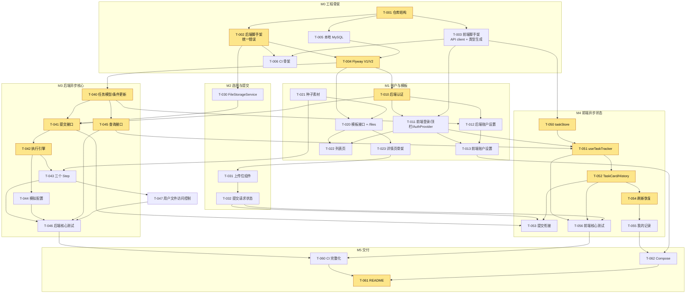

# 实施计划（Implementation Plan）

> 来源：[backlog.md](./backlog.md)（任务 T-xxx 的范围与完成定义）、[requirements.md](./requirements.md)（F-xx 验收标准）
> 配套：[architecture.md](./architecture.md)、[database.md](./database.md)、[api.yaml](./api.yaml)
> 状态：草案 v0.1（2026-11-04）
>
> 本文不重复 backlog 中每个任务的范围描述，只补充：**按本架构落地时的具体产出、依赖关系、开发顺序和验证方式**。任务编号沿用 backlog。

## 0. 工作约定

1. **契约先行**：涉及接口的任务先改 [api.yaml](./api.yaml)，前端执行 `npm run gen:api` 重新生成类型，后端按契约写 DTO 和测试。契约变化在 PR 描述中单独列出。
2. **纵向切片**：每个里程碑结束时都能演示一段完整功能（见 §2），不做"先写完全部后端再写前端"。
3. **完成定义（每个任务通用）**：
   - 该任务的验证项（§3）全部通过；
   - 后端 `./mvnw -B verify` 与前端 `npm run lint && npm run typecheck && npm test && npm run build` 在开发容器中通过（命令见 §0.1），T-006 之后 CI 为绿色；
   - 新增的配置项写入 `application.yml` 注释和 `.env.example`；
   - 与本文、api.yaml、database.md 不一致的地方，在同一 PR 中更新文档。
4. **分支与提交**：一个任务一个分支、一个 PR；数据库变更只追加新的 Flyway 迁移，不修改已合并的迁移。

### 0.1 常用验证命令

所有服务（mysql、backend、frontend）都在 Docker 中运行，宿主机只需要 Docker（architecture §1.3）。

```bash
# 本地开发环境（源码挂载，前端热更新；后端改代码后 restart backend）
docker compose -f docker-compose.dev.yml up --build   # http://localhost:3000
DEV="docker compose -f docker-compose.dev.yml"

# 后端测试（单测 + Testcontainers IT，容器经宿主机 docker.sock 启动 MySQL）
$DEV run --rm --no-deps backend ./mvnw -B verify

# 前端检查
$DEV exec frontend sh -c "npm run lint && npm run typecheck && npm test && npm run build"
$DEV exec frontend npm run gen:api    # api.yaml 变更后重新生成类型

# 依赖变更（package.json / pom.xml）后重建 dev 镜像与依赖卷
$DEV up -d --build --renew-anon-volumes frontend

# 演示 / 验收环境
docker compose up --build             # http://localhost:3000
```

下文 curl 示例中，`$API` 指 `http://localhost:3000`（经 Next.js 代理）或 `http://localhost:8080`（直连后端）；`-c/-b jar.txt` 用于保存和携带会话 Cookie。

---

## 1. 依赖关系



**关键路径**（与 backlog 一致）：T-001 → T-002 → T-004 → T-010 → T-040 → T-041 → T-042 → T-045 → T-050 → T-051 → T-052 → T-054 → T-062 → T-061。

说明：T-045（查询接口）只依赖 T-040，可以和 T-041 ~ T-044 并行；T-050（store）只依赖 T-003，可以在 M1 期间就开始。

---

## 2. 开发顺序

按"阶段 + 并行泳道"排列。单人开发时按表格从上到下执行；两人开发时 A 走后端泳道、B 走前端泳道。

| 阶段 | 后端泳道 | 前端泳道 | 阶段结束时可演示 / 检查点 |
| --- | --- | --- | --- |
| **S0 骨架** | T-001 → T-002 → T-005 → T-004 | T-003 | `docker compose -f docker-compose.dev.yml up --build` 一条命令启动全部服务；健康检查 UP；空库启动后表与种子就绪；前端能调用 `/actuator/health` |
| | T-006（前后端都完成后） | | 第一次绿色 CI |
| **S1 身份 + 目录** | T-010 → T-021 → T-020 | T-011 → T-022 → T-023 | 注册、登录、退出、切换用户；浏览、筛选模板；进入详情页；未登录看不到上传区 |
| **S2 异步核心（后端）** | T-040 → T-045 → T-030 → T-041 → T-042 → T-043 → T-044 → T-047 → T-046 | T-050（store 纯函数，可提前） → T-031 → T-032 | **curl 完整闭环**：提交 → 三步执行 → 成功 / 指定阶段失败；前端：选图、预览、上传进度（可先对着 MSW） |
| **S3 异步状态（前端）** | T-012（账户设置后端，需要 T-040） | T-051 → T-052 → T-053 → T-054 → T-055 → T-056 | **浏览器完整闭环**：提交后出现卡片、多任务、查询异常、刷新恢复、我的记录 |
| | | T-013 | 修改密码、删除账户 |
| **S4 交付** | T-060 | | CI 跑全部测试 |
| | T-062 → T-061 | | `docker compose up --build` 一条命令完成全部演示 |
| **S5 打磨（P1，按剩余时间）** | T-072、T-073、T-074 | T-070、T-071、T-075 | 见 backlog §4 |

S2 之所以把后端异步核心整体前置：它是 PRD 的首要考察点，且 curl 即可验证，不依赖前端 UI。

---

## 3. 任务产出与验证方式

"自动"一列是要写进代码库、在 CI 中运行的测试；"手动"一列是 PR 合并前在本地执行一次的检查。

### M0 工程骨架

| 任务 | 按本架构的产出 | 自动验证 | 手动验证 |
| --- | --- | --- | --- |
| T-001 | `frontend/`、`backend/`、`docs/`、根目录 `docker-compose.yml`、`docker-compose.dev.yml`、`.gitignore`、`.editorconfig`、`.env.example`、README 骨架 | — | `git status` 没有 `node_modules`、`target`、`.next`、`data/` |
| T-002 | Spring Boot 工程（版本按 architecture §2 验证后锁定）；`common.error`：`ErrorCode`、`ApiException`、`ErrorResponse`、`GlobalExceptionHandler`（含 `MaxUploadSizeExceededException → 413`、`NoResourceFoundException → 404 NOT_FOUND`、`MethodArgumentNotValidException → 400 VALIDATION_FAILED`、`HttpRequestMethodNotSupportedException → 405`、兜底 500）；Actuator 只暴露 health；JVM / JDBC 时区 UTC；`dev`/`test`/`demo`/`prod` profile | `GlobalExceptionHandlerTest`（MockMvc）：每类异常的 HTTP 状态和 `{code,message}` 结构与 api.yaml 一致；500 响应不含堆栈 | `curl $API/actuator/health` → `{"status":"UP"}` |
| T-003 | Next.js + TS strict + ESLint + Tailwind；`next.config` rewrites `/api/:path*`、`/files/:path*` → `BACKEND_INTERNAL_URL`；**不创建 middleware / proxy.ts**；`lib/api/client.ts`（`ApiError{kind,status,code,message,details}`、AbortSignal）；`npm run gen:api`（openapi-typescript → `lib/api/schema.d.ts`）；Vitest + RTL + MSW 初始化 | `client.test.ts`：网络错误 → `kind:'network'`；4xx/5xx JSON → `kind:'http'` 带 `code`；非 JSON 的 5xx 也能转成 `ApiError`；abort 不被当成错误上报 | dev compose 启动后 `:3000` 页面显示后端健康状态；四个脚本在容器内全部通过 |
| T-005 | `docker-compose.dev.yml`：mysql:8.4（数据卷、`utf8mb4_0900_ai_ci`）+ backend / frontend 开发容器（`Dockerfile` 的 `dev` 目标、源码挂载）；`backend/Dockerfile`、`frontend/Dockerfile`（多阶段：dev / build / runtime） | — | `docker compose -f docker-compose.dev.yml up --build` 后 `:3000` 页面显示后端 UP；修改前端代码即时生效；容器内 `./mvnw -B verify` 通过 |
| T-004 | `db/migration/V1__init_schema.sql`（database.md §2 全部表、约束、索引，不含 `task_step_logs`）、`V2__seed_data.sql`（database.md §5） | `MigrationIT`（Testcontainers）：迁移成功；`information_schema` 中存在 database.md 列出的每个唯一索引和 CHECK；插入 `status='SUCCEEDED' AND result_url IS NULL` 被 CHECK 拒绝；插入大小写不同的重复用户名被拒绝；`active_email` 在 `deleted_at` 非空时为 NULL | 空库启动后 `SELECT COUNT(*) FROM templates` ≥ 3；重启后种子不重复 |
| T-006 | `.github/workflows/ci.yml`：`push` / `pull_request`；frontend job（`npm ci` → lint → typecheck → test → build）；backend job（JDK 21 → `./mvnw -B verify`，Ubuntu runner 自带 Docker 供 Testcontainers 使用）；docker job（`docker compose up --build --wait` 冒烟：三个服务 healthy、经 `:3000` 访问 health 为 UP） | CI 本身 | 推一个故意的类型错误分支，frontend job 失败 |

### M1 账户与模板

| 任务 | 按本架构的产出 | 自动验证 | 手动验证 |
| --- | --- | --- | --- |
| T-010 | `auth` 模块：`AuthController`（register / login / logout / me）、`AuthService`、`SessionService`（SHA-256 存储、7 天）、`AuthInterceptor`（匿名白名单：`GET /api/categories`、`GET /api/templates/**`、`POST /api/auth/register|login|logout`、`/api/dev/**`）、`CurrentUser` 参数解析器；`DuplicateKeyException` 按索引名映射 `USERNAME_TAKEN` / `EMAIL_TAKEN` | `AuthControllerIT`：注册 → 201 + Set-Cookie（HttpOnly、SameSite=Lax）→ me 200；用户名大小写不同重复 409；已删除账户的用户名 409；未删除账户邮箱重复（大小写不同）409；已删除账户的邮箱可注册；用邮箱登录 401；密码错误 401 与用户不存在 401 响应完全相同；logout 后旧 Cookie 访问 me 401；过期会话 401；匿名 `GET /api/templates` 200、匿名 `GET /api/tasks` 401；`users.password_hash` 以 `$2` 开头；`sessions` 中不存在明文令牌 | `curl -c jar.txt -X POST $API/api/auth/login -H 'Content-Type: application/json' -d '{"username":"demo1","password":"<README 中的密码>"}'`，再 `curl -b jar.txt $API/api/auth/me` |
| T-011 | `/login`、`/register`（提示"邮箱注册后不能修改"）；`AuthProvider`（status、user、epoch）；顶栏用户菜单；全局 401 处理 + `next` 回跳；`useRequireAuth`；退出清理（abort 全部、`taskStore.reset()`、epoch+1） | `AuthProvider.test.tsx`：me 返回 401 → anonymous 且不跳转；登录后 epoch 递增；退出后 store 被清空；任意业务接口 401 → 跳转 `/login?next=...` | 登录 demo1 → 退出 → 登录 demo2，页面没有 demo1 的数据 |
| T-012 | `account` 模块：`PUT /api/account/password`、`DELETE /api/account`；`TaskAbandonService.abandonActiveByUser` 在同一事务中调用 | `AccountControllerIT`：当前密码错误 → 400 `CURRENT_PASSWORD_INCORRECT`（不是 401）；修改后旧密码登录 401、新密码 200；其他会话 401、当前会话仍 200；`confirmText` 为 `delete` / `DELETE ` / 缺失 → 400；删除后原 Cookie 401、无法登录；该用户 PENDING / PROCESSING 任务变为 `FAILED + ACCOUNT_DELETED`，已终态任务不变；其他用户任务不变；任务和 task_assets 行仍在 | 见 T-046 第 8 项的端到端场景 |
| T-013 | `/account`：只读账户信息、`ChangePasswordForm`、`DeleteAccountDialog`（原生 `<dialog>` 或等价语义、焦点归还） | `DeleteAccountDialog.test.tsx`：输入不是 `DELETE` 时按钮禁用；取消不发请求；删除失败保持登录并显示错误；删除成功执行退出清理并跳转首页。`ChangePasswordForm.test.tsx`：两次新密码不一致时不发请求 | 只用键盘完成修改密码和删除账户；页面没有 Billing / Terms / Privacy / Subscription |
| T-021 | `backend/src/main/resources/seed/covers/*`、`seed/results/*`；`samples/`（合法 jpg/png、>5 MB 文件、伪装成 .jpg 的文本文件）；素材来源清单 | — | 文件许可已记录（OQ-19） |
| T-020 | `catalog` 模块：`GET /api/categories`、`GET /api/templates`、`GET /api/templates/{id}`；`WebMvcConfig` 只把 `/files/seed/**` 映射到 `classpath:/seed/`（用户文件由 T-047 的 Controller 提供，不做静态映射） | `CatalogControllerIT`：全部 / 按分类 / 不存在的分类返回空列表 / 模板详情字段与 api.yaml 一致且**不含** `sample_result_path` / 不存在 → 404 `TEMPLATE_NOT_FOUND`；`/files/seed/...` 200；`/files/../application.yml` 不可访问 | 浏览器打开每个 `coverUrl` |
| T-022 | `/`：CategoryTabs（"全部" + 分类，与 `?category=` 同步）、TemplateGrid；切换时 abort 旧请求 | `TemplateListPage.test.tsx`（MSW）：加载 / 空 / 错误 + 重试；快速切换分类时较慢的旧响应不覆盖新结果；未知分类回落到"全部" | F-01 验收清单 |
| T-023 | `/templates/[templateId]`：标题、封面、描述、素材要求；两栏布局；404 与请求失败区分；未登录时上传区和 History 显示"登录后即可制作" | `TemplateDetailPage.test.tsx`：404 → "模板不存在"；500 → "加载失败 + 重试"（不显示为不存在）；匿名 → 登录提示 | F-02 验收清单 |

### M2 选图与提交

| 任务 | 按本架构的产出 | 自动验证 | 手动验证 |
| --- | --- | --- | --- |
| T-030 | `storage` 模块：`ImageTypeDetector`（魔数）、`FileStorageService.store(InputStream, detectedType) → StoredFile(storageKey, url)`、`delete(storageKey)`、`toUrl(storageKey)`；multipart 上限 5 MB / 20 MB。比 backlog 的"临时目录 → 正式目录"更简单：直接写正式目录，失败时删除（architecture §5.1） | `ImageTypeDetectorTest`：JPEG / PNG / WebP 识别正确；改了扩展名的文本文件识别为不支持；空文件拒绝。`FileStorageServiceTest`（临时目录）：生成的 key 不含用户文件名、不含 `..`；`delete` 后文件不存在 | — |
| T-031 | `features/upload/UploadSlots`、`useSlots`：`empty | selected | invalid`，blob URL 生命周期，锁定，显示服务端 `slotIndex` 错误，`aria-label` | `UploadSlots.test.tsx`：选择合法文件后出现预览且没有发出请求；非法类型 / 超大文件不进入上传位并显示原因；替换时旧 blob URL 被 `revokeObjectURL`；锁定期间不能操作 | 多种文件手动试一遍 |
| T-032 | `lib/api/upload.ts`（XHR、`upload.onprogress`、`upload.onload` 表示"已发完" → 进入 submitting、abort）；`useSubmitTask`：`idle | uploading(p) | submitting | error` | `useSubmitTask.test.ts`（模拟 XHR）：未选齐时 `canSubmit=false`；双击只发一次；进度事件 → uploading → 发完 → submitting；网络错误后已选文件仍在；400 `ASSET_VALIDATION_FAILED` 的 `slotIndex` 错误显示到对应上传位；卸载时 abort | DevTools 限速 Slow 3G 观察进度条 → "提交中" |

### M3 后端异步核心

| 任务 | 按本架构的产出 | 自动验证 | 手动验证 |
| --- | --- | --- | --- |
| T-040 | `task.domain`（`TaskStatus`、`TaskStage`、`FailureCode`、`Task`、`TaskAsset`）；`TaskMapper.xml`：database.md §2.5 列出的全部写方法 + `findByIdAndUser`、`listByUser(userId, templateId?)`、`listByIdsAndUser`；`TaskAssetMapper` | `TaskMapperIT`：对 SUCCEEDED / FAILED 任务调用 `markProcessing` / `markSucceeded` / `markFailed` 都返回 0 且数据不变；`markSucceeded` 在 stage≠RESULT_ORGANIZING 时返回 0；`findByIdAndUser` 传别人的 userId 返回空；`abandonActiveByUser` 只影响该用户的进行中任务 | — |
| T-041 | `TaskController.create`、`TaskSubmissionService`（校验 → 写文件 → `TaskWriter.create()` 事务 → dispatch → 补偿）、`SimulationSettings.snapshot()` 写入 `sim_config`；`TaskDtoAssembler` | `TaskSubmissionIT`（MockMultipartFile，执行器替换为记录调用的假实现）：成功 → 202 + `Location` + PENDING，执行器收到 taskId；模板不存在 404；张数不符 400 `IMAGE_COUNT_MISMATCH`；类型不符 / 超大 / 空文件 400 带正确 `slotIndex`；超过 multipart 上限 413；未登录 401；执行器抛 `TaskRejectedException` → 503 `QUEUE_FULL`。**每个失败用例都断言** `tasks`、`task_assets` 行数不变、存储目录没有新文件 | `curl -b jar.txt -F templateId=demo-postcard -F files=@samples/a.jpg -F files=@samples/b.png $API/api/tasks` |
| T-042 | `TaskDispatcher`（`ThreadPoolTaskExecutor`，线程名 `task-exec-`）、`TaskPipeline`、`TaskStep` 接口、`StepFailedException`；MDC 日志 | `TaskPipelineTest`（Mockito，假 step）：见 T-046 第 1 ~ 3 项 | 提交后 `SELECT status, stage FROM tasks WHERE id=?` 反复执行，能看到阶段依次变化；日志中每步有开始 / 结束 / 耗时 |
| T-043 | `AssetCheckStep`、`GenerateStep`、`ResultOrganizeStep`；每步开头调用 `SimulationGate`（sleep + 指定阶段失败） | `AssetCheckStepTest`：文件缺失 → `ASSET_MISSING`；大小与记录不一致 → `ASSET_INVALID`。`ResultOrganizeStepTest`：结果文件被写到 `results/{taskId}/`，返回的 URL 指向它。`SimulationGateTest`：failStage 匹配时抛 `SIMULATED_FAILURE`，原因为默认文案或自定义文案 | 成功任务的 `resultUrl` 在浏览器可打开；手动删除某个素材文件后提交的任务在 ASSET_CHECK 失败 |
| T-044 | `SimulationProperties`（`app.simulation.*`）、`SimulationSettings`（`AtomicReference`）、`DevSimulationController`（`@Profile({"dev","demo"})`） | `DevSimulationControllerIT`：GET 返回默认值；PUT 合法值后 GET 一致；负数 / 超过 60000 / 非法阶段名 → 400；`prod` profile 下 404。`SimulationSnapshotIT`：改配置前创建的任务仍按旧快照执行 | `curl -X PUT $API/api/dev/simulation -H 'Content-Type: application/json' -d '{"assetCheckMs":1000,"generatingMs":5000,"resultOrganizingMs":1000,"failStage":"GENERATING","failReason":null}'` 后连续提交两个任务，都在 GENERATING 失败 |
| T-045 | `TaskController.get`、`TaskController.list`（`templateId`；`ids` 参数先在契约中定义，T-073 再实现）；`TaskQueryService` 只读（类上 `@Transactional(readOnly = true)`） | `TaskQueryIT`：A 在模板 X、Y 各有任务，`?templateId=X` 只返回 X；不带参数两者都返回且按 `createdAt` 倒序；B 查 A 的 taskId → 404；B 的列表不含 A 的任务；非数字 taskId → 400；`inputAssets` 按 slotIndex 升序 | — |
| T-047（新增，S） | DQ-02：`storage.web.UserFileController` 提供 `/files/uploads/{yyyy}/{mm}/{fileName}`、`/files/results/{taskId}/{fileName}`；`AuthInterceptor` 覆盖这两个前缀；按 database.md Q13 / Q14 查归属，只用数据库中的 `storage_key` 读文件；`Cache-Control: private, no-store`。依赖 T-040、T-041、T-043 | `UserFileControllerIT`：本人 200 且 Content-Type 正确；匿名 401；他人 404；不存在 404；`fileName` 含 `..` 或不符合格式 404 / 400；删除账户后本人原 Cookie 401、其他用户 404 | 浏览器中任务卡片的缩略图和结果图正常显示；退出后直接打开图片链接返回 401 |
| T-046 | 汇总下表的后端核心测试 | 见下表 | `./mvnw -B verify` 在开发容器与 CI 中都通过 |

**T-046 后端核心测试清单**（对应 requirements F-15 后端条目）：

| # | 测试 | 类型 | 验证的需求 |
| --- | --- | --- | --- |
| 1 | 成功路径：step 调用顺序 = `[ASSET_CHECK, GENERATING, RESULT_ORGANIZING]`，`markProcessing` 在每个 step 之前调用，最终 `markSucceeded(resultUrl)` | `TaskPipelineTest` 单测 | R-05.1、F-06 |
| 2 | 参数化 3 个阶段失败：`markFailed(stage, code, reason)` 的 stage 正确，后续 step 调用 0 次，不调用 `markSucceeded` | `TaskPipelineTest` 参数化 | R-06.1 |
| 3 | step 抛 `RuntimeException` → 兜底 `INTERNAL_ERROR`；`markProcessing` 返回 0（被废弃）→ 后续 step 不执行、不写结果 | `TaskPipelineTest` | F-06 规则 6、8 |
| 4 | 终态不可变 | `TaskMapperIT`（T-040） | R-05.3 |
| 5 | 查询不推进：任务处于 PROCESSING 时连续 GET 20 次，DB 行（含 `updated_at`）不变，pipeline 无额外调用；不发任何 GET 时任务也能自行到达终态 | `TaskQueryIT` + Awaitility | R-05.2 |
| 6 | 每阶段 5 s 时，提交接口 < 1 s 返回 202，随后 Awaitility 等到 SUCCEEDED 且 `resultUrl` 可通过 MockMvc 访问 | `TaskFlowIT`（真实执行器 + Testcontainers） | R-04、F-05 |
| 7 | 提交校验失败无残留（T-041 已覆盖） | `TaskSubmissionIT` | F-04 |
| 8 | 每阶段 2 s，提交后立刻删除账户：最终 `FAILED + ACCOUNT_DELETED`，`result_url` 为 NULL，`stage` 没有进入下一阶段；该用户已有的素材和结果链接全部返回 401 / 404，文件仍在磁盘上 | `AccountDeletionFlowIT` | F-28 规则 4、5；DQ-02 |
| 9 | 资源隔离（T-045 已覆盖） | `TaskQueryIT` | F-07 规则 2 |

### M4 前端异步状态

| 任务 | 按本架构的产出 | 自动验证 | 手动验证 |
| --- | --- | --- | --- |
| T-050 | `features/tasks/taskStore.ts`（Zustand）：`entries`、`upsertFromServer(task, epoch)`、`upsertMany`、`markQueryLoading/Error/Ok`、`selectByTemplate`、`selectAll`、`selectActive(scope)`、`reset()` | `taskStore.test.ts`（纯函数）：两个任务互不影响；`markQueryError` 不改 `task.status`；终态不被非终态覆盖；`updatedAt` 更旧的响应被丢弃；epoch 不一致的写入被丢弃；按模板派生正确；`reset` 清空 | — |
| T-051 | `useTaskTracker(scope)`：`setTimeout` 链、2 s 间隔、每任务最多一个在途请求、404 / 401 处理、卸载与 epoch 变化时 abort；`refetch(id)`、`refetchAll()` | `useTaskTracker.test.ts`（fake timers + MSW）：终态后不再请求该任务；没有未结束任务时零请求；卸载后零请求；epoch 变化后迟到响应被丢弃；同一任务不会并发两个请求 | 所有任务结束后 DevTools Network 不再出现 `/api/tasks/` 请求 |
| T-052 | `TaskCard`（等待 / 处理中·阶段 / 成功·缩略图 / 失败·阶段 + 原因 / 查询异常叠加 + "重新查询"）、`TaskList`、History 面板 + 刷新按钮、`ResultPreviewDialog` | `TaskCard.test.tsx`：五种外观各一例；查询异常与 FAILED 文案和样式（`data-state`）不同；结果图加载失败显示占位但状态不变；预览对话框 Esc 关闭、焦点回到触发按钮 | F-09 验收清单 |
| T-053 | 详情页把 `useSubmitTask` 的 202 响应写入 store，`submitState` 回到 idle，清空上传位（OQ-07 临时默认） | `SubmitFlow.test.tsx`：202 后立即出现 PENDING 卡片、按钮不再显示"提交中"；连续 3 次提交出现 3 张独立卡片；提交失败不插入卡片 | 提交后 1 s 内出现卡片 |
| T-054 | 详情页登录状态确认后请求 `GET /api/tasks?templateId=`，写入 store，未结束任务自动进入跟踪 | `HistoryPanel.test.tsx`：历史加载失败显示错误 + 重试（不显示为空）；返回的未结束任务被跟踪 | 提交后刷新页面，任务继续推进到终态；关闭浏览器等任务完成后再打开能看到结果 |
| T-055 | `/records`：`GET /api/tasks`，卡片显示模板标题和封面，点击进入模板详情；`useTaskTracker('all')` | `RecordsPage.test.tsx`：空 / 加载 / 错误；不同模板的任务都显示并带模板标题 | F-11 中"我的记录"相关条目；同一任务在两个页面状态一致 |
| T-056 | 汇总下表的前端核心测试 | 见下表 | `npm test` 本地与 CI 都通过 |

**T-056 前端核心测试清单**（对应 requirements F-15 前端条目）：

| # | 场景 | 断言 |
| --- | --- | --- |
| 1 | 同时跟踪 3 个任务，MSW 按调用次数分别推进阶段，其中一个最终 FAILED、一个 SUCCEEDED | 每张卡片只显示自己的阶段 / 原因 / 结果，没有串扰 |
| 2 | 任务 A 的查询返回 500，任务 B 正常 | A 保留"处理中·生成中"并显示查询异常和"重新查询"，不显示"制作失败"；B 正常推进到成功；点击 A 的"重新查询"后恢复 |
| 3 | 服务端返回 FAILED | 显示失败阶段和原因，与场景 2 的查询异常文案、`data-state` 不同 |
| 4 | 全部任务到达终态 | 再推进 10 个间隔，MSW 记录的请求数不再增加 |
| 5 | 退出登录时有在途请求，响应晚于退出到达 | 响应不写入 store，界面不出现旧用户的任务 |
| 6 | 提交时网络错误 vs 任务执行失败 | 前者显示"上传失败，可重新提交"且已选文件仍在；后者显示在任务卡片上 |

### M5 交付

| 任务 | 按本架构的产出 | 自动验证 | 手动验证 |
| --- | --- | --- | --- |
| T-060 | 确认 backend job 运行全部 IT（Testcontainers）、docker job 覆盖演示环境；Maven / npm 缓存与 `gen:api` 同步检查已在 T-006 中完成，此处只按需补充 | CI 本身 | 推一个故意失败的测试，对应 job 失败 |
| T-062 | Dockerfile 与 `docker-compose.yml`（architecture §1.2：健康检查、`depends_on: condition: service_healthy`、`mysql-data`、`storage-data` 两个卷、`SPRING_PROFILES_ACTIVE=demo`）已在 S0 提前完成；本任务只做功能闭环后的验收与调整（如上传文件写入数据卷、`IMAGE_TAG` 回滚说明） | — | 见下方"验收演示脚本"全部步骤；`docker compose down && docker compose up` 后历史和图片仍在；经 `:3000` 上传一个约 15 MB（3 × 5 MB）的请求成功，确认 rewrites 不截断请求体 |
| T-061 | README（requirements F-16 清单逐项） | — | 另一个人只看 README 完成验收演示脚本 |

**验收演示脚本**（T-062 / T-061 共用，也是 README 演示章节的底稿）：

1. `docker compose up --build`，打开 `http://localhost:3000`；未登录浏览列表、切换分类、进入详情（上传区显示登录提示）。
2. 用 `demo1` 登录；选择图片、替换、移除；提交，观察"上传中 → 提交中 → 卡片出现"。
3. `PUT /api/dev/simulation` 把每阶段设为 10 s，连续提交 3 个任务，观察三张卡片分别推进。
4. 设置 `failStage=GENERATING`，再提交一个任务，卡片显示"失败 · 生成阶段 · 原因"。
5. 任务处理中时 `docker compose stop backend`：卡片保留状态并显示查询异常；`docker compose start backend` 后点"重新查询"恢复。（注：后端重启会中断执行中的任务，见 OQ-13，演示时选择已完成或新提交的任务观察恢复。）
6. 处理中刷新页面，任务继续推进；打开"我的记录"看到全部模板的任务。
7. 退出，登录 `demo2`，看不到 `demo1` 的任何记录。
8. `/account`：修改密码，旧密码无法登录；提交一个慢任务后删除账户，确认自动退出、无法登录；用同一邮箱 + 新用户名注册成功且看不到旧数据。

---

## 4. 需求 → 验证对照

| 需求 | 主要验证（自动） | 主要验证（手动） |
| --- | --- | --- |
| F-01 | `CatalogControllerIT`、`TemplateListPage.test` | 演示 1 |
| F-02 | `CatalogControllerIT`、`TemplateDetailPage.test` | 演示 1 |
| F-03 / F-04 | `TaskSubmissionIT`、`ImageTypeDetectorTest`、`UploadSlots.test`、`useSubmitTask.test` | 演示 2；curl 提交非法文件 |
| F-05 | `TaskFlowIT`（快速返回） | 演示 2、6 |
| F-06 | `TaskPipelineTest`、`TaskMapperIT`、各 Step 测试 | 观察 DB 阶段变化 |
| F-07 | `TaskQueryIT` | — |
| F-08 | `DevSimulationControllerIT`、`SimulationSnapshotIT` | 演示 3、4 |
| F-09 | `TaskCard.test`、T-056 #2 #3 | 演示 4、5 |
| F-10 | `useTaskTracker.test`、T-056 #1 #4 #5 | 演示 3；Network 面板 |
| F-11 | `HistoryPanel.test`、`RecordsPage.test` | 演示 6 |
| F-12 | `AuthControllerIT`、`AuthProvider.test` | 演示 7 |
| F-28 | `AccountControllerIT`、`AccountDeletionFlowIT`、`UserFileControllerIT`、`DeleteAccountDialog.test` | 演示 8 |
| F-13 | `MigrationIT` | 演示 1 |
| F-14 | CI 本身 | 故意失败的分支 |
| F-15 | T-046、T-056 | — |
| F-16 | — | T-061 清单 |
| F-17 | — | 演示脚本全流程 |

---

## 5. Open Questions 关闭时机

不阻塞开工：所有未关闭问题都按 requirements 的临时默认实现，下表是"最晚需要确认"的时间点，过了这个点改动成本会明显上升。

| 最晚确认时间 | 问题 | 影响的任务 | 结论变化时的改动 |
| --- | --- | --- | --- |
| T-004 合并前 | OQ-29、OQ-30、OQ-31（用户名 / 邮箱规则、已删除用户名能否再用） | T-004、T-010 | 一条新迁移 + 校验规则 |
| T-010 合并前 | OQ-24、OQ-28 | T-010、T-011 | 校验规则、配置项 |
| T-012 合并前 | OQ-25 余项、OQ-26 余项 | T-012、T-013 | AccountService、可能新增 CANCELLED 状态（迁移 + 契约） |
| T-030 / T-041 前 | OQ-04、OQ-17、OQ-18 | T-030 ~ T-032、T-041 | 校验逻辑、配置 |
| T-041 ~ T-044 前 | OQ-08、OQ-10、OQ-11、OQ-12、OQ-14 | T-041 ~ T-044 | 对应 step / 配置 |

已确认（2026-11-04）：DQ-01 dev 接口不需要登录；DQ-02 删除账户后文件链接失效（新增 T-047）；DQ-03 返回 `failureCode`；DQ-04 确认密码只在前端校验。
| T-053 / T-055 前 | OQ-07、OQ-09 余项 | T-053 ~ T-055 | 前端行为 |
| T-061 / T-062 前 | OQ-01、OQ-13、OQ-19、OQ-21 | T-061、T-062、T-072 | README、启动开关 |

DQ-01 ~ DQ-04 的说明见 [architecture.md §11](./architecture.md#11-本文涉及的未确定问题)。

---

## 6. 风险

| 风险 | 影响 | 应对 | 在哪个任务中尽早验证 |
| --- | --- | --- | --- |
| Spring Boot 主版本与 mybatis-spring-boot-starter / Flyway MySQL 模块不兼容 | M0 延期 | T-002 第一天就跑通"连接 MySQL + Flyway + 一个 Mapper 查询"；不兼容则退回 Boot 3.5.x | T-002（**已在 S0 消除**：Boot 4.0.9 + starter 4.0.1 + flyway-mysql 通过 Testcontainers 集成测试） |
| Next.js rewrites 截断或缓冲大文件上传、丢失 `Set-Cookie` | 上传失败 / 登录态丢失 | 不使用 middleware；T-010 后立即经 `:3000` 验证登录 Cookie；T-041 后经 `:3000` 上传 15 MB | T-010、T-041 |
| standalone 构建时 rewrites 目标被固化为 localhost | 容器中前端无法访问后端 | Dockerfile 用构建参数注入 `BACKEND_INTERNAL_URL` | T-005（**已在 S0 处理**：`frontend/Dockerfile` 构建参数，CI docker job 冒烟） |
| Testcontainers 在 CI 中拉镜像慢 | CI 变慢 | 复用单个容器（`@Testcontainers` 静态容器 + 单例模式）；必要时改用 `services: mysql` | T-004、T-060 |
| 时间相关测试不稳定 | CI 偶发失败 | 后端用 Awaitility + 短耗时配置（每阶段 50 ~ 200 ms）；前端统一用 fake timers | T-046、T-056 |
| 演示时后端重启导致任务永远处理中 | 演示失败 | README 说明 OQ-13 边界；演示脚本避开；T-072 视结论实现 | T-061 |
