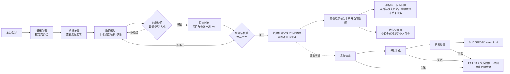
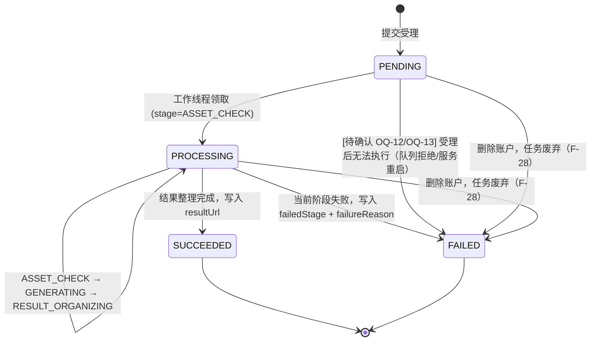
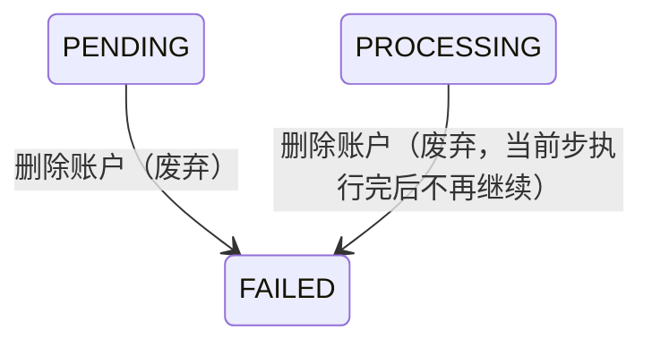

# 素材制作网站 — 技术需求规格（Requirements）

> 来源：[PRD.md](./PRD.md)（R-01 ~ R-14）及参考截图 [image/1.png ~ image/4.png](../image/)（仓库根目录）
> 配套文档：[backlog.md](./backlog.md)（任务拆分与实施顺序）、[open-questions.md](./open-questions.md)（待确认问题）
> 设计文档：[architecture.md](./architecture.md)、[database.md](./database.md)、[api.yaml](./api.yaml)、[implementation-plan.md](./implementation-plan.md)
> 状态：草案 v0.5（2026-11-04）。Open Questions 未关闭前，带 `[待确认 OQ-xx]` 标记的条目不应视为最终规则。
> v0.2 变更：已确认 OQ-02（身份：密码登录 + 账户设置页，只保留修改密码和删除账户）、OQ-03（一级分类）、OQ-05（点提交时一起上传图片）、OQ-09（详情页只显示当前模板的任务，另设"我的记录"页）。
> v0.3 变更：已确认 OQ-23（用户名登录、开放注册、未登录只能看模板）、OQ-25（登录后修改密码）、OQ-26（输入 DELETE 确认删除；数据保留；进行中任务废弃；不可重复注册）。
> v0.4 变更：注册时需要邮箱，注册后不能修改；登录仍用用户名 + 密码；账户删除后，相同邮箱可以再注册（替代 v0.3 中"不可重复注册"的理解）。
> v0.5 变更（2026-11-04，架构设计阶段确认，见 open-questions.md DQ-01 ~ DQ-04）：模拟开发接口不需要登录（DQ-01）；用户素材和结果图需要登录且只能本人访问，删除账户后链接失效（DQ-02）；失败任务同时返回 `failureCode` 和 `failureReason`（DQ-03）；"确认密码"只在前端校验，接口不接收（DQ-04）。

## 0. 文档约定

| 标记 | 含义 |
| --- | --- |
| **P0** | MVP 必须项：PRD 明确要求且缺失会导致业务闭环或验收核心项不成立 |
| **P1** | PRD 要求或推荐，但不阻塞业务闭环（体验、可访问性、容器交付等）；尽量纳入首次交付 |
| **P2** | PRD 明确"不要求"或仅允许"在 README 讨论"的扩展项；本期不实现 |
| `[待确认 OQ-xx]` | PRD 未定义的业务规则，见 open-questions.md；括号内给出的"临时默认"仅用于不阻塞开发，可被推翻 |
| `[技术决策]` | PRD 明确交由实现方自行选择的技术方案，本文给出建议，最终在 README 锁定 |

参考截图编号映射（R-11.3）：

| 文件 | 编号 | 内容 |
| --- | --- | --- |
| image/1.png | UI-01 | 模板列表与分类 |
| image/2.png | UI-02 | 普通模板详情与上传位（右侧含 History） |
| image/3.png | UI-03 | 制作中与历史结果（多任务） |
| image/4.png | 未编号（R-10 引用） | 账户设置：**只保留**密码修改（Reset）和 Delete Account（OQ-02 已确认） |

截图中的题外功能（积分 "5000 credits"、会员 "yearPremium"、语言切换、"Create Now ✦ 100" 扣费、任务删除按钮、Manage Billing / Terms of Service / Privacy Policy / Subscription Policy）**不扩展需求**（R-11.3）。账户设置页的密码修改与删除账户已确认纳入范围（F-28）。

---

## 1. 产品目标

1. **业务闭环**：构建一个可独立运行的素材制作网站，用户完成「浏览模板 → 上传图片 → 提交制作任务 → 后台异步处理期间继续使用网站 → 查看个人历史与制作结果」。
2. **不调用真实 AI**：用可控耗时、可控成功/失败的**模拟生成器**完成闭环。
3. **考察重点**（验收方式 §2）：
   - Java 后端如何组织**多步骤异步处理**（素材检查 → 模拟生成 → 结果整理）；
   - 前端如何管理**异步状态**（上传、提交、多任务跟踪、请求异常与任务失败区分、刷新恢复）；
   - 页面与素材交互、用户身份与个人记录、工程交付（CI、测试、README、容器）。
4. **质量导向**：完整、可靠且能解释优先于复杂度；如实描述完成程度。

## 2. 用户角色

| 角色 | 说明 | 主要诉求 |
| --- | --- | --- |
| **终端用户** | 网站使用者，具备一个身份（方案自行设计，R-10） | 浏览/筛选模板、上传素材、提交任务、查看进度与结果、查看个人历史 |
| **演示者 / 开发者** | 通过开发接口或配置控制模拟器 | 调整各阶段耗时、触发指定阶段失败、演示多任务与刷新恢复 |
| **评估者** | 阅读源码、在容器中运行验收 | 一条命令启动；README 清晰说明演示方法；CI 与测试可运行 |

> 不存在管理员 / 运营角色（不要求模板 CRUD、复杂模板后台，R-02.3、不在范围 §1）。

## 3. 核心业务流程

### 3.1 主流程

### 3.2 任务状态机

整体状态（status）与当前阶段（stage）分别建模（R-05.3 允许）：

硬性规则：

- **终态不可变**：`SUCCEEDED` / `FAILED` 不得再变更为其他状态（R-05.3）。
- **只有后台执行器推进状态**：查询接口为只读，不得驱动任务推进（R-05.2）。
- **阶段严格顺序**：ASSET_CHECK → GENERATING → RESULT_ORGANIZING，某阶段失败后不执行后续阶段（R-05.1、R-06.1）。
- 每个阶段在开始时持久化 `stage`，形成独立、服务端可观察的执行边界（R-05.1），不能由前端定时切换文案。

### 3.3 前端异步状态分层

前端必须区分以下**互不混淆**的状态维度（R-07.1、R-07.2）：

| 维度 | 状态 | 归属 |
| --- | --- | --- |
| 上传位（纯前端） | 空 / 已选择（本地预览）/ 不合法（类型或大小） | 每个上传位独立 |
| 提交请求（含图片） | 空闲 / **素材上传中**（显示上传进度）/ **提交中**（文件已发出，等待服务端受理）/ 提交失败（网络、上传或校验错误） | 当前表单 |
| 任务（服务端事实） | 等待处理 / 处理中(阶段) / 成功(结果) / 失败(阶段+原因) | 每个任务独立 |
| 任务查询请求 | 正常 / 查询中 / 查询异常 | 每个任务独立，**不改写**任务状态 |

---

## 4. 领域模型（建议）`[技术决策]`

字段名不强制（R-02.2），以下为建议，用于对齐前后端：

| 实体 | 关键字段 | 说明 |
| --- | --- | --- |
| User | id, username（唯一，含已删除账户，见 OQ-31）, email（注册后不可修改；只在未删除账户中唯一）, passwordHash, createdAt, deletedAt | 密码用 BCrypt 等慢哈希；删除账户为软删除（OQ-26 已确认）。`[技术决策]` MySQL 没有部分唯一索引，可用生成列 `active_email = IF(deleted_at IS NULL, LOWER(email), NULL)` 加唯一索引，实现"未删除账户中邮箱唯一" |
| Session | token, userId, createdAt, expiresAt | 服务端会话；修改密码或删除账户时可批量作废 |
| Category | id/code, name, sortOrder | 一级分类（OQ-03 已确认） |
| Template | id, title, categoryId, coverUrl, description, requiredImageCount, acceptedMimeTypes, maxFileSizeBytes, sampleResultUrl, sortOrder | 种子数据，只读 |
| Asset | id, userId, taskId, slotIndex, storagePath, url, mimeType, sizeBytes, originalName, createdAt | 在提交请求中与任务一起创建（OQ-05 已确认），1 个素材只属于 1 个任务 |
| Task | id, userId, templateId, status, stage, failedStage, failureCode, failureReason, resultUrl, simulationSnapshot, createdAt, startedAt, finishedAt, updatedAt | 核心实体 |

枚举建议：

- `status`: `PENDING` | `PROCESSING` | `SUCCEEDED` | `FAILED`
- `stage`: `ASSET_CHECK` | `GENERATING` | `RESULT_ORGANIZING`（PENDING 时为空）

## 5. 技术方案约束（R-01）

| 层 | 选型 | 约束 |
| --- | --- | --- |
| 前端 | Next.js App Router + React + TypeScript | 必须 |
| 后端 | Java + Spring Boot + MyBatis | 必须；模板、素材、任务、个人记录接口均由 Java 提供 |
| 数据库 | MySQL | 必须；任务状态与历史记录持久化 |
| 版本 | 实现方自选并在 README 标明 | `[技术决策]` 建议：Java 21 LTS、Spring Boot 3.x 稳定版、mybatis-spring-boot-starter 3.x、MySQL 8.x、Next.js 稳定版 + React 对应版本、Node LTS；实施时验证兼容后锁定 |
| 前后端连接 | Next.js 可直连 Java，或做中间层 | 业务执行与持久化**不能**只在 Next.js 完成 |
| 异步/通知 | 自选；不强制 MQ / Redis / SSE / WebSocket | `[技术决策]` 建议：Spring `ThreadPoolTaskExecutor` + 前端轮询 |
| 文件存储 | 后端本地目录或容器数据卷 | 不能只用浏览器临时地址（blob URL）代替服务端素材 |
| Schema 管理 | — | `[技术决策]` 建议 Flyway 或 `schema.sql + data.sql`，需能在容器中自动初始化 |

---

## 6. 功能清单

| ID | 功能 | PRD | 优先级 |
| --- | --- | --- | --- |
| F-01 | 模板分类与模板列表 | R-02 | P0 |
| F-02 | 模板详情 | R-03.1 | P0 |
| F-03 | 素材选择与上传（本地选择/预览/替换/移除；提交时上传并反馈进度与失败） | R-03.1, R-03.3 | P0 |
| F-04 | 提交前校验（前端 + 服务端）与防重复提交 | R-03.2 | P0 |
| F-05 | 制作任务提交与受理 | R-04 | P0 |
| F-06 | 后台多步骤异步执行 | R-04, R-05.1 | P0 |
| F-07 | 任务状态与历史查询接口 | R-05.2, R-05.3 | P0 |
| F-08 | 模拟控制：耗时调整与指定阶段失败 | R-06 | P0 |
| F-09 | 前端任务状态展示与请求异常区分 | R-07 | P0 |
| F-10 | 多任务跟踪与查询生命周期 | R-08 | P0 |
| F-11 | 个人历史记录（详情页当前模板 + "我的记录"页）、刷新恢复与结果预览 | R-09 | P0 |
| F-12 | 用户身份：注册/登录/退出（密码）与个人记录隔离 | R-10, R-08.2 | P0 |
| F-28 | 账户设置页：修改密码、删除账户 | R-10（OQ-02 已确认） | P0 |
| F-13 | 种子数据与示例素材 | R-02.2, R-02.3 | P0 |
| F-14 | CI 流水线 | R-12.1 | P0 |
| F-15 | 核心行为测试 | R-12.2 | P0 |
| F-16 | README 与交付材料 | R-13 | P0 |
| F-17 | Docker Compose 一键启动 | R-14 | P1（强烈建议纳入 MVP） |
| F-18 | 视觉布局（参考 UI-01/02/03） | R-11.1 | P1 |
| F-19 | 可访问性与小屏可操作 | R-11.2 | P0（2026-11-05 由 P1 提升：R-11.2 为 PRD 正文要求） |
| F-20 | 服务重启时未完成任务的处理 | 不在范围 §1、R-13.2 | P1（只在 README 说明，OQ-13 已确认） |
| F-23 | 任务受理幂等 | 不在范围 §2 | P2 |
| F-24 | SSE / WebSocket 推送 | R-08.1（可选） | P2 |
| F-25 | 失败任务重试 / 重新制作 / 断点续跑 / 自动重试 | R-06.2, 不在范围 §2 | P2 |
| F-26 | 删除历史、下载结果、视频处理 | R-09 | P2 |
| F-27 | 历史分页 | — | P2 `[待确认 OQ-09]` |

---

## 7. 功能规格

### F-01 模板分类与模板列表（P0）

**输入**
- 可选筛选参数：分类 ID（缺省 = 全部）。分类只有一级（OQ-03 已确认）。

**输出**
- 分类列表：`[{ id, name, sortOrder }]`
- 模板卡片列表：`[{ id, title, categoryId, coverUrl }]`（列表页只需卡片字段；详情字段由 F-02 提供）

**业务规则**
1. 数据必须来自 Java 接口，不得在前端写死（R-02.1）。
2. 支持按分类筛选；点击卡片进入该模板详情。
3. 一个模板只属于一个分类；模板按 `sortOrder` 稳定排序（临时默认：种子数据顺序）。分类栏是否提供"全部"`[待确认 OQ-03 余项]`（临时默认：提供，且为默认选中）。
4. 种子模板须能演示：≥2 个分类、≥2 种不同 `requiredImageCount`（建议 1/2/3 张）。

**异常情况**
| 场景 | 处理 |
| --- | --- |
| 加载中 | 骨架屏或加载占位 |
| 分类下无模板 | 空状态提示 |
| 接口失败/超时 | 错误提示 + "重试"按钮，不白屏 |
| 未知分类参数 | 后端返回空列表或 400；前端回落到"全部"并提示 `[技术决策]` |
| 封面加载失败 | 卡片显示占位图，标题仍可见可点 |

**验收标准**
- [ ] 打开列表页，分类与卡片来自后端接口（断开后端时显示错误态而非静态数据）。
- [ ] 切换分类后只显示该分类模板；切回"全部"恢复完整列表。
- [ ] 快速连续切换分类，最终显示的结果与最后选择的分类一致（旧请求不覆盖新结果）。
- [ ] 点击任一卡片进入对应模板详情页。
- [ ] 加载、空、失败三种状态各有可理解的界面反馈。

---

### F-02 模板详情（P0）

**输入**
- 路由参数：模板 ID

**输出**
- `{ id, title, description, coverUrl, categoryId, requiredImageCount, acceptedMimeTypes, maxFileSizeBytes }`

**业务规则**
1. 展示标题、描述、示例封面与素材要求（张数、允许类型、单张大小上限）。
2. 根据 `requiredImageCount` 渲染对应数量的上传位（F-03）。
3. 页面右侧 History 区只显示当前用户在**当前模板**下的任务（参考 UI-02/UI-03，OQ-09 已确认）。全部模板的任务在"我的记录"页查看（F-11）。

**异常情况**
| 场景 | 处理 |
| --- | --- |
| 模板不存在 | 后端 404；前端显示"模板不存在"页面，提供返回列表入口 |
| 加载中 | 加载占位，上传与提交不可用 |
| 请求失败 | 错误提示 + 重试；不得误显示为"模板不存在" |

**验收标准**
- [ ] 访问存在的模板，展示标题、描述、封面、素材要求，上传位数量与 `requiredImageCount` 一致。
- [ ] 访问不存在的模板 ID，显示"不存在"反馈且可返回列表。
- [ ] 后端不可用时显示请求失败（与"不存在"区分），可重试。
- [ ] 返回按钮回到列表页（建议保留原分类筛选）。

---

### F-03 素材选择与上传（P0）

> OQ-05 已确认：**点击提交时，图片和制作参数在同一个请求中上传**，不设单独的素材上传接口。

**输入**
- 选择阶段：用户选择的本地图片文件（每个上传位 1 张），只存在于前端内存中
- 上传阶段：`multipart/form-data` 提交请求（见 F-05），按上传位顺序携带文件

**输出**
- 选择阶段：本地预览（blob URL）
- 上传阶段：随提交结果返回，见 F-05；成功后服务端已保存的素材可通过任务详情访问（`inputAssets[].url`）

**业务规则**
1. 选择图片后立刻显示本地预览，此时**不发请求**。blob URL 只用于预览，提交时必须把文件本身发给服务端，由服务端保存（R-03.3）。
2. **替换**：在已有图片的上传位重新选择，直接替换本地文件和预览，并释放旧的 blob URL。
3. **移除**：清空该上传位，释放 blob URL。服务端没有对应文件，无需处理。
4. 选择时先做客户端校验（类型、大小），不合法的文件不放入上传位，并提示原因。
5. **素材上传中**：提交请求正在发送文件时，显示上传进度（`[技术决策]` 需要上传进度事件，用 XMLHttpRequest 或支持进度的封装，`fetch` 拿不到上传进度）。文件发送完毕、等待服务端响应时，切换为"提交中"。两种状态都要和"任务处理中"区分开（R-07.1）。
6. **上传失败**：网络中断、超时、服务端 5xx 或请求体超限时，整次提交失败。已选择的文件和预览全部保留，用户可直接重新提交，不用重新选图。
7. 服务端拒绝某个文件（类型或大小不符）时，错误响应带上 `slotIndex`，前端在对应上传位上标出错误（`[技术决策]`）。
8. 上传或提交期间锁定上传位，不能替换或移除，避免界面显示的文件和实际发送的文件不一致。
9. 服务端独立校验类型与大小（R-03.2）。类型判断依据 `[待确认 OQ-17]`（临时默认：Content-Type 与文件头魔数双重校验）。
10. 文件保存在后端本地目录或数据卷，Asset 记录归属当前用户和当前任务。素材和结果图的访问控制（DQ-02 已确认）：文件名随机生成；访问时需要登录，且只返回当前用户自己任务的文件，他人的或不存在的文件返回 404；删除账户后链接失效。种子封面和示例图公开。

**异常情况**
| 场景 | 处理 |
| --- | --- |
| 选择了类型不符或超大的文件 | 前端拦截，不放入上传位，提示允许的类型和上限 |
| 绕过前端提交非法文件 | 服务端返回 400（带 slotIndex），不创建任务、不留文件 |
| 请求体超过全局上限 | 服务端返回 413，统一错误结构 `[待确认 OQ-18]` |
| 上传中网络失败 / 超时 / 5xx | 显示"上传失败，可重新提交"，保留已选文件 |
| 上传中离开页面 / 退出登录 | 取消请求（abort） |
| 未登录 / 会话失效 | 401，跳转登录，登录后已选文件不保证保留 |

**验收标准**
- [ ] 上传位数量 = 模板要求张数；每个上传位有可读标签（如"选择第 1 张图片"）。
- [ ] 选择合法图片后立即出现本地预览，Network 面板中没有上传请求。
- [ ] 选择非法类型或超大文件时，文件不进入上传位，并显示原因。
- [ ] 替换、移除后预览正确更新，提交按钮的可用状态随之变化。
- [ ] 点击提交后显示上传进度（可用浏览器网络限速观察），然后显示"提交中"，最后出现任务卡片。
- [ ] 上传过程中断网：显示上传失败，已选图片仍在，恢复网络后可直接重新提交。
- [ ] 用 curl 提交非法类型或超大文件，服务端拒绝，DB 中没有任务，存储目录没有残留文件。
- [ ] 任务创建后，服务端保存的输入素材 URL 可在新标签页打开（不是 blob URL）。

---

### F-04 提交前校验与防重复提交（P0）

**输入**
- 模板 ID、按上传位顺序排列的图片文件

**输出**
- 校验通过 → 进入 F-05；不通过 → 上传位级（带 slotIndex）或表单级错误

**业务规则**
1. 前端"可提交"条件：所有必需上传位都已选择合法图片，且当前不在上传中或提交中。`requiredImageCount` 是"恰好 N 张"还是区间 `[待确认 OQ-04]`（临时默认：恰好 N 张）。
2. 上传中和提交中按钮禁用，防止重复点击；受理成功后立即退出"提交中"（R-07.1）。
3. 服务端校验（不信任前端），全部在保存文件和创建任务之前完成：
   - 模板存在；
   - 文件数量符合模板要求；
   - 每个文件的类型 ∈ `acceptedMimeTypes`，大小 ≤ `maxFileSizeBytes`（按该模板的规则）；
   - 文件非空、可读。
4. 校验失败返回 4xx 和可读的 message，不创建任务，不留下文件。
5. 每次提交都上传新文件，不存在跨任务复用已上传素材的情况（原 OQ-06 不再适用）。

**异常情况**
| 场景 | 处理 |
| --- | --- |
| 素材未准备好（缺图、文件不合法） | 按钮禁用，并提示缺少或有问题的上传位 |
| 服务端校验失败 | 显示错误，有 slotIndex 时标到对应上传位；按钮恢复可用，已选文件保留 |
| 提交请求网络失败 / 超时 | 提示"提交失败，可重试"，不在任务区插入任务。**注意**：超时可能发生在服务端已创建任务之后，刷新历史可以看到；由于提交含文件，重试代价更大 `[见 F-23 幂等，P2]` |
| 模板不存在（提交时） | 404 提示 |

**验收标准**
- [ ] 上传位未全部选好时，提交按钮不可用。
- [ ] 快速双击提交，只发出一个请求、只创建一个任务。
- [ ] 用 curl 提交：缺图、多图、类型或大小不符合模板、模板不存在 → 都被拒绝，没有任务记录，也没有残留文件。
- [ ] 服务端拒绝后，前端显示原因，已选文件保留，修正后可再次提交。

---

### F-05 制作任务提交与受理（P0）

**输入**
- `multipart/form-data`：`templateId` + `files[]`（按上传位顺序）+ 当前用户会话

**输出**
- 受理成功（建议 HTTP 202）：`{ taskId, status: "PENDING", stage: null, createdAt }`

**业务规则**
1. 接口完成参数检查、保存文件、持久化任务记录和 Asset 记录后**立即返回** taskId，不等待制作结束（R-04）。上传文件所花的时间计入本接口，但模拟制作的耗时不计入。
2. 文件和数据库要保持一致（`[技术决策]`）：先把文件写到临时位置，数据库事务提交成功后再移到正式目录；事务失败或校验失败时删除临时文件，不留孤儿文件。
3. 任务记录提交事务后再派发给后台执行器（`[技术决策]` 使用 `TransactionSynchronization#afterCommit` 或等价机制），避免工作线程读到未提交记录。
4. 任务受理后，关闭浏览器或刷新页面不影响后台任务继续执行（上传过程中关闭页面，则请求中断、不创建任务）。
5. 多任务可排队或并行（R-04），具体并发度 `[待确认 OQ-12]`（临时默认：有界线程池，核心线程数可配置，默认 2）。
6. 模拟配置在**任务创建时快照**还是**执行时读取** `[待确认 OQ-10]`（临时默认：创建时快照到 `simulationSnapshot`，保证同一任务行为可重复、并发演示互不影响）。
7. 执行器队列已满时的处理 `[待确认 OQ-12]`（临时默认：拒绝受理并返回 503，不创建任务，同时清理已保存的文件）。

**异常情况**
| 场景 | 处理 |
| --- | --- |
| 校验失败 | 见 F-04 |
| 数据库写入失败 | 500，不派发任务，删除已保存的临时文件 |
| 派发失败（队列满） | 见规则 7 |

**验收标准**
- [ ] 将模拟总耗时设为 30s，在本地网络下提交小图片，接口响应时间 < 1s，返回 taskId，DB 中状态为 PENDING 或 PROCESSING。
- [ ] 提交后立即关闭页面，30s 后重新打开，任务已成功（或按模拟配置失败）。
- [ ] 连续提交 3 个任务，均获得不同 taskId，均最终到达终态。

---

### F-06 后台多步骤异步执行（P0）

**输入**
- 已受理的 taskId（由执行器领取）

**输出**
- 任务记录的状态/阶段变更；成功时 `resultUrl`；失败时 `failedStage` + `failureCode` + `failureReason`

**业务规则**
1. 按顺序执行三个步骤，每步实现为独立单元（`[技术决策]` 建议 `TaskStep` 接口 + `TaskPipeline` 编排）：
   1. **素材检查 ASSET_CHECK**：重新确认任务关联素材存在、文件可读、类型/大小符合模板 `[待确认 OQ-14 检查范围]`；
   2. **模拟生成 GENERATING**：按配置延迟；
   3. **结果整理 RESULT_ORGANIZING**：生成并记录可预览的结果地址 `[待确认 OQ-08 结果图来源]`（临时默认：复制模板预置结果图到结果目录，生成任务专属 URL）。
2. 每步开始时持久化 `status=PROCESSING, stage=<当前步>`；每步可配置模拟耗时。
3. 任一步抛出异常或命中模拟失败：持久化 `status=FAILED, failedStage=<当前步>, failureCode=<失败分类>, failureReason=<可读原因>, finishedAt`，**不执行后续步骤**。
4. 全部成功：持久化 `status=SUCCEEDED, resultUrl, finishedAt`。
5. 所有状态写入使用**条件更新**（如 `UPDATE ... WHERE id=? AND status IN ('PENDING','PROCESSING')`），保证终态不可被覆盖。
6. 工作线程中的未预期异常必须被捕获并落为 FAILED，不得让任务永远停留在 PROCESSING（服务重启场景除外，见 F-20）。
7. `failureReason` 面向用户可读 `[待确认 OQ-11 文案规范]`；同时记录机器可读的 `failureCode`（DQ-03 已确认，取值见 api.yaml `FailureCode`）；技术堆栈只写日志。
8. 每次条件更新都检查影响行数：为 0 说明任务已被外部结束（如删除账户时废弃，F-28），执行器立即停止，不执行后续步骤、不写结果。

**异常情况**
| 场景 | 处理 |
| --- | --- |
| 素材文件已丢失 | ASSET_CHECK 失败，原因如"素材文件缺失" |
| 线程被中断（停机） | 尽力标记或保持原状，见 F-20 |
| DB 暂时不可用 | 记录日志；`[技术决策]` 不做自动重试（P2） |

**验收标准**
- [ ] 观察 DB（或查询接口）可见 stage 依次经过 ASSET_CHECK → GENERATING → RESULT_ORGANIZING，最终 SUCCEEDED 且 `resultUrl` 可访问。
- [ ] 分别配置三个阶段失败：任务停在对应 `failedStage`，后续步骤未执行（单测可验证 step 调用次数），`failureReason` 可读。
- [ ] 不发起任何查询请求时，任务仍能自行完成（证明查询不驱动推进）。
- [ ] 终态任务被重复写入尝试时状态不变（单测）。

---

### F-07 任务状态与历史查询接口（P0）

**输入**
- 单任务：taskId + 当前用户
- 历史列表：当前用户 + 可选 templateId 过滤（详情页传 templateId；"我的记录"页不传，返回全部）

**输出**
- 任务视图：`{ taskId, templateId, templateTitle, templateCoverUrl, status, stage, failedStage, failureCode, failureReason, resultUrl, inputAssets: [{slotIndex, url}], createdAt, updatedAt, finishedAt }`（"我的记录"页要展示模板信息，所以模板标题和封面为必返字段）
- 历史列表：任务视图数组，按 `createdAt` 倒序 `[待确认 OQ-09 余项：是否分页]`

**业务规则**
1. 只读：查询不得改变任何任务状态（R-05.2）。
2. 只能查询**自己的**任务；查询他人任务返回 404（不暴露存在性）`[技术决策]`。
3. 状态以 DB 为准；终态任务查询结果稳定，不会变回处理中（R-05.3）。
4. 返回字段足以让前端渲染等待/处理中(阶段)/成功(结果)/失败(阶段+原因)。

**异常情况**
| 场景 | 处理 |
| --- | --- |
| taskId 不存在或不属于当前用户 | 404 |
| 身份缺失/失效 | 401 |
| DB 异常 | 5xx（前端按"查询异常"处理，见 F-09） |

**验收标准**
- [ ] 任务执行期间多次查询，状态/阶段只前进不后退；终态后多次查询结果恒定。
- [ ] 用户 B 查询用户 A 的 taskId 返回 404；B 的历史中不含 A 的任务。
- [ ] 历史列表按创建时间倒序，包含创建时间、状态、成功结果地址或失败原因。

---

### F-08 模拟控制：耗时与指定阶段失败（P0）

**输入**
- 各阶段耗时（ms）
- 失败阶段：无 / ASSET_CHECK / GENERATING / RESULT_ORGANIZING
- 失败原因文案（可选）

**输出**
- 当前生效的模拟配置

**业务规则**
1. 可**重复**触发指定阶段失败（非随机，R-06.2）。
2. 耗时可调整，便于观察处理中和多任务状态（R-06.1）。
3. 配置入口放在后端配置或开发接口，**不出现在正式页面或模板字段**（R-06.2）。
4. `[技术决策]` 建议同时提供：
   - `application.yml` 默认值（`simulation.stage-durations.*`、`simulation.fail-stage`），可由环境变量覆盖；
   - 仅在 `dev`/`demo` profile 启用的开发接口 `GET/PUT /api/dev/simulation`，运行时修改无需重启；不需要登录，便于 curl 演示（DQ-01 已确认）。
5. 配置粒度（全局 / 按任务 / 按模板）`[待确认 OQ-10]`（临时默认：全局配置，任务创建时快照）。
6. 不要求用户重新执行失败任务（R-06.2）。

**异常情况**
| 场景 | 处理 |
| --- | --- |
| 非 dev profile 访问开发接口 | 404 |
| 非法阶段名/负数耗时 | 400 |

**验收标准**
- [ ] 将 fail-stage 设为 GENERATING，连续提交 2 个任务，两次均在 GENERATING 失败、原因一致。
- [ ] 恢复 fail-stage=无，新任务成功；已结束的失败任务保持 FAILED。
- [ ] 将耗时调为每阶段 10s，前端可清晰观察到三个阶段切换。
- [ ] 生产 profile 下开发接口不可用。
- [ ] README 写明上述操作命令（curl 示例 / 环境变量）。

---

### F-09 前端任务状态展示与请求异常区分（P0）

**输入**
- 提交接口响应、任务查询响应、查询请求错误

**输出**
- 任务卡片 UI

**业务规则**
1. 区分并展示：素材上传中、提交请求中、任务等待处理、任务处理中（显示当前阶段）、任务成功（显示结果预览）、任务失败（显示失败阶段与原因）（R-07.1）。
2. 提交受理成功后**立即**展示任务卡片（PENDING），提交按钮退出"提交中"。
3. **查询异常 ≠ 任务失败**（R-07.2）：
   - 查询请求失败（网络错误、5xx、超时）时，保留卡片上最后一次已知的任务状态；
   - 额外显示"状态获取失败"提示与"重新查询"入口（单卡与/或全局刷新，参考 UI-02 右上角刷新图标）；
   - 绝不把任务标记为 FAILED。
4. 只有服务端返回 `status=FAILED` 时才显示"制作失败"。
5. 状态合并单调：前端不得用较旧/非终态的响应覆盖已是终态的本地记录 `[技术决策]`。
6. 阶段文案映射（建议）：ASSET_CHECK="素材检查中"、GENERATING="生成中"、RESULT_ORGANIZING="结果整理中"。

**异常情况**
| 场景 | 处理 |
| --- | --- |
| 查询返回 404（任务被删除/身份变化） | 停止跟踪并提示"任务不存在或无权访问" |
| 查询返回 401 | 停止所有跟踪，跳转登录页 |
| 成功结果图加载失败 | 显示占位与"结果加载失败"，不改变任务状态 |

**验收标准**
- [ ] 提交后按钮立刻恢复可用，任务区出现新卡片显示"等待处理"/"处理中·素材检查中"。
- [ ] 暂停后端（或 mock 查询 500）：卡片仍显示最后状态 + 查询异常提示 + 重新查询按钮；恢复后端后点击重新查询，卡片恢复正确状态。
- [ ] 后端配置 GENERATING 失败：卡片显示"失败 · 生成阶段 · <原因>"，样式与查询异常明显不同。
- [ ] 成功任务显示结果缩略图，可预览。

---

### F-10 多任务跟踪与查询生命周期（P0）

**输入**
- 当前用户的未结束任务集合

**输出**
- 各任务独立更新的状态

**业务规则**
1. 允许连续创建多个任务；各任务状态、阶段、错误、结果按 taskId 隔离，互不串扰（R-08.1）。
2. 自动跟踪所有未结束任务（PENDING/PROCESSING）；任务到达终态后停止对它的跟踪；无待跟踪任务时不再轮询（R-08.2）。
3. `[技术决策]` 建议：单一调度器按固定间隔（如 1.5–2s）查询未结束任务；查询失败的任务可退避，但保留手动重新查询。
4. 离开相关页面时取消进行中的请求（AbortController）并停止定时器。
5. 切换用户时：取消全部请求、清空前一用户的任务数据、丢弃任何迟到的旧响应（以 userId/会话世代号校验）（R-08.2）。
6. 跟踪范围：模板详情页（当前模板的未结束任务）和"我的记录"页（全部未结束任务）都要自动跟踪，离开页面即停止。离开这两个页面后（如回到列表页）是否继续跟踪并提示完成 `[待确认 OQ-09 余项]`（临时默认：不跟踪）。

**异常情况**
| 场景 | 处理 |
| --- | --- |
| 某一任务查询失败 | 仅该任务显示查询异常，其他任务正常更新 |
| 迟到响应（属于已离开页面/已切换用户） | 丢弃 |
| 同一任务并发重复请求 | 去重，同一时刻每个任务最多一个在途请求 |

**验收标准**
- [ ] 每阶段 5s，间隔 1s 连续提交 3 个任务（其中通过模拟配置使第 2 个失败）：三张卡片各自显示自己的阶段/结果/失败原因，无串扰。
- [ ] 所有任务结束后，浏览器 Network 面板不再出现任务查询请求。
- [ ] 离开详情页后，不再有该页的轮询请求。
- [ ] 切换到另一用户后，页面不出现前一用户任务；前一用户的迟到响应不写入当前视图。

---

### F-11 个人历史记录、刷新恢复与结果预览（P0）

**输入**
- 详情页 History：当前用户 + 当前 templateId
- "我的记录"页：当前用户（全部模板）

**输出**
- 历史任务列表：创建时间、处理状态（含阶段）、成功结果或失败原因；"我的记录"页另外显示模板标题和封面

**业务规则**（OQ-09 已确认）
1. **两个展示位置**：
   - 模板详情页右侧 History：**只显示当前模板**的个人任务（UI-02/UI-03）；
   - **"我的记录"页**（独立路由，`[技术决策]` 建议 `/records`，顶栏提供入口）：显示该用户**所有模板**的任务，每条带模板标题和封面，点击模板可进入该模板详情页。
2. 两处都展示创建时间、处理状态、成功结果或失败原因（R-09），并复用同一个任务卡片组件。
3. 刷新任一页面后都从 Java 后端恢复记录，并自动继续跟踪未结束任务（R-09）。
4. 同一个任务在两个页面显示的状态必须一致（都以服务端为准）。
5. 成功结果支持**预览图片**即可（如点击放大的对话框）；不要求下载、删除、重新制作、视频（R-09）。
6. 排序、分页、时间格式与时区 `[待确认 OQ-09 余项]`（临时默认：创建时间倒序、不分页、浏览器本地时区 `YYYY-MM-DD HH:mm`）。
7. "我的记录"页是否需要按模板或状态筛选 `[待确认 OQ-09 余项]`（临时默认：不筛选）。

**异常情况**
| 场景 | 处理 |
| --- | --- |
| 历史为空 | 空状态（"还没有制作记录"） |
| 历史加载失败 | 错误 + 重试，不显示为空 |
| 结果图加载失败 | 占位 + 提示 |

**验收标准**
- [ ] 在模板 A、模板 B 各提交一个任务：A 详情页只显示 A 的任务，B 详情页只显示 B 的任务，"我的记录"页同时显示两者并标明所属模板。
- [ ] 提交任务后立即刷新详情页或"我的记录"页：任务仍在，状态从后端恢复，并继续自动更新至终态。
- [ ] 关闭浏览器，任务完成后再打开：两处都显示成功结果或失败原因。
- [ ] 从"我的记录"点击模板，能进入对应模板详情页。
- [ ] 成功结果可点击预览大图；预览对话框可用键盘关闭，焦点回到触发元素。

---

### F-12 用户身份：注册 / 登录 / 退出与个人记录隔离（P0）

> OQ-02 已确认：**使用密码登录**。OQ-23 已确认：**用户名登录，开放自助注册，未登录可以看模板但不能使用相关功能**。
> 2026-11-04 补充确认：**注册时需要邮箱，注册后不能修改；登录用用户名 + 密码（邮箱不能用于登录）；账户删除后，相同邮箱可以再注册**。账户设置见 F-28。

**输入**
- 注册：用户名 + 邮箱 + 密码 + 确认密码
- 登录：用户名 + 密码
- 退出：当前会话

**输出**
- 注册 / 登录成功：建立会话，返回 `{ userId, username, email }`
- `GET /api/auth/me`：当前用户信息

**业务规则**
1. 密码只保存慢哈希（`[技术决策]` BCrypt），不保存明文，不在任何日志或接口中出现。
2. 会话 `[技术决策]`：服务端随机 token 存 Session 表，前端以 HttpOnly Cookie 携带（如由 Next.js 中间层转发，需说明 Cookie 的作用域）。会话有效期 `[待确认 OQ-28]`（临时默认：7 天）。
3. 素材、任务、历史全部按用户隔离；访问他人资源返回 404。
4. **切换用户** = 退出后用另一个账户登录。退出时前端取消所有在途请求、清空用户相关状态（R-08.2）。
5. 密码规则 `[待确认 OQ-24]`（临时默认：8 ~ 64 位，不限制字符种类）。
6. 用户名规则 `[待确认 OQ-29]`（临时默认：3 ~ 20 位，字母、数字、下划线；不区分大小写判重；注册后不可修改）。
7. **邮箱**（已确认）：注册时必填，注册后不能修改；只用于账户标识和展示，不能用来登录。
   - 邮箱在**未删除**的账户中唯一；账户删除后，同一邮箱可以注册新账户。新账户与旧账户无关，看不到旧账户的任何记录。
   - 邮箱规则 `[待确认 OQ-30]`（临时默认：只校验格式，不发验证邮件；不区分大小写判重；最长 254 位）。
8. **用户名**唯一。已删除账户的用户名能否再被注册 `[待确认 OQ-31]`（临时默认：不能，已删除账户的用户名永久占用，防止新用户顶替旧用户名造成混淆）。
9. 登录失败时统一提示"用户名或密码错误"，不透露账号是否存在（`[技术决策]`）。注册时用户名或邮箱已存在需要明确提示，这一点无法避免暴露它们是否已被使用。
10. **未登录访问**（OQ-23 已确认）：
   - 可以浏览模板列表和模板详情（标题、描述、封面、素材要求）；
   - 不能使用相关功能：选图上传、提交制作、详情页 History、"我的记录"、账户设置；
   - 具体呈现 `[待确认 OQ-23 余项]`（临时默认：详情页的上传区和 History 区替换为"登录后即可制作"提示和登录按钮；直接访问"我的记录"或账户设置时跳转登录页，登录后回到原页面）。
11. 不做第三方登录、邮箱验证、"忘记密码"（不在范围 §1，OQ-25 已确认只做登录后修改密码）。
12. 方案与演示方法写入 README，提供至少 2 个预置演示账户（种子数据，密码在 README 中公开说明，仅供演示）。

**异常情况**
| 场景 | 处理 |
| --- | --- |
| 用户名已被注册（含已删除账户的用户名，按 OQ-31 临时默认） | 注册返回 409，提示"用户名已被使用" |
| 邮箱已被未删除的账户使用 | 注册返回 409，提示"邮箱已被使用" |
| 用户名、邮箱或密码不符合规则 | 前端拦截；服务端返回 400 |
| 两次密码不一致 | 只在前端拦截，不发请求；接口不接收"确认密码"（DQ-04 已确认） |
| 用户名或密码错误 | 401，统一提示 |
| 会话缺失或过期 | 401，前端跳转登录并清空用户数据 |
| 账户已删除 | 无法登录，提示同"用户名或密码错误" |

**验收标准**
- [ ] 能用用户名 + 邮箱 + 密码注册新账户，用用户名 + 密码登录、退出；用邮箱作为登录名无法登录；数据库中密码为哈希值。
- [ ] 注册已存在的用户名（包括已删除账户的用户名）失败并提示。
- [ ] 注册未删除账户正在使用的邮箱失败并提示（大小写不同也算同一个）。
- [ ] 账户 A 删除后，用 A 的邮箱注册新账户 B 成功；B 看不到 A 的任何记录。
- [ ] 未登录时能浏览模板列表和详情，但详情页没有可用的上传区和 History，只有登录提示；直接调用提交或查询接口返回 401。
- [ ] 用户 A 创建任务后退出，登录用户 B：B 看不到 A 的任务、素材和记录；再登录 A，A 的记录完整。
- [ ] 用 B 的会话直接请求 A 的 taskId 或素材，被拒绝。
- [ ] 退出过程中 A 的在途请求不会把数据写到 B 的界面上。
- [ ] 未登录访问"我的记录"或提交任务时，被引导到登录页。

---

### F-28 账户设置页：修改密码、删除账户（P0）

> OQ-02 已确认：需要账户设置页，**只保留**密码修改（截图中的 Reset）和 Delete Account。截图中的 Manage Billing、Terms of Service、Privacy Policy、Subscription Policy 不实现。
> OQ-25 已确认：Reset = **登录后修改密码**。OQ-26 已确认：**输入 DELETE 二次确认；数据保留；正在跑的任务废弃；不能重复注册**。

**输入**
- 修改密码：当前密码 `[待确认 OQ-25 余项]` + 新密码 + 确认新密码
- 删除账户：确认输入框中的文字（必须为 `DELETE`）

**输出**
- 修改密码成功：提示成功；会话处理见规则 3
- 删除账户成功：会话失效，回到未登录状态

**业务规则**
1. 账户设置为独立页面（`[技术决策]` 建议 `/account`，顶栏用户菜单进入），需要登录。页面上方显示账户基本信息（默认头像图标 + 用户名 + 邮箱，均为只读；邮箱不能修改，用户名能否修改见 OQ-29），下方两个操作。
2. **修改密码**（OQ-25 已确认）：登录状态下修改，不做"忘记密码"邮件重置。新密码规则同 F-12。
   - 是否需要输入当前密码 `[待确认 OQ-25 余项]`（临时默认：需要）；
   - 修改后其他设备的会话是否失效 `[待确认 OQ-25 余项]`（临时默认：其他会话全部失效，当前会话保留）。
3. **删除账户的二次确认**（OQ-26 已确认）：点击删除后弹出确认对话框，用户在输入框中输入 `DELETE` 后，确认按钮才可用。
   - 大小写是否必须完全一致 `[待确认 OQ-26 余项]`（临时默认：必须完全一致，区分大小写，不去除首尾空格）；
   - 服务端也要校验确认文字，不能只靠前端（`[技术决策]`）。
4. **数据保留**（OQ-26 已确认）：删除账户后，用户记录、任务记录、上传素材、结果文件都保留在库中（软删除，用户记 `deletedAt`），但该账户无法再登录，任何人都不能通过界面或接口访问这些数据，包括此前拿到的素材和结果图链接（DQ-02 已确认：链接失效）。
5. **正在跑的任务废弃**（OQ-26 已确认）：删除时该用户所有 PENDING / PROCESSING 的任务立即结束，不再执行后续步骤。
   - `[技术决策]` 实现方式：在删除账户的同一事务中，用条件更新把这些任务改为终态；执行器在下一个阶段开始前（`markProcessing`）或写结果时（`markSucceeded`）发现更新影响行数为 0，就停止。正在执行的那一步会执行完，但结果不会写入。
   - 废弃后的任务记为什么状态 `[待确认 OQ-26 余项]`（临时默认：`FAILED`，`failedStage` 为废弃时所处的阶段，`failureCode` = `ACCOUNT_DELETED`，`failureReason` = "账户已删除，任务已废弃"；不新增状态）。
6. **重新注册**（2026-11-04 补充确认，替代此前"不能重复注册"的理解）：账户删除后，**相同邮箱可以再注册**新账户；新账户与旧账户无关，看不到旧数据。已删除账户的**用户名**能否再用 `[待确认 OQ-31]`（临时默认：不能）。
7. 删除成功后，服务端作废该用户的全部会话；前端执行与退出相同的清理（取消请求、清空状态），并跳转到首页。

**删除账户时的任务状态变化**：

**异常情况**
| 场景 | 处理 |
| --- | --- |
| 当前密码错误 | 400 / 401，提示"当前密码不正确"，不改密码 |
| 新密码不符合规则 | 前端拦截；服务端返回 400 |
| 两次新密码不一致 | 只在前端拦截，不发请求（DQ-04 已确认） |
| 确认文字不是 `DELETE` | 确认按钮不可用；绕过前端时服务端返回 400 |
| 删除时取消 / 关闭对话框 | 不发请求 |
| 删除请求失败（网络 / 5xx） | 提示失败，账户保持原状，仍处于登录状态，任务不受影响 |
| 会话过期 | 401，跳转登录 |

**验收标准**
- [ ] 账户设置页只有账户信息、修改密码、删除账户三部分，没有 Billing、Terms、Privacy、Subscription 等入口。
- [ ] 当前密码错误时修改失败；修改成功后用旧密码无法登录、用新密码可以登录。
- [ ] 删除对话框中输入 `delete`、`DELET` 或留空时，确认按钮不可用；输入 `DELETE` 后才可用；取消时什么都不发生。
- [ ] 用 curl 发送错误的确认文字，服务端拒绝。
- [ ] 将每阶段耗时设为 10s，提交一个任务后立即删除账户：数据库中该任务最终为废弃状态，没有进入后续阶段，也没有写入 resultUrl。
- [ ] 删除后自动退出，该账户无法再登录；数据库中该用户的任务和文件仍然存在。
- [ ] 删除前记下的素材和结果图链接，删除后无论是否登录其他账户都无法打开（DQ-02）。
- [ ] 用已删除账户的邮箱 + 新用户名注册成功，新账户看不到旧数据。
- [ ] 用已删除账户的用户名注册，提示用户名已被使用（按 OQ-31 临时默认）。
- [ ] 其他用户的数据和正在执行的任务不受影响。
- [ ] 删除和修改密码的按钮、对话框都能用键盘操作，并有可读标签。

---

### F-13 种子数据与示例素材（P0）

**业务规则**
1. 模板数据存于种子文件或数据库，由 Java 接口读取（R-02.3）。
2. 至少 2 个分类、≥3 个模板，覆盖不同 `requiredImageCount`（建议 1/2/3）及不同类型/大小限制（便于演示校验）。
3. 封面与预置结果图须为**本地可访问的示例文件**或合法可用资源，不依赖付费或公司内部服务（R-02.3）；来源须在 README 说明（R-13.2）`[待确认 OQ-19]`。
4. 提供可用于演示上传的示例图片（含一张超大/非法类型样例更佳）。

**验收标准**
- [ ] 全新环境初始化后，列表页可见种子模板，封面全部加载成功。
- [ ] README 列出素材来源与许可。

---

### F-14 CI 流水线（P0）

**业务规则**（R-12.1）
1. GitHub Actions，在 `push` 与 `pull_request` 触发。
2. 前端：依赖安装（使用锁文件）→ lint → TypeScript 类型检查 → 测试（F-15）→ build。
3. 后端：Java 测试 + 构建（`mvn verify` 或 `gradle build`）。
4. 交付压缩包保留 `.github/workflows/`。

**验收标准**
- [ ] 新 PR 自动触发两个 job，全部通过；故意引入类型错误或失败测试时 CI 失败。

---

### F-15 核心行为测试（P0）

**必须覆盖**（R-12.2）：

后端
- [ ] 三步骤按顺序执行，成功后 SUCCEEDED + resultUrl。
- [ ] 每个阶段失败时（参数化 3 例）：停在该阶段、记录 failedStage 与原因、后续步骤未执行。
- [ ] 终态不可被后续写入覆盖。
- [ ] 查询接口不推进状态。
- [ ] 提交接口在长耗时配置下快速返回。
- [ ] 提交服务端校验（数量、类型/大小、模板不存在），校验失败时没有任务记录和残留文件。
- [ ] 资源隔离：他人的任务查询返回 404。
- [ ] （建议）身份：注册、登录、密码错误、修改密码后旧密码失效、删除账户后无法登录。

前端
- [ ] 多个任务并行跟踪时状态互不串扰。
- [ ] 查询请求失败时显示查询异常且保留原任务状态，与服务端 FAILED 显示不同。
- [ ] 任务终态后停止对其轮询；无未结束任务时不再请求。
- [ ] （建议）切换用户后丢弃旧响应。

`[技术决策]` 建议：后端 JUnit 5 + Mockito（编排逻辑单测）+ Spring Boot Test（MySQL 使用 Testcontainers，或 CI 中 MySQL service）；前端 Vitest + React Testing Library + MSW + fake timers。不要求 E2E 浏览器测试。

---

### F-16 README 与交付材料（P0）

须包含 R-13.2 全部条目，作为交付检查清单：

- [ ] 技术版本、项目结构、构建/测试/启动命令、前后端与数据库连接方式
- [ ] 配置项与无真实凭据的示例（`.env.example`）、数据库初始化、模拟数据与素材准备
- [ ] 主要接口及请求/响应字段；任务状态、阶段与后台执行方式
- [ ] 演示：成功、指定阶段失败、调整耗时、多任务、刷新恢复
- [ ] 用户身份与个人记录设计及演示方法
- [ ] 已完成/未完成项、已知限制、实际投入（含重启恢复等边界说明）
- [ ] 部署与回滚基本步骤
- [ ] AI 使用说明（工作流、一个具体例子）
- [ ] 复用的脚手架/开源代码/素材来源
- [ ] 验收 commit 标注
- [ ] 交付物：前后端源码、锁文件、DB 结构与初始化数据、CI 配置（R-13.1）

---

### F-17 Docker Compose 一键启动（P1，强烈建议纳入 MVP）

**业务规则**（R-14）
1. `docker compose up --build` 启动 frontend、backend、mysql，并自动初始化 schema 与种子数据。
2. 提供各服务 Dockerfile、非敏感配置示例、启动说明；上传目录使用数据卷。
3. 健康检查与启动顺序（backend 等待 MySQL 就绪）。

> 说明：验收在容器隔离环境中进行；未提供 Compose 时评估方可能只审源码（验收方式 §1），因此建议视同 P0 推进。

**验收标准**
- [ ] 干净环境执行 `docker compose up --build`，浏览器打开前端地址可完成完整闭环。
- [ ] `docker compose down` 后再 `up`（保留卷），历史记录与素材仍在。

---

### F-18 视觉布局（P1）

- 列表页参考 UI-01：顶部导航、分类标签行、卡片网格（封面 + 底部标题）。
- 详情/制作页参考 UI-02/UI-03：左栏（返回 + 标题、封面、上传区、底部主按钮），右栏 History 卡片网格（处理中 / 失败文案 / 结果图）+ 刷新按钮。
- 账户设置页参考 image/4.png，只保留账户信息、修改密码、删除账户。
- "我的记录"页、登录/注册页没有参考截图，自行设计，与其他页面风格一致。
- 不要求还原品牌素材或像素一致；截图题外功能不实现（见 §0）。

**验收标准**：三个页面层级清晰、间距一致、各状态均有视觉反馈。

### F-19 可访问性与小屏（P0）

> 2026-11-05 由 P1 提升为 P0：PRD R-11.2 明确要求"小屏下应能操作"、语义元素、保留键盘焦点、上传与图标按钮有可理解的标签。

- 按钮、输入、对话框使用语义化元素；保留可见键盘焦点；上传位与图标按钮提供 `aria-label`（R-11.2）。
- 小屏（≥360px 宽）下所有主流程可操作，详情页两栏可折为单栏。

**验收标准**：仅用键盘可完成"登录 → 选模板 → 选图 → 提交 → 预览结果"以及账户设置中的两个操作；360px 宽下无横向滚动且可完成主流程。

### F-20 服务重启时未完成任务的处理（P1）

PRD 不要求重启后自动恢复执行，但要求 README 说明该边界。OQ-13 已确认（2026-11-05）：本期不处理，重启前未结束的 PENDING / PROCESSING 任务保持原状态（前端会一直显示"处理中"），由 README 说明这一边界。

### F-23 ~ F-27

见 §6 清单，P2 项本期不实现，仅在 README 讨论取舍。

---

## 8. 接口草案 `[技术决策]`（路径不强制，R-05.3）

| 方法 | 路径 | 说明 | 功能 |
| --- | --- | --- | --- |
| POST | `/api/auth/register` | `{ username, email, password }` → 创建账户并建立会话 | F-12 |
| POST | `/api/auth/login` | `{ username, password }` → 建立会话 | F-12 |
| POST | `/api/auth/logout` | 清除会话 | F-12 |
| GET | `/api/auth/me` | 当前用户 | F-12 |
| PUT | `/api/account/password` | `{ currentPassword, newPassword }` | F-28 |
| DELETE | `/api/account` | `{ confirmText: "DELETE" }` → 软删除账户、废弃进行中任务、作废会话 | F-28 |
| GET | `/api/categories` | 分类列表（一级） | F-01 |
| GET | `/api/templates?categoryId=` | 模板卡片列表 | F-01 |
| GET | `/api/templates/{id}` | 模板详情 | F-02 |
| POST | `/api/tasks` | `multipart/form-data`：`templateId` + `files[]` → 202 `{ taskId, ... }` | F-03/F-05 |
| GET | `/api/tasks/{taskId}` | 单任务状态 | F-07 |
| GET | `/api/tasks?templateId=` | 当前用户历史：带 templateId 用于详情页，不带用于"我的记录"页 | F-07/F-11 |
| GET/PUT | `/api/dev/simulation` | 模拟配置（仅 dev/demo profile，不需要登录，DQ-01） | F-08 |
| GET | `/files/seed/**` | 种子封面、示例图（公开） | F-13 |
| GET | `/files/uploads/**`、`/files/results/**` | 上传素材、结果图（需登录，仅本人，DQ-02） | F-03/F-28 |

统一错误结构：`{ "code": "TEMPLATE_NOT_FOUND", "message": "模板不存在", "details": {...} }`。

## 9. 非功能需求

| 类别 | 要求 |
| --- | --- |
| 一致性 | 任务状态转换由后端单点驱动；条件更新保证终态不可变 |
| 可观察性 | 后端日志记录每个任务每个阶段的开始/结束/失败（含 taskId） |
| 安全 | 资源按用户隔离；密码慢哈希存储，日志不记录密码；会话 Cookie 设 HttpOnly / SameSite；上传文件随机命名、限制类型/大小、禁止路径穿越，用户文件仅本人可访问（DQ-02）；开发接口仅 dev profile；仓库不含真实凭据（演示账户密码除外，并在 README 标明仅供演示） |
| 性能 | 提交接口不受模拟耗时影响；轮询间隔合理，无未结束任务时零轮询 |
| 可移植 | 通过 Compose 在任意装有 Docker 的机器运行；配置通过环境变量覆盖 |
| 兼容 | 现代桌面浏览器（Chrome/Edge/Firefox/Safari 最新两版）；小屏可操作 |

## 10. MVP 范围

### 10.1 纳入 MVP

- 全部 P0：F-01 ~ F-16、F-19（可访问性与小屏）、F-28（账户设置）
- P1 中一并交付：F-17（Compose）、F-18（基础视觉）、F-20（只在 README 说明）

### 10.2 暂不实现（本期范围外）

| 项 | 依据 |
| --- | --- |
| 真实 AI 生成、真实图片处理、视频处理 | PRD 目标 2、R-09、不在范围 §1 |
| 支付、积分、会员（截图中 credits / yearPremium / ✦100） | 不在范围 §1、R-11.3 |
| 模板 CRUD / 模板管理后台 | R-02.3、不在范围 §1 |
| 第三方账号登录、独立身份服务、邮箱登录、邮箱验证、修改邮箱、"忘记密码"邮件重置 | 不在范围 §1；已确认邮箱注册后不可改、登录用用户名，OQ-25 确认只做登录后修改密码 |
| 删除账户时物理删除数据、恢复已删除账户 | OQ-26 已确认数据保留 |
| 账户设置中的 Manage Billing、Terms of Service、Privacy Policy、Subscription Policy（截图 4） | OQ-02 已确认只保留修改密码与删除账户 |
| 两级分类、一个模板属于多个分类 | OQ-03 已确认一级分类 |
| 单独的素材上传接口、复用已上传素材 | OQ-05 已确认提交时一起上传 |
| 国际化 / 语言切换 | 不在范围 §1 |
| 删除历史、下载结果、重新制作、失败重试 | R-06.2、R-09 |
| 随机失败 | R-06.2 |
| 消息队列、Redis、集群、多区域部署 | R-01.5、不在范围 §1 |
| 服务重启后自动恢复执行、断点续跑、自动重试、受理幂等 | 不在范围 §1/§2（README 讨论） |
| E2E 浏览器测试、自动发布、真实线上部署 | R-12.2 |
| 精确百分比进度 | R-05.3 |
| 独立移动端设计 | R-11.2 |
